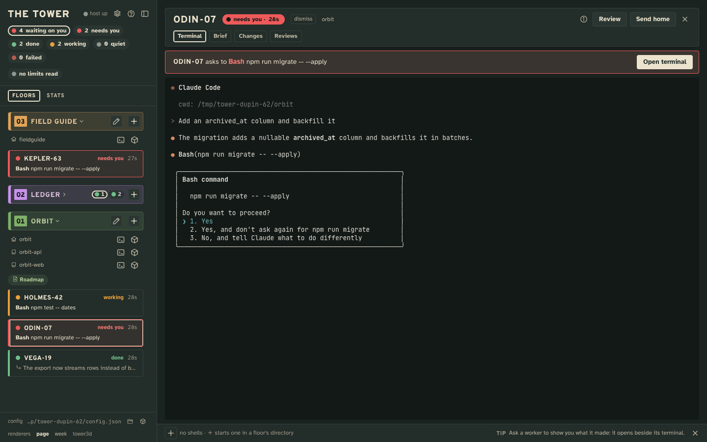
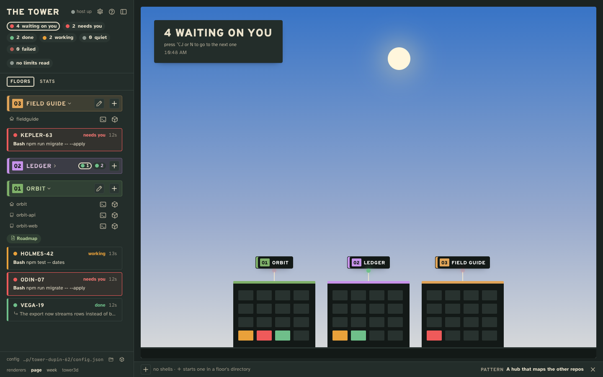
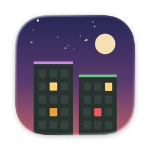
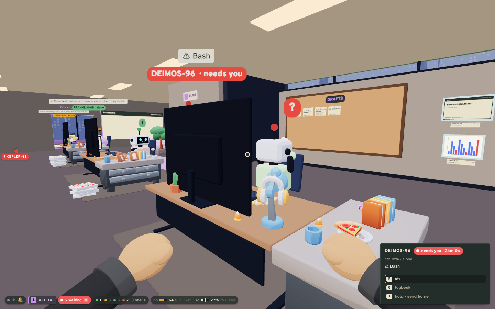
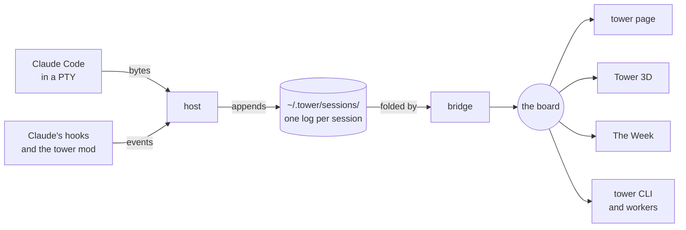

# The tower

**An HQ for running many Claude Code sessions at once, on your own machine.** Every session is the full Claude Code
terminal in a real PTY, kept alive by a small host process and recorded to a log. Everything you see is derived from
those logs, so the presentation is swappable: three views ship with it, and you can write your own without losing a
single capability.



The tower is for the moment one Claude Code session stops being enough: a few features in flight, a reviewer or two,
something that runs every night. Instead of a stack of terminal tabs you have a building. Each **project** is a
**floor**; each session on it is a **worker** with a **callsign** (`HOLMES-42`) it keeps for good, across
resumes. You see at a glance who is working, who is done and who is waiting on you, and you go to them in order.

Local only: no accounts, no external services. macOS.

## What you can do

**Know who needs you.** A worker that asks a question, holds a permission dialog, or finished a turn you haven't
answered is *waiting on you*. The tower lists those waits in order, notifies you and rings; `N` goes to the next
one. With no worker open, the skyline shows every floor and how many wait on you.



**Work with workers, not tabs.** Each worker's terminal is Claude Code itself, typed into directly. Beside it:

- **Brief:** its recent turns as a chat, your prompts and its answers, across every conversation it held.
- **Changes:** the full diff of what it changed in its repos, with files marked viewed and lines you can select to
  leave a note on.
- **Reviews:** the checkout's review thread, where you, the worker and its reviewers discuss the work before it
  lands.
- Anything it **shows** you: a page it built, a chart, a report (`tower show <file>`), opened in a tab of its own.

**Let workers organise themselves.** Every worker has the `tower` command on its PATH and a skill that teaches it
the tower, so most things start as a sentence:

> "Hire a worker for the flaky date tests and have it report back to you."
> "When you're done, get yourself reviewed."
> "Check on ODIN-07: why has it been working for an hour?"
> "Keep that idea as a draft, we'll do it next week."

- **Hiring and crews.** A worker hires others (`tower hire`), each in its own git worktree, within limits you set per
  floor. Hires are listed under whoever hired them, report back to it, and go home with it.
- **Reviewers.** `tower review` hires a reviewer in a fork of a worker's checkout, uncommitted work included. It
  reviews once against the worker's goal and leaves notes on the thread; the worker answers each one.
- **Collections.** Folders of files a floor keeps for later: drafts (prompts waiting for a worker), review threads,
  and any kind you declare. Every item gets a two-word tag (`ivory-otter`) to refer to it by.
- **Policies.** Standing work on a schedule: a markdown file with a cron and a prompt. At each slot the tower starts a
  worker on it, or offers the slot to you first. An automatic policy runs only while you have approved its exact
  words.

**Keep the rest of the work close.**

- **Shells** in a floor's directories, docked under the terminal, that outlive the page.
- **The shelf:** pages kept beside a floor's sessions, such as your notes, a dashboard your project builds, or a URL.
- **Stats:** spend, tokens, turns, how long workers waited on you, the weekly budget's pace and what landed on each
  project's default branch, over any window.
- **Resume and carry on.** Every session's log is kept, so a worker that ended can be resumed from its floor's
  archive. Workers stopped mid-turn by a restart offer to carry on where they were.
- **Tidy** lists what can go (landed worktrees, absorbed branches, leftover processes, old logs) and removes nothing
  until you press.
- **⌘K** opens a command palette over all of it: workers, floors, drafts, commands and what the selected worker
  offers.



**`tower app`** puts the same tower in a Mac window of its own, built from your checkout, with who waits on you on
its Dock icon, in notifications and in the menu bar. Quitting it leaves every session running.

[docs/usage.md](docs/usage.md) walks through all of it. Or ask any worker "give me a tour of the tower": it shows you
the tower on your own floors.

## Three views over one board

The tower ships three **renderers**, each a different view of the same data:

- **The tower page**, the daily surface above: floors in a sidebar, the selected worker's terminal in the main pane.
- **Tower 3D**, a first-person office: walk the floors, ride the elevator, sit at a worker's desk to drive its
  session through a real terminal, with live screens on every monitor. It has the tower page's full feature set.
- **The Week**, the budget week read as a yearbook: totals, every worker by floor, the rhythm of the hours.



All three read the same **board** (one JSON view of the whole system, pushed live) and drive the system through the
same HTTP API. None of them holds a capability of its own: anything a renderer can do, a renderer written from
scratch can do, and so can a worker from its shell. A renderer is a folder of static files the tower serves at
`/r/<name>/`; copy one that ships, or write your own, and pick which one opens by default in the config.

## How it works



- **The host** is a small detached process that owns every session's terminal. It writes everything that happens to
  that session (output, input, Claude's hook events) to an append-only log. Because the host, not the page, holds the
  terminals, you can restart the tower, close the browser or crash a renderer and every session keeps running.
- **The bridge** folds those logs into state: who is working, who waits on you, what each conversation said, what it
  cost. Nothing derived is stored; it is computed from the logs again whenever needed.
- **The board** is the result, the one contract every renderer reads.

The tower keeps three kinds of state and nothing else: the config (what you want), the logs (what happened) and the
collections (files kept for later). This is the principle the rest follows: *observe, don't store*.

## Extend it

The tower is meant to be shaped to your work, not to prescribe a workflow.

- **The config.** Floors, shelves, collections, callsigns, hiring limits, how worktrees are cut, your editor and how
  sessions start, all in `~/.tower/config.json`. Every key is in [docs/config.md](docs/config.md); `tower config
  check` checks an edit.
- **Extensions.** A folder with an `extension.json` manifest and optionally a server module, started beside the
  tower's own pieces. An extension can add verbs and reads to the API, collections, streams of facts, scheduled slots,
  views in the tower page and parts of every card on the board. Much of the tower is built this way: drafts, review
  threads, policies, the quota probe and autotidy are bundled extensions. [`examples/extensions/`](examples/extensions/)
  has ones to start from, such as `grid` (workers' terminals side by side). Run one in place by pointing
  `extensions.<id>.path` in the config at its folder in the checkout, so it follows `tower update` (`tower extensions
  restart <id>` takes the new code), or copy it out of the checkout to make it your own.
- **Renderers.** Your own view of the whole system, or a copy of one that ships, at `/r/<name>/`.
- **The API and the `tower` command.** Every verb and read is on the HTTP API, described at `GET /schema`, and on the
  `tower` command. Workers hold the same command, so a worker can build a renderer, write a policy or check on its
  peers as well as you can. Same-user processes are trusted; the tower guards only against browser pages.

[docs/extending.md](docs/extending.md) covers every extension point, its contract, and what isn't one.

## Install

Requirements:

- macOS
- Node 24 or later
- Claude Code 2.1.292 or later, signed in (tested up to 2.1.312; `tower doctor` and the board say when yours is
  outside that range)
- `git` and `curl` (Xcode's command line tools)
- Optional: VS Code's `code` on the PATH, or another editor set in the config, to open projects and files from the
  tower

```sh
git clone https://github.com/RegiByte/the-tower.git tower && cd tower
npm run setup        # install, write a first config, check the machine, start everything, open the tower
```

Setup ends with what to do next: `npm link` (puts the `tower` command on your PATH), a first worker, the tour, and the
config. `npm run setup -- <dir> [repos...]` makes `<dir>` the first floor instead of this checkout; `--tower3d` also
builds Tower 3D (or `npm run tower3d` any time later, then open `/r/tower3d/`).

```sh
tower up | down [host|terms|tower]   # start or stop the host, the shell daemon and the tower
tower doctor                         # check what the tower needs, with a fix for each failure
tower config check                   # check the config as the tower reads it
tower update                         # move to the newest release; says if the host needs a restart
tower spawn <project> [-- <prompt>]  # start a worker
tower app                            # open the tower as a Mac app
```

Stopping the host ends its sessions (they can be resumed); the tower itself restarts freely. Releases are tags
`vX.Y.Z`, each with an entry in [CHANGELOG.md](CHANGELOG.md) saying what it asks of you.

## A note on stability

The tower is a personal project in daily use. It drives Claude Code's terminal, hooks and plugin system, and a
future Claude Code release may break it before the tower catches up; `tower doctor` says when you are outside the
tested range.

## Read more

- [docs/usage.md](docs/usage.md): everything the tower makes possible, as a walkthrough.
- [docs/config.md](docs/config.md): every config key, what it takes and its default.
- [docs/extending.md](docs/extending.md): renderers, extensions, shelf pages, the API.
- [PRINCIPLES.md](PRINCIPLES.md): why the tower is built the way it is.
- [AGENTS.md](AGENTS.md): the architecture, the code rules and how to contribute. `kb/` holds the project's
  knowledge base, rendered with `node .claude/skills/kb/tool/kb.mjs render`.

## License

MIT ([LICENSE](LICENSE)). Tower 3D's models and characters are from Kay Lousberg's KayKit packs (CC0); the fonts and
libraries it ships with keep their own licenses: [THIRD_PARTY.md](THIRD_PARTY.md).
