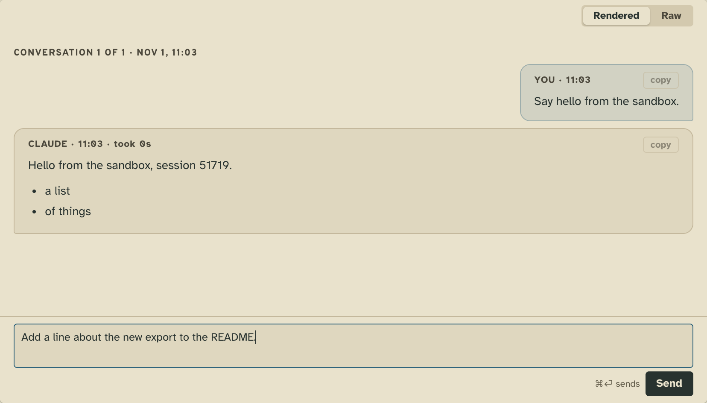
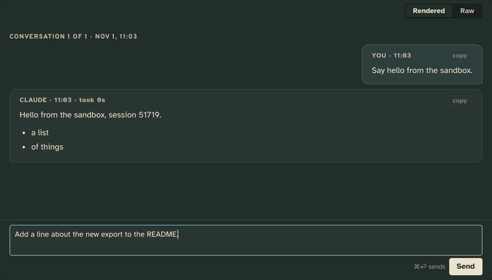
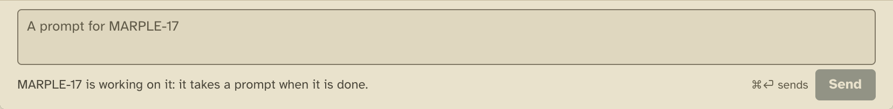
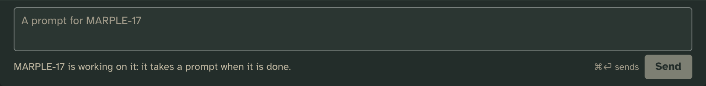
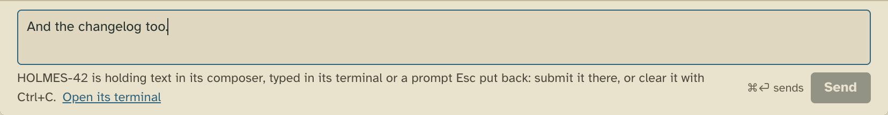
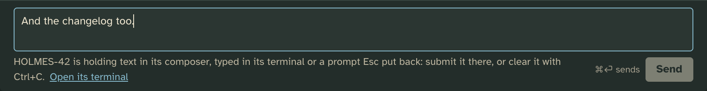

# Chat

A plain text box at the foot of a worker's Brief, for sending it a prompt without typing into its terminal.

## What it adds

### The tower page

**The box under the worker's latest turn**, in its Brief. ⌘⏎ sends (Ctrl+Enter off macOS), and Enter is a new line.
The box clears once the prompt is sent, and the turn then shows in the Brief above it, read from the worker's log.

| Light | Dark |
| --- | --- |
|  |  |

**Send only while the worker waits at its prompt.** At other times the box still takes typing, but Send is off, and
the line under the box says why: it is working, it asks you something, or one of Claude's screens holds it.

| Light | Dark |
| --- | --- |
|  |  |

When someone has typed into the worker's terminal and not sent it, the box won't add to that text. It says so and
links to the terminal, where you can send that text or clear it.

| Light | Dark |
| --- | --- |
|  |  |

The tower checks again when the prompt arrives. If the worker started working or someone typed into its terminal in
between, the tower refuses the prompt. The text stays in the box with the tower's reason under it, so nothing you
typed is lost.

It sends plain text only, never images or keys. It won't send text that starts with `/` or `!`, which Claude would
run as a slash or shell command, and it points you to the terminal for those. Tower 3D,
The Week and the CLI draw no box.

## Add it

Copy this folder anywhere outside the checkout (so `tower update` leaves your copy alone), then add it to the config
by its absolute path:

```json
"extensions": {
  "chat": { "path": "/abs/path/to/chat" }
}
```

The tower picks it up without a restart. Hide the box for yourself with
`layout["card.composer"].hidden: ["chat/input"]`.

## How it works

The manifest declares one view, `chat/input`, on a card at `row` scale, with no server code. The tower page draws
that view in `card.composer`, the region at the foot of the Brief. The region grows with the box up to a cap and then
scrolls, so the view draws at its natural height. The view sends only when the card offers the `prompt` verb, and it
calls the verb's own call, `submit/at-prompt`. Each refusal comes back with a code (`not_at_prompt`,
`composer_holds`, `moved`) and a message, and the view shows the message. The send chord is the keymap's `submit` in
a text field, so the config's `keys.submit` changes it. What you type is kept per worker in the view's state
(`tower.store`), so it survives a reload.

## Make it yours

The view lives in one file, `client/input.js`, and draws with the design tokens, so it follows the light and dark
palettes. In your copy, restyle it, change its words, or give it more controls. It sends only through
`submit/at-prompt`.

Its imports come from [the library](../../../docs/extending.md#the-library) (`/lib/*.js`), so a copy loads at any path. To have your editor read them in a
copy, run [`tower types .`](../../../docs/extending.md#types-outside-the-checkout) in it and write a `tsconfig.json` of
`{ "extends": "./.tower/tsconfig.json", "compilerOptions": { "allowJs": true } }`, and add `@types/node`.

## Pictures

`npm run tool:extension-shots -- examples/extensions/chat` retakes them from [`shots.json`](shots.json).
