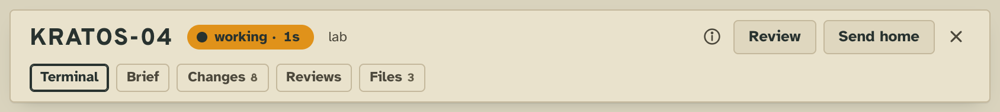
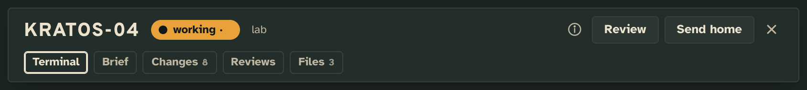
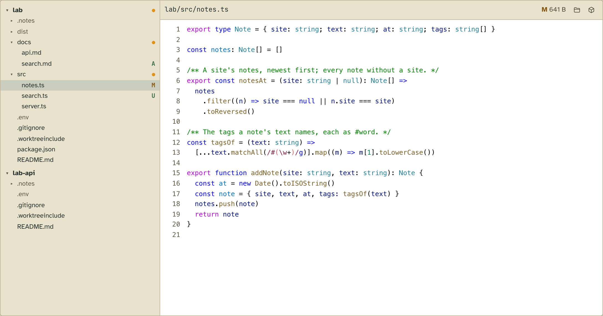
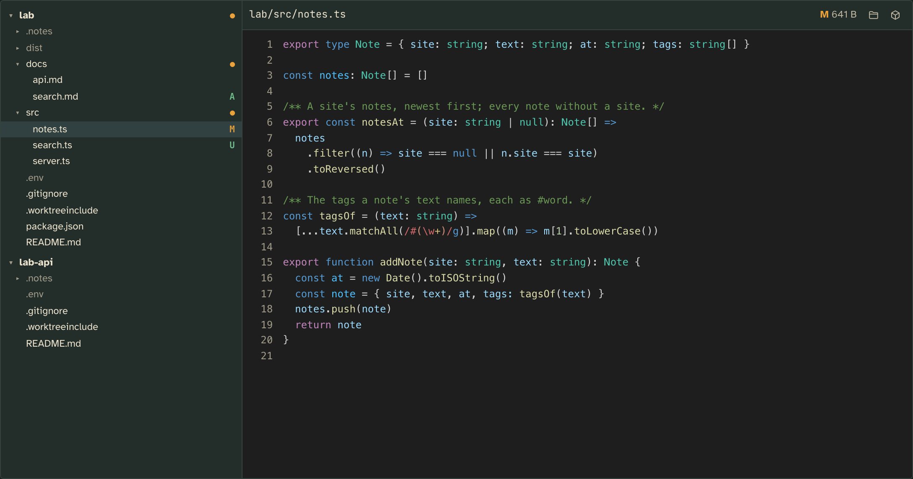
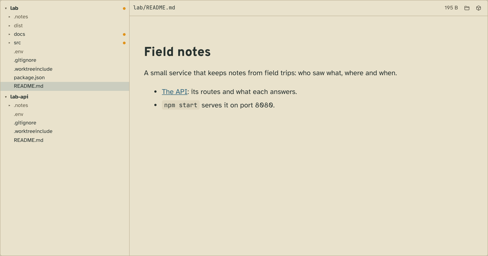
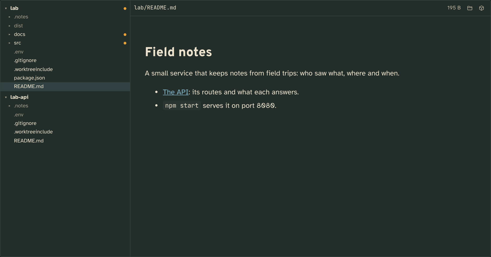

# Files

A worker's checkout as a tree in its tabs, what git sees changed marked, and any file of it opened beside the tree,
code highlighted as VS Code draws it.

## What it adds

### The tower page

**A Files tab on every worker**, its tally the number of files the worker changed.

| Light | Dark |
| --- | --- |
|  |  |

**The tree and the file open from it.** The tree is the worker's own checkout, each repo a root. What git ignores is
dimmed, and what git sees changed is marked (`M`, `A`, `D`, `R`, `U` untracked, `C` in conflict), with a dot on a
folder holding any. A file opens read-only beside the tree, with buttons that show it in Finder and open it in your
editor. Code is highlighted by [Shiki](https://shiki.style) with VS Code's grammars and Light+ and Dark+ themes.

| Light | Dark |
| --- | --- |
|  |  |

**Markdown, images, video and html pages** open in the tower's own views by type, or in any view of yours that takes
their type over. A relative link in a markdown file opens the file it names in the tree.

| Light | Dark |
| --- | --- |
|  |  |

The tab follows the checkout while it is seen: a file the worker changes is drawn again, and the marks move. The file
open is in the page's address, so a reload, Back and a copied link land on it.

### The CLI

Every read is on the API, each confined to the worker's checkout, so a worker or a script reads it as the tab does:

```
$ tower x files
files  Files 1.0 · running
  tower x files repos/<project>/<id>  The repos of the worker's checkout, each named as a review anchor names it. (it names the project)
  tower x files tree/<project>/<id>  One folder of a repo of the worker's checkout: folders first, each in name order, what git ignores marked, a link out marked outside; .git never listed. (it names the project)
  tower x files status/<project>/<id>  What git sees changed in each repo of the worker's checkout, a mark by path (M, A, D, R, U untracked, C in conflict; an untracked folder as its path and a slash), and a stamp that changes when any of it does. (it names the project)
  tower x files stat/<project>/<id>  One file of the worker's checkout: its size, when it last changed, its media type (a file of an unknown kind with no NUL in its first 8 KB is text/plain), and its absolute path, for the editor and Finder. (it names the project)
  tower x files raw/<project>/<id>/<repo>/<file...>  One file of the worker's checkout, as written, sandboxed: up to 50 MB. (it names the project)
```

Tower 3D, The Week and the workers' guidance have none of it. Editing is out on purpose: a worker owns its checkout.

## Add it

Run it from the tower's checkout, so `tower update` brings it with the tower it works with
(`realpath $(which tower)` is `<the tower's checkout>/src/mod/bin/tower`):

```json
"extensions": {
  "files": { "path": "<the tower's checkout>/examples/extensions/files" }
}
```

To make it your own, copy the folder outside the checkout, run `npm install` in the copy (its `package.json` names
Shiki), and add it by the copy's path.

## What it needs from you

Nothing, to start. **Open in your editor** uses the config's `editor`, VS Code's `code` unless set:

```json
"editor": { "window": ["cursor", "--new-window", "{dir}"], "open": ["cursor", "{path}"], "goto": ["cursor", "--goto", "{path}:{line}"] }
```

## How it works

Files is a view, a region and five reads; it writes no facts and keeps nothing but its view state. A file opened is
a `file` subject handed to the `file.open` region, where `files/code` draws code and the tower's views by type draw
the rest. A view of yours on `file` takes code over with one config line:

```json
"renderers": { "page": { "layout": { "file.open": { "order": ["mine/code"] } } } }
```

## Make it yours

In a copy: another language is a file `client/langs/<id>.ts` re-exporting `shiki/langs/<id>.mjs` and a line in
`client/code.ts`'s maps, which also holds the themes.

## Pictures

`npm run tool:extension-shots -- examples/extensions/files` retakes them from [`shots.json`](shots.json), on a
made-up project that `shots/seed/seed.sh` commits into the sandbox.
