# Grid

Up to four workers side by side in the tower page's main pane, each with its own tabs, so you can watch and type into
several at once.

## What it adds

### The tower page

**Open Grid on each floor** in the sidebar, and in the palette. ⌘⇧G opens the grid of the floor you are on, or of
the worker you are looking at. Opened on the skyline, from the palette or with ⌘⇧G, the grid holds workers of every
floor.

| Light | Dark |
| --- | --- |
| 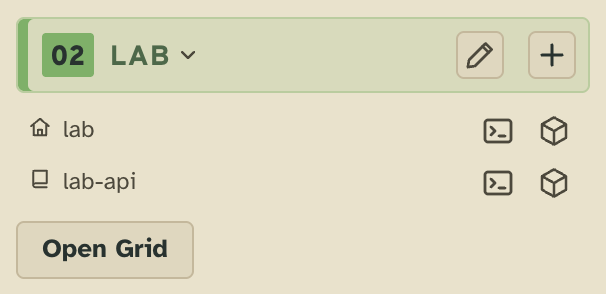 | 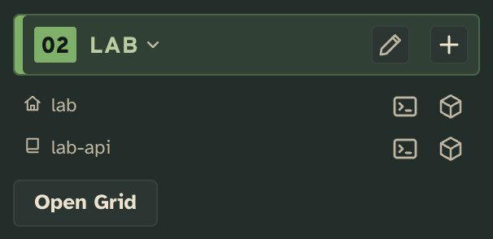 |

**The grid in the main pane**: up to four of the floor's workers, two side by side, three as two over one, four as
four squares. Each cell is the worker's own view at cell size: its head over its tabs (Terminal, Brief, Changes,
Reviews, and any an extension adds), its terminal typed into when the cell has focus. **Open** opens the worker on
its own; ✕ takes it out of the grid. The grid opens with the floor's workers on duty, and keeps which workers it
holds, so a reload, a link or Back opens it as it was.

| Light | Dark |
| --- | --- |
| 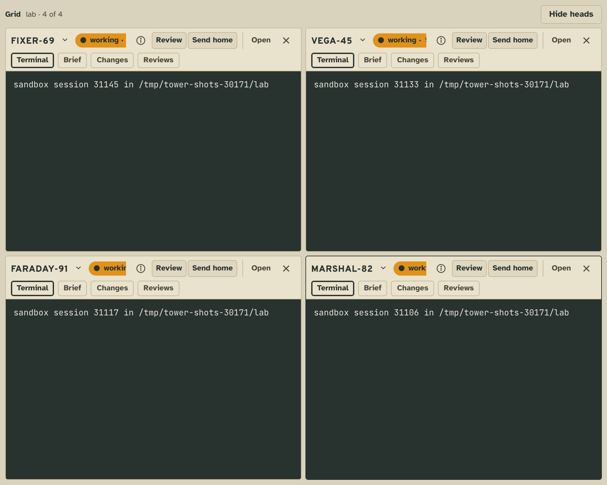 | 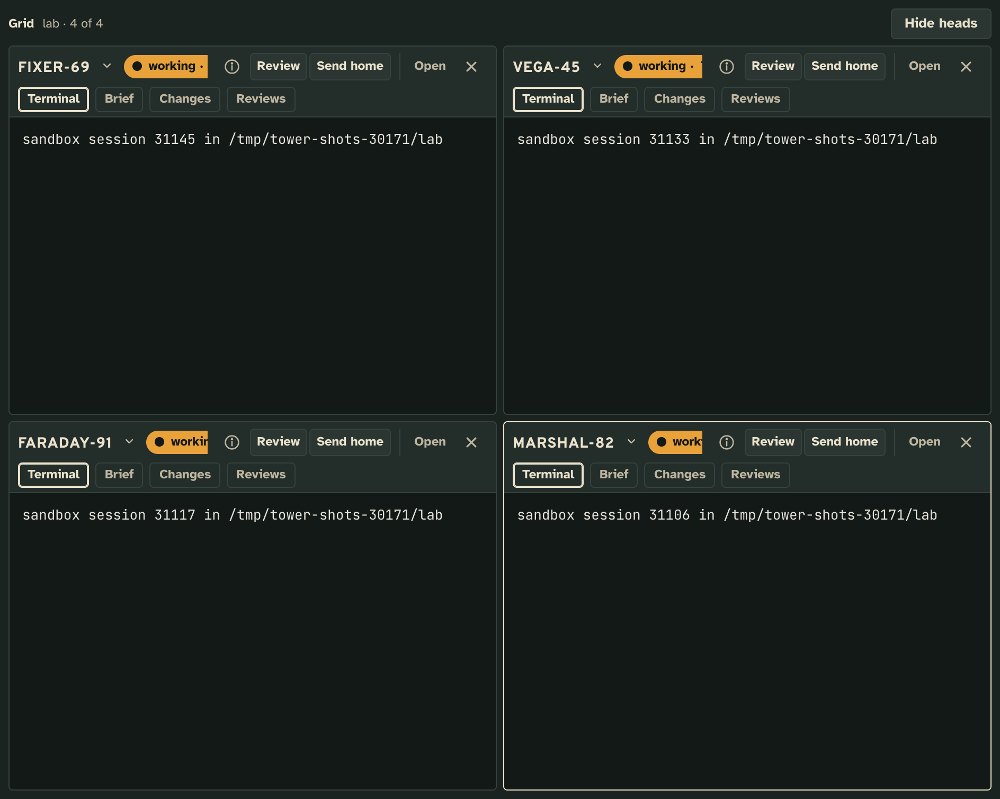 |

**The callsign's menu swaps the worker in a cell** for another of the floor's workers on duty. One already in a cell
swaps places with it.

| Light | Dark |
| --- | --- |
| 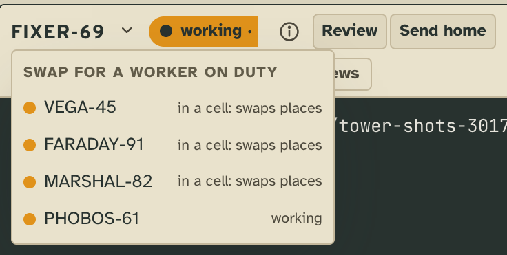 | 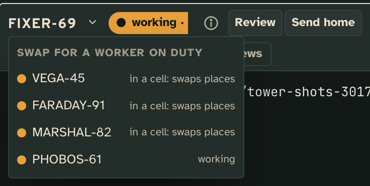 |

**Add worker**, while the grid has fewer than four cells, lists the floor's workers on duty that are in no cell: the
one picked takes a new cell.

| Light | Dark |
| --- | --- |
| 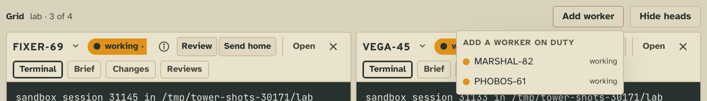 | 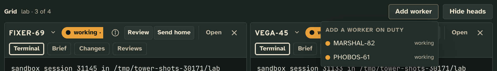 |

**Hide heads** shrinks each cell's head to one row of its lamp, callsign and tabs, for more terminal; **Show heads**
brings them back. Each cell keeps its tab and scroll either way.

| Light | Dark |
| --- | --- |
| 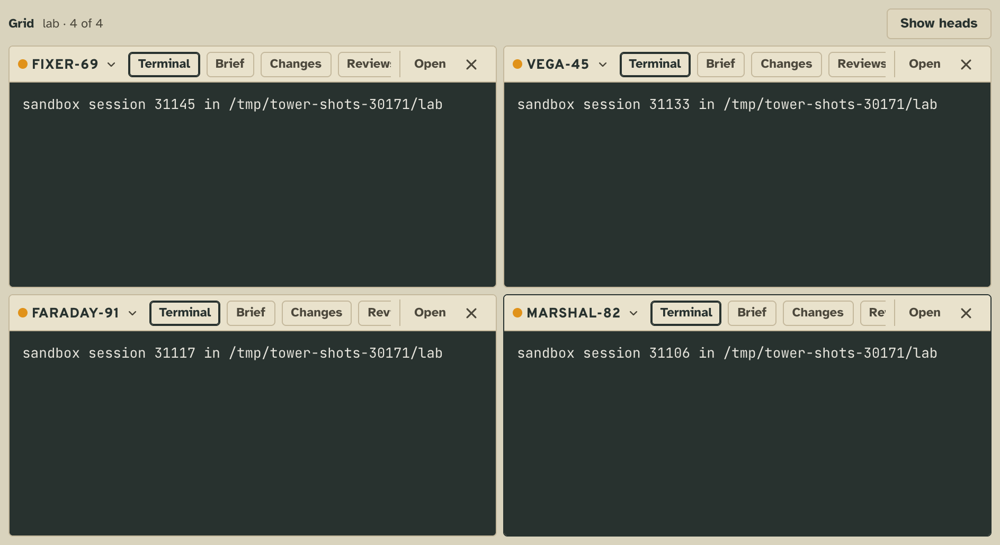 | 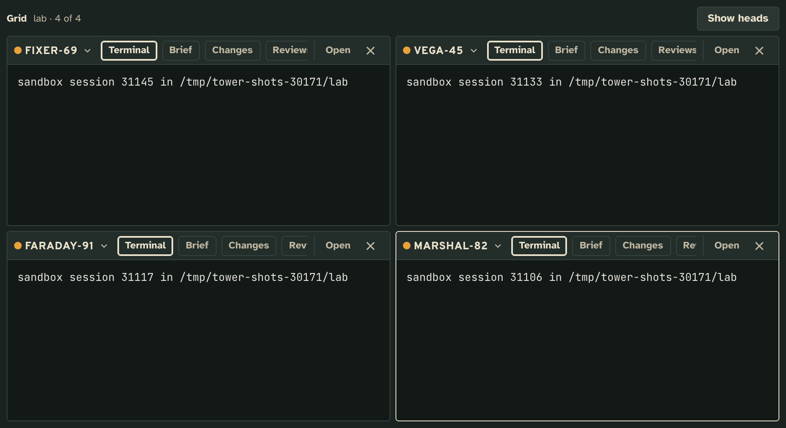 |

**Add to grid on every worker's head** (and in the palette) puts it in its floor's grid, opening the grid if it is
closed. With four cells already, it takes the place of the first.

| Light | Dark |
| --- | --- |
| 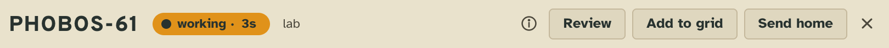 |  |

Tower 3D, The Week, the CLI and the workers have none of it: the grid is a view of the tower page, and it tells the
workers nothing.

## Add it

Copy this folder anywhere outside the checkout (so `tower update` leaves your copy alone), then add it to the config
by its absolute path:

```json
"extensions": {
  "grid": { "path": "/abs/path/to/grid" }
}
```

The tower picks it up without a restart. `tower extensions` lists it as started, and `tower extensions check
/abs/path/to/grid` reads it as the tower would.

## What it needs from you

Nothing: it has no settings and runs no command. The one config key it reads is its chord, which the config's
`keys` replaces:

```json
"keys": { "grid/grid": ["Meta+Shift+K"] }
```

## How it works

Grid is client code only: a view, a region and a command, with no server.

- `extension.json`
  - `views.grid`: the view, `on` a floor or the whole board, at `pane` scale, showing cards. It `needs` the kit's
    `region` and `display`. `keys` is its chord.
  - `regions.card.cell`: a region the grid declares, one worker's view at `cell` scale. The grid asks the tower for
    it on each cell, and the tower mounts the worker's own view there.
  - `commands.add`: [Add to grid](#the-tower-page), offered on every card.
- `client/grid.js`
  - `mount(host, ctx)` draws the grid into `host` and returns `{ update, show, close }` (`docs/extending.md`, Views).
    The tower page mounts it at a location, `#v/grid/grid/floor%3A<floor>`, so a reload, a link and Back keep it.
  - Each cell is `kit.region(el, 'card.cell', card, { 'tower/card': { head, acts, pick, omit } })`. The grid draws
    nothing in a cell itself: Open and ✕ go to the worker's head as `acts`, the floor's workers on duty as its
    `pick`, and its own Add to grid in `omit`. The head answers with `act` and `pick` events, which the grid hears on
    the cell. Hide heads hands each cell new options (`region.options(...)`), which keeps its tab and scroll.
  - Add worker's menu is the grid's own, drawn with the same served parts the head draws its pick with (`lampOf`,
    `statusName` from `/cards.js`).
  - Which workers fill the cells, by floor, and whether heads show, are the view's own state (`ctx.state`, kept in
    `tower.store`).
  - `add` is Add to grid: `kit.display(card, { view: 'grid/grid' })` hands the card to the open grid (`show`), or
    opens its floor's grid and then hands it over.

## Make it yours

- **How many cells, and how they sit**: `MAX` and the `.grid-cells` rules in `STYLE`, in `client/grid.js`.
- **What a cell's head offers**: `ACTS` and `optionsOf` in `client/grid.js`.
- **Which workers a new grid opens with**: `seed` in `client/grid.js`.
- **The chord**: `views.grid.keys` in `extension.json`, or the config's `keys."grid/grid"`.

## Pictures

`npm run tool:extension-shots -- examples/extensions/grid` retakes them from the scenes in
[`shots.json`](shots.json).
