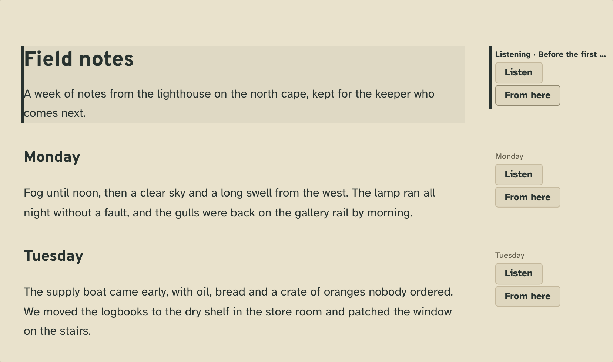
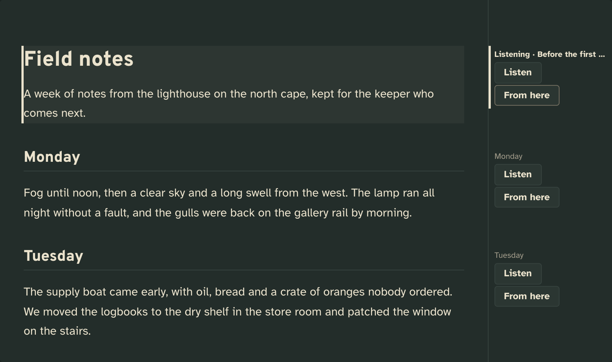
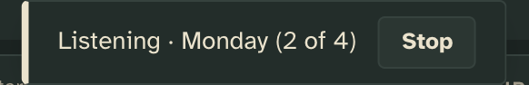
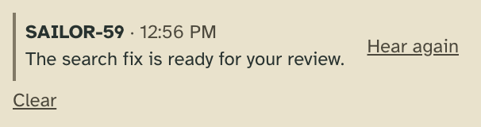
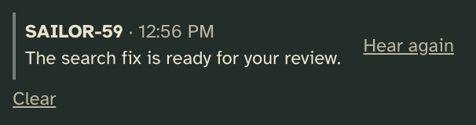

# Narration

Hear what workers write, and the short memos they say to you, read aloud in a voice of your choosing.

## What it adds

### The tower page

**A speaker in the tab of a file a worker showed.** On any markdown or text file, it reads the whole file aloud.

| Light | Dark |
| --- | --- |
|  |  |

**Listen and From here beside each section of a markdown document** (a kept item, a shown file, a shelf page).
Listen reads that section; From here reads from it to the end. While it reads, the section being read is lit and its
row says "Listening".

| Light | Dark |
| --- | --- |
|  |  |

**A notice at the bottom of the page** for as long as it reads, wherever you go on the page, with **Stop**.

| Light | Dark |
| --- | --- |
|  |  |

**The memo strip at the top of the sidebar**: the latest memo a worker said and the rest of today's, each with
**Hear again**. **Clear** puts them away on that browser.

| Light | Dark |
| --- | --- |
|  |  |

Listen also appears on every markdown or text kept item (a draft, say), beside each prompt and answer in a worker's
Brief, and in the palette, which also holds **Stop listening**.

### The workers

Every worker's `tower whoami` carries narrate's one-line guidance:

```
  narrate  ·  Say a short memo aloud to the user: when they asked to be told, a long task finished, or something needs them.
```

`tower x narrate` prints the whole of it: when to speak and how to write for listening. A worker says a memo with

```sh
tower x narrate memo '{"text": "The search fix is ready for your review."}'
```

A memo over the limit (300 characters unless the settings say otherwise) is refused with its length and the limit.
The tower page you used last (clicked, typed in or switched to, on any machine reading the tower) says it aloud
as "GAGARIN-40 says: …" (the words before it are yours to set), in the same voice as Listen. If that page is reading a document, the memo waits for the part
being read to end, is said, and the document goes on. Every other page lists it silently. A page you haven't pressed
or typed on since it loaded can't play sound, so there the memo stands as a notice with **Hear**.

Tower 3D, The Week and the CLI draw none of it: they import no client modules. The memos are on each worker's card
(`x.narrate.memos`) for any renderer to draw.

## Add it

Copy this folder anywhere outside the checkout (so `tower update` leaves your copy alone), then add it to the config
by its absolute path:

```json
"extensions": {
  "narrate": { "path": "/abs/path/to/narrate" }
}
```

The tower picks it up without a restart. `tower extensions` lists it as started, and `tower extensions check
/abs/path/to/narrate` reads it as the tower would.

## What it needs from you

**Nothing, to start: but the browser's speech is only a placeholder.** Without settings, narration speaks through
the browser's `speechSynthesis`, whose voices are flat, differ from one browser to the next, and can't be chosen
here. **A voice command is what makes it sound good**: any text-to-speech program, named in the settings.

```json
"narrate": {
  "path": "/abs/path/to/narrate",
  "settings": { "voice": { "command": ["/abs/path/to/narrate/voices/say.sh"] } }
}
```

Two samples are in [`voices/`](voices/), each an example of the contract below to copy and adapt:

- [`say.sh`](voices/say.sh): macOS's own `say`, free and offline. `SAY_VOICE` picks one of the voices `say -v '?'`
  lists.
- [`elevenlabs.sh`](voices/elevenlabs.sh): ElevenLabs' text-to-speech API over `curl`. It reads `ELEVENLABS_API_KEY`
  and `ELEVENLABS_VOICE_ID` from the environment the tower starts with. Keep the key there, never in the config,
  which every worker can read. It is an example of the contract, not an integration the tower maintains.

The contract is plain Unix:

- The command is the program's absolute path and its arguments. It runs without a shell, in this folder, with the
  tower's environment minus a Claude session's variables, and is killed after 120 s.
- It reads the text on stdin: at most 2000 characters, since narration voices a long text in chunks of up to 1800,
  cut at paragraphs, then sentences.
- It writes an audio file (`.mp3`, `.m4a`, `.aiff` or `.wav`) and prints its absolute path as the last line of its
  output.
- Exit 0 means it worked. Any other exit is a failure, and what it wrote on stderr is shown as the toast.

The audio files are the command's own: narration serves only the files its command printed since the tower started,
each under a token, and never deletes them. Write them to a temporary folder.

**How a memo is limited and spoken** is `settings.memo`, both keys optional:

```json
"settings": { "memo": { "maxLength": 200, "prefix": "{callsign} reports: " } }
```

- `maxLength`: the most characters a memo may have (1 to 2000, default 300). The `memo` verb refuses a longer one,
  saying its length and this limit.
- `prefix`: what is said, and shown in the notice, before the memo; `{callsign}` stands for the worker's. Default
  `"{callsign} says: "`; an empty string says nothing before it.

**What workers say** is narrate's guidance, which you can change for your workers in the config,
`extensions.narrate.guidance`: `brief` and `full` replace narrate's, `also` adds to it ("never between 22:00 and
8:00").

## How it works

A narration reads parts in order. Listen on a section or a prompt reads it alone; From here reads that section and
each one after it; Listen on a document the page draws by sections (a kept item's head, a shown file's tab) reads it
section by section from the first, and anything else as one text.

- `extension.json`: `commands` with `on: ["item.*", "shown", "section", "said"]`, which offers a command on every item
  of any collection, everything a worker showed, and two viewer subjects a page draws (a document's sections, a
  brief's prompts and answers, each carrying its own text as `body`), and `accepts`, which narrows that to the subjects
  whose media type is markdown or plain text. `words.icon` names `client/speaker.svg`, which a page draws where a
  command shows as an icon (a shown file's tab). Its `settings` schema, the `say` verb and two reads, `voice` and
  `audio/<token>`, the latter `serves: "file"`.
- `server.ts`: a verb that runs the voice command with `ctx.run` (argv, stdin, a timeout) and a read that serves only
  the files it was given, by token.
- `client/narrate.js`: a command's export takes `{ tower, board, target, subject, args, kit }`; `target` is the
  subject (`{ kind, key, project, value }`), `tower` the page's `window.tower`, the same API every renderer drives,
  `textOf(tower, target)` reads a subject's text wherever it is, and `kit.toast` says something to the user.
  `kit.bus` is the page's viewer subjects: `bus.under(of, 'section')` finds a document's sections, and
  `bus.mark(key, 'narrate', { label })` marks the one being read, for the document to draw. `kit.notice` is a toast
  that stands until it is closed: "Listening", with Stop.
- `client/voice.js` holds both voices. With a command, it voices the first chunk (Listen stays busy, and a toast says
  it is voicing), plays it in an `<audio>` element while the next chunk is voiced, and so on in order, across the
  parts; Stop, or another Listen, pauses it and drops what is still being voiced. The audio is fetched whole into a
  Blob URL, which plays in Chrome and in WebKit (Safari, Tower.app) alike.
- `verbs.memo` and `facts.memo`: the verb is the only way a memo is written. It takes the worker's own session from
  the call, refuses a text over `settings.memo.maxLength`, and logs the fact with `ctx.facts.append`, so a worker's memo
  is one fact in its own log. The card fold in `server.ts` puts its latest memos on its card (`x.narrate.memos`), each
  keyed by session and time.
- `reads.memo-settings`: the limit and prefix in force, which is how the client and a worker learn them.
- `views.memos` (`client/memos.js`): a view on the board at `row` scale, which the tower page mounts in its
  `board.strip` for as long as the page is open. It says a memo that arrives while `board.viewers.last.<renderer>`
  is its page's `tower.viewer` (`tower.renderer()` names it), never one already on the board as it mounted, through
  `voice.interject`: at once when nothing reads, else after the chunk sounding.
- `guidance`: what narrate tells the workers about memos, when to speak and how to write for listening.

## Make it yours

- **The voice**: copy a script from `voices/`, or write your own around any program (a local model, a voice
  service's CLI) in the same shape: read stdin, write a file, print its path.
- **What workers say, and when**: `guidance` in `extension.json`, or the config's `extensions.narrate.guidance`.
- **Where Listen appears**: `commands.speak.on` and `accepts` in `extension.json`.
- **How a memo is drawn and said**: `client/memos.js`.

## Pictures

`npm run tool:extension-shots -- examples/extensions/narrate` retakes them from the scenes in
[`shots.json`](shots.json), voiced by `voices/say.sh`.
