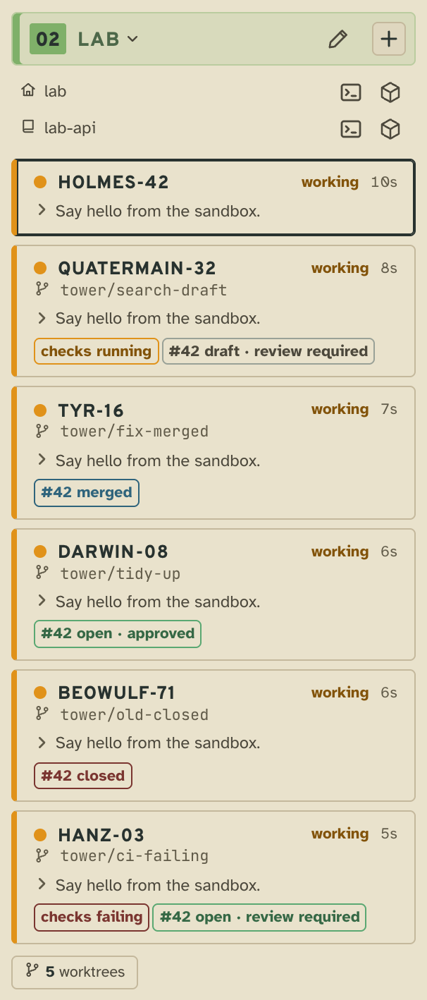
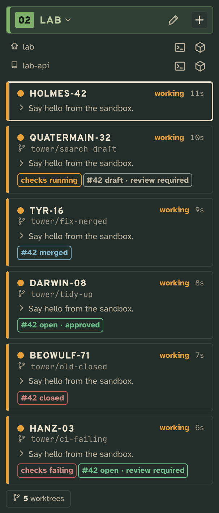
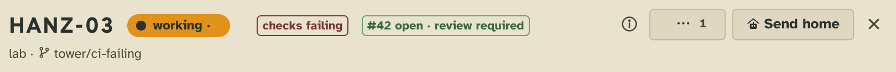
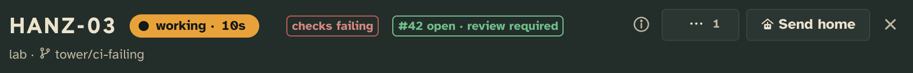

# PR status

A badge on a worker's card naming the pull request of its branch, where it stands (open, draft, merged or closed) and
its review, linking to it on GitHub, and a second one while its checks fail or still run.

## What it adds

### The tower page

**The badges in the worker's row in the sidebar**, under its branch: `#42 open`, `#42 draft`, `#42 merged` or
`#42 closed`, colored as GitHub colors them as near as the tower's tones go: green, grey, blue (GitHub's purple) and
red. An open one says its review too: `#42 open · approved`, `· changes requested` or `· review required`. Its tip is
what the card doesn't already say: the number and title, where it stands with its review and checks, and the repo it
opens in on GitHub; a click opens it. While an open pull request's checks fail or still
run, a second badge says so, `checks failing` in red or `checks running` in orange, and opens its checks; passing
checks say nothing.

| Light | Dark |
| --- | --- |
|  |  |

**The badges in the worker's head**, beside its status.

| Light | Dark |
| --- | --- |
|  |  |

### Tower 3D

The badges in the head of a worker's desk panel.

### The `tower` command

Workers aren't told about it: the badge keeps itself current, asked again as a worker's turn ends, so a worker has
nothing to do for it. `tower x pr-status prs` lists every branch it has asked about, with its pull request, none, or
why GitHub couldn't be asked, and when it asks next (`dueAt`); `tower x pr-status ask-now` asks about every
branch at once.

## Add it

Copy this folder anywhere outside the checkout (so `tower update` leaves your copy alone), then add it to the config
by its absolute path:

```json
"extensions": {
  "pr-status": { "path": "/abs/path/to/pr-status" }
}
```

The tower picks it up without a restart.

## What it needs from you

The [GitHub CLI](https://cli.github.com), signed in (`gh auth login`), and repos whose `origin` is on GitHub. Its
settings:

- `every`: how often it asks about a branch whose pull request is open, `"2m"` by default, 30 seconds at least. A
  branch with none, or with one merged or closed, backs off (below).
- `gh`: the command as the tower runs it, `["gh"]` by default. The tower may not have your shell's `PATH` (started at
  login, say): when `tower x pr-status prs` says `ENOENT`, name it by its absolute path, `["/opt/homebrew/bin/gh"]`.

```json
"pr-status": { "path": "/abs/path/to/pr-status", "settings": { "every": "5m" } }
```

When `gh` can't be asked, the badges say nothing new, so `tower doctor` says it: its check `pr-status/asking` warns
while any branch's latest ask failed, with why and what to do (`gh` not found: name it by its path; not signed in:
`gh auth login`). A checkout whose remotes aren't on GitHub is no fault: its branches just have no badge. A badge
seen before the failure stays, its tip saying GitHub can't be asked now; one repo GitHub refuses in a batch fails only
its own branches.

## How it works

**What it asks.** For the workers on the board in a worktree with a branch (the main checkout has none), its server
reads each checkout's GitHub repo once with `gh repo view`, and its remotes with `git remote -v`. It then asks for the
three newest pull requests of every branch's name in one GraphQL query per GitHub host, `gh api graphql`, each branch
an alias in it, 20 branches a query at most (a round's answer stays well inside the 64 KB `ctx.run` keeps): each pull
request's number, state, draft, title, review decision, head commit and repo, when it was opened, and the rolled-up
state of the checks on its newest commit. A query of ten branches costs one point of GitHub's rate limit, as a query
of one does.

**When.** As soon as workers end a turn, which is when one has just pushed or opened a pull request: its board
trigger compares two boards and calls `pr-status/ask` once with the branches of the workers in a worktree whose card
went from `working` to a turn's end (`done`, `watching`, `idle`, `failed`, or `exited` and `lost` for a worker gone
mid-turn; a permission prompt mid-turn is not one). Besides that, its `tick` every 30 seconds asks about the branches
that are due, or due within the next few seconds. A branch with an open pull request is due every `every`, and every
30 seconds while its checks still run, so a result shows within half a minute; one with none, or with one merged or
closed, waits 5, then 15, then 30 minutes while GitHub keeps saying the same, and back to the start when it changes. Most branches have no pull request most of the time, and a
new one shows at the turn's end anyway. When each branch is due is kept in memory, and forgotten for a branch that
leaves the board, so a restart asks about every branch once. One round runs at a time, and a halt (a restart, a
config change) stops one before it records what a killed `gh` said.

**Whose it is.** GitHub finds a pull request by its head branch's name, and names repeat: a stranger's fork can have a
branch of the same name, others may push branches named like yours to the upstream repo, and a later worker gets
`tower/<callsign>` again. Of the three, the badge shows the newest that is this branch's:

- **A pushed branch** (one with a push remote, as `git push -u` sets): its pull request comes from the repo it pushes
  to, such as your fork. One opened after the branch was made (the branch's reflog) is its, which holds through a
  rebase not yet pushed. One opened before is its only while open with its head commit in the branch's history (`git
  merge-base --is-ancestor`): a branch checked out from a pull request's. So a reused name shows none of the pull
  requests opened before it.
- **A branch not yet pushed** has opened none of its own: a pull request counts only from a repo the checkout knows
  (`gh repo view`'s or a GitHub remote's) with its head commit in the branch's history.

Each errs toward no badge: a branch checked out from an older pull request loses it once rebased locally until the
push, and once that pull request is merged or closed; a worktree older than git's reflog expiry (90 days by default)
loses its merged one.

**What it keeps.** What GitHub said of a branch, its pull request or none, or why it couldn't be asked, is
appended to its system stream `seen` only when it changed, so the stream is a short history of each branch's pull
request. The card's fold reads the stream's state by each folder and branch of the card's worktree, and puts the pull
request on the card as `x['pr-status']` (number, state, url, title, review, checks) and as its badges. A branch that couldn't be asked shows no
badge; one that fails after an answer keeps the badge it had, and an open pull request is asked about again at `every`.
`tower x pr-status prs` says why.

Every worker in the same worktree shows the same pull request, and a worker that has gone home keeps its badges while
its card is on the board.

**More than one repo.** A worktree spans its floor's repos, so a worker working in one may have opened a pull request
from another. Each repo's branch of the worktree is asked about, and its pull request shows on every worker in that
worktree: with more than one, each badge names its repo (`api #12 open`), the worker's own folder's first, which is
`x['pr-status']`; the rest are in its `also`.

## Make it yours

In your copy, `TONE` in `server.ts` says how each state reads, in the tone nearest GitHub's color for it (`ready`, green, for open; `quiet` for a draft; `offered`, blue, for merged, GitHub's purple having no tone; `broken`, red, for closed), `CHECKS_BADGE` which checks get a badge, `BACKOFF` how
long a branch with no open pull request waits, and `foldCard` writes the badges' words.

Its imports come from [the library](../../../docs/extending.md#the-library) (`/lib/*.js`), so a copy loads at any path. To typecheck a copy, run [`tower types .`](../../../docs/extending.md#types-outside-the-checkout)
in it, write a `tsconfig.json` of `{ "extends": "./.tower/tsconfig.json" }`, and add `@types/node`.

## Pictures

`npm run tool:extension-shots -- examples/extensions/pr-status` retakes them from [`shots.json`](shots.json), with
[`shots/seed/gh.sh`](shots/seed/gh.sh) standing in for `gh`: the sandbox has no GitHub.
