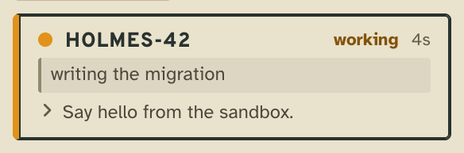
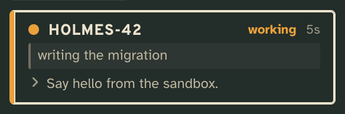
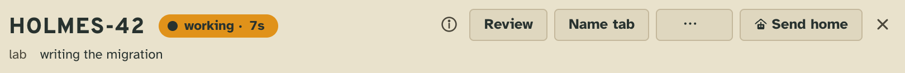
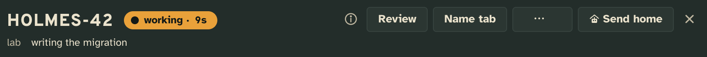
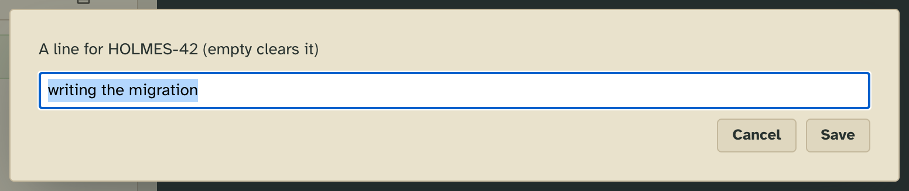
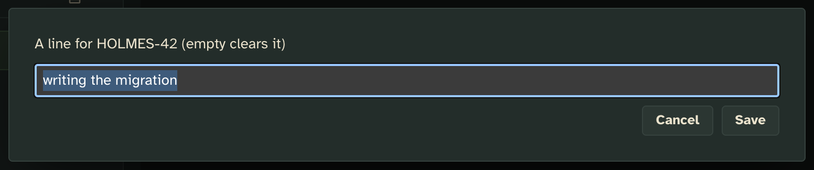

# Tab line, reminded

[Tab line](../tabline/), for workers that forget their line: a few words under a worker's card saying what it is on,
and the workers reminded to keep it there.

## What it adds

It provides the `tabline` capability, so it takes tab line's place: the same line, the same `tower x tabline`, the same
lines already written. What it adds is the reminding.

### The tower page

**The line in the worker's row in the sidebar**, under its callsign and status.

| Light | Dark |
| --- | --- |
|  |  |

**The line in the worker's head**, beside where it works, and **Name tab** among its buttons, also in the palette.

| Light | Dark |
| --- | --- |
|  |  |

| Light | Dark |
| --- | --- |
|  |  |

### The workers

A worker's `tower whoami` carries its own line and the one-line guidance, as tab line's does:

```
You are HOLMES-42, session <id>, a worker on lab (floor "lab").
Your Claude session name is not known to the tower yet.
writing the migration
  tabline  ·  Set a short line under your card saying what you are on, when that changes.
```

A one-line brief is easy to pass over, and a resumed worker runs no `tower whoami`. So every worker started, resumed
or forked also reads, in its brief, how to set its line and the line it carries over:

```
- Your tab line: a few words under your card saying what you are on, read by the user at a glance. Set it as you
  start a task and when the task changes: `tower x tabline facts/line --value '<a few words>'`, in the words
  `tower x tabline` asks for (read it once). Keep it when you go idle: it then says what you last worked on.
  It reads "writing the migration" now: change it when your task is no longer that.
```

With `remind` at `prompt`, a Claude worker also reads [`plugin/hooks/remind.md`](plugin/hooks/remind.md) at each
prompt: if the prompt gives it a task its line doesn't say yet, set the line before starting.

Tower 3D draws the line on a worker's desk, as it does tab line's.

## Add it

Copy this folder anywhere outside the checkout (so `tower update` leaves your copy alone), then add it to the config
by its absolute path, in place of tab line: while both provide `tabline`, both are refused, so remove tab line's entry
or turn it off with `"off": true`.

```json
"extensions": {
  "tabline-remind": { "path": "/abs/path/to/tabline-remind" }
}
```

The lines written under tab line stay: they are the same capability's facts.

## What it needs from you

Nothing. `settings.remind` says how hard workers are reminded; a floor's own value wins on its workers:

| `remind` | What the workers read |
| --- | --- |
| `start` (default) | the guidance, and in the brief of each worker started or resumed: how to set its line, and the line it carries |
| `prompt` | also a short reminder at each prompt (Claude workers) |

The config's `extensions.tabline-remind.guidance` changes the guidance: `also` adds to it ("write the line in
Portuguese"), and the brief and the reminder send the worker to it for which words to use. A change reaches the next
worker started or resumed.

## How it works

The line is tab line's, unchanged: `facts.line`, `writable` by `user` and `self`, and `folds.card.project.lines`, the
newest value over the worker's lineage. `provides: "tabline"` keeps every outward name tab line's.

[`server.ts`](server.ts) is a launch contributor (`spawn.launch`): for each worker started, resumed or forked it reads
the floor's `remind` and the worker's line facts over its lineage, and gives the brief's part and, for `prompt`, the env
key `TOWER_TABLINE_REMIND=prompt`. `plugins.claude` is its Claude plugin: one `UserPromptSubmit` hook that prints
`remind.md`, which Claude adds to the prompt, only when that key says `prompt`.

## Make it yours

In your copy: reword the brief in `server.ts` (`HOW`) and the reminder in `plugin/hooks/remind.md`; drop `self` or
`user` from `facts.line.writable` to say who may write a line.

Its server imports only types, from [the library](../../../docs/extending.md#the-library) (`/lib/*.js`), and
[`tower types .`](../../../docs/extending.md#types-outside-the-checkout) in your copy types them.

## Pictures

`npm run tool:extension-shots -- examples/extensions/tabline-remind` retakes them from [`shots.json`](shots.json).
