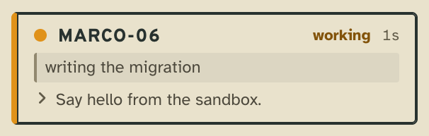
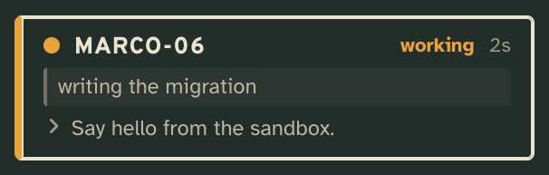
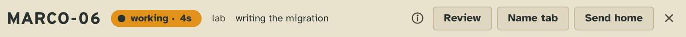
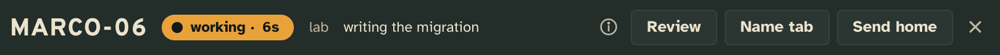
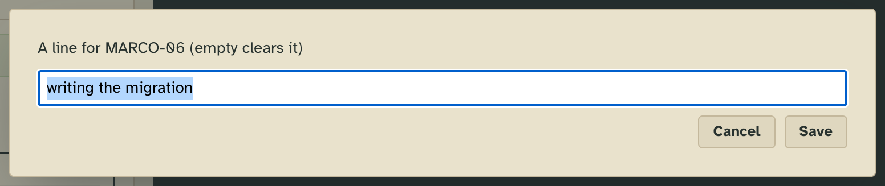
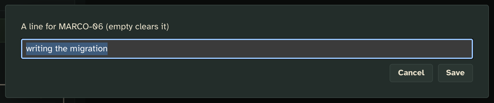
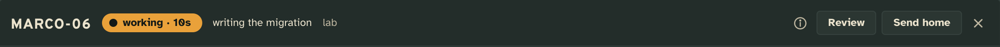

# Tab line

A few words under a worker's card saying what it is on, like a named terminal tab: written by you or by the worker.

## What it adds

### The tower page

**The line in the worker's row in the sidebar**, under its callsign and status.

| Light | Dark |
| --- | --- |
|  |  |

**The line in the worker's head**, beside where it works, and **Name tab** among its buttons.

| Light | Dark |
| --- | --- |
|  |  |

**Name tab** asks for the line in a small dialog, filled with the line as it is. Save writes it; an empty line clears
it. Name tab is also in the palette, on every worker.

| Light | Dark |
| --- | --- |
|  |  |

### Tower 3D

The line in the head of a worker's desk panel. Tower 3D offers no Name tab: it imports no client modules.



### The workers

A worker's `tower whoami` carries its own line under who it is, and tab line's one-line guidance:

```
You are MARCO-06, session <id>, a worker on lab (floor "lab").
Your Claude session name is not known to the tower yet.
writing the migration
  tabline  ·  Set a short line under your card saying what you are on, when that changes.
```

A worker writes its own line with

```sh
tower x tabline facts/line '{"value": "writing the migration"}'
```

and clears it with `'{"value": null}'`. The Week and the CLI's other commands don't show it; it is on each worker's
card for any renderer to draw.

## Add it

Copy this folder anywhere outside the checkout (so `tower update` leaves your copy alone), then add it to the config
by its absolute path:

```json
"extensions": {
  "tabline": { "path": "/abs/path/to/tabline" }
}
```

The tower picks it up without a restart.

## What it needs from you

Nothing. What workers are told about their line is its guidance, which the config's `extensions.tabline.guidance`
changes for your workers: `brief` and `full` replace it, `also` adds to it ("set it only when the user asks").

## How it works

Tab line is the manifest-only form of a card line, with no server code. `facts.line` is a string of at most 80
characters, `writable` by `user` (Name tab, naming the worker) and `self` (a worker, its own); each write is one fact
in the worker's log. `folds.card.project.lines` makes the card's line the newest value over the worker's lineage, so
a resumed worker keeps its line.

## Make it yours

In your copy: drop `self` or `user` from `facts.line.writable` in `extension.json` to say who may write a line.

## Pictures

`npm run tool:extension-shots -- examples/extensions/tabline` retakes them from [`shots.json`](shots.json); the desk
needs Tower 3D built first (`npm run tower3d`).
