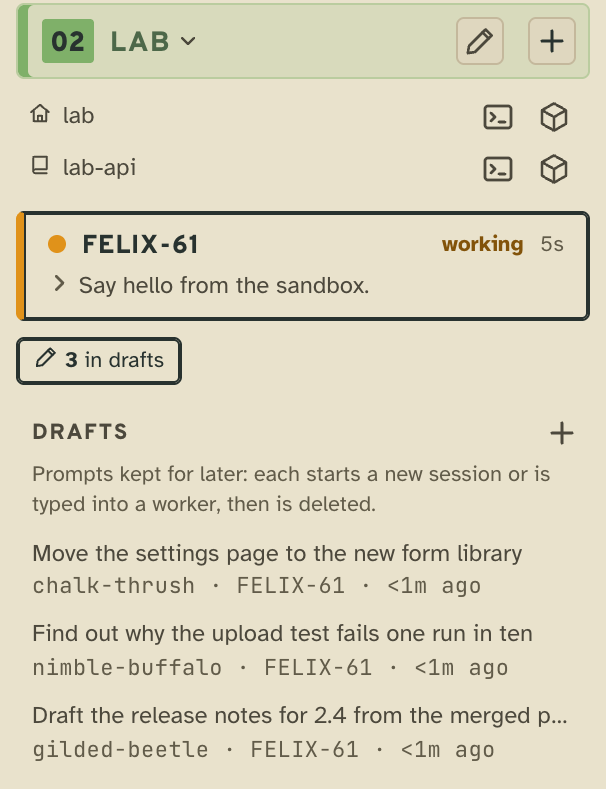
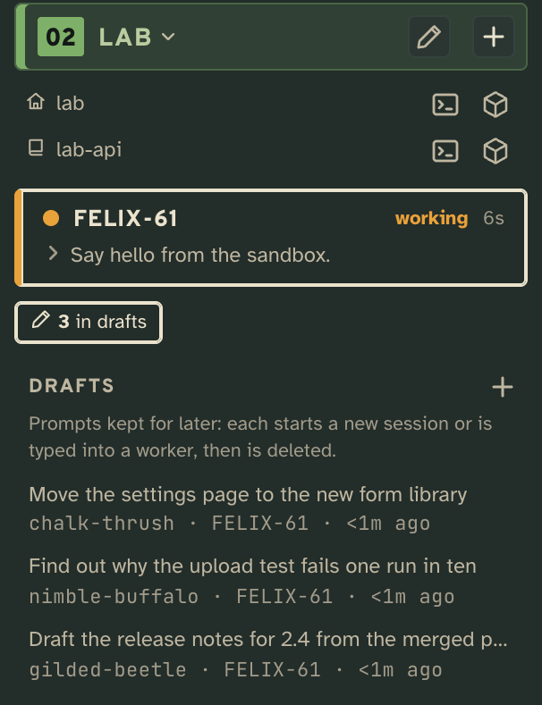
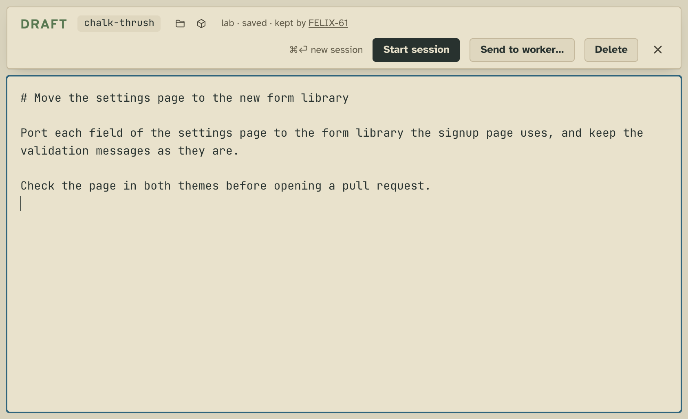
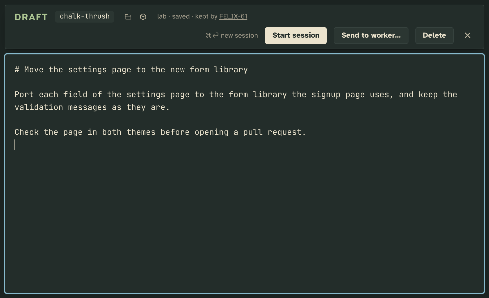
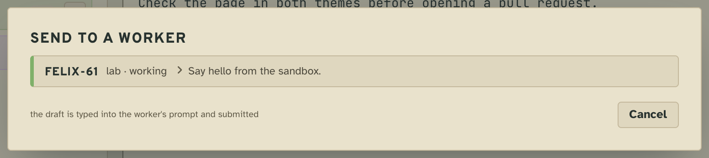
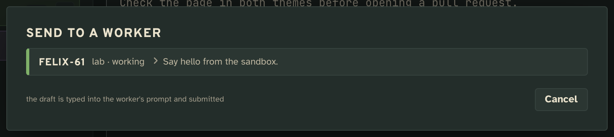
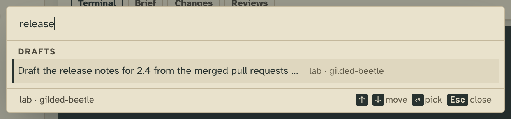
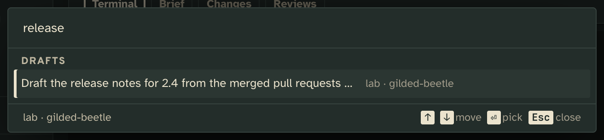

# Drafts

Keep a prompt for later, edit it in the tower, then start a worker on it or type it into one that is running.

## What it adds

### The tower page

**A `drafts` collection on every floor, its tray in the floor's sidebar**, and a pencil on the floor's sign that opens
a new draft. The tray says how many are kept and unfolds to the newest six by their first line, each with its tag, the
worker that kept it and its age, `+` for a new one, and "+N more" for the rest in the main pane.

| Light | Dark |
| --- | --- |
|  |  |

**The draft editor in the main pane.** The first line names the draft. What you type is saved 800 ms after you stop
(⌘S saves at once); a change made on disk while you edit asks you to take theirs or keep yours, and closing on a
conflict keeps your edits as a new draft beside it. **Start session** (⌘⏎) opens the new-worker form on the draft,
which is deleted once a worker starts on it. **Delete** deletes it at once, with Undo on the toast.

| Light | Dark |
| --- | --- |
|  |  |

**Send to worker…** lists every running worker, its floor first, each with what it is doing. A pick types the draft
into that worker's prompt, submits it, and deletes the draft.

| Light | Dark |
| --- | --- |
|  |  |

**Drafts in the palette** (⌘K), found by their title, opened in the editor.

| Light | Dark |
| --- | --- |
|  |  |

A prompt typed into the new-worker form that closes without starting a worker, or whose start fails, is kept as a
draft, never lost.

### Tower 3D

Tower 3D draws each floor's drafts as notes on a corkboard on its shared wall, and edits them in a panel beside the
world with this extension's client module. The drawing is Tower 3D's own code; it appears only on floors where drafts
is on.

### The workers

Every worker's `tower whoami` lists the collection:

```
  drafts  ·  Drafts  ·  Prompts kept for later: each starts a new session or is typed into a worker, then is deleted.
```

and the brief every worker starts with tells it to keep an idea off its goal, or a prompt the user wants for later,
with `tower keep drafts` (markdown on stdin, its first line the title). `tower kept drafts` lists them. Both are the
core's collection commands: drafts adds no verbs and no `tower x drafts` commands.

The Week draws none of it.

## Add it

Drafts ships with the tower and is on by default on every floor. To turn it off everywhere:

```json
"extensions": { "drafts": { "off": true } }
```

or on one floor, in that project's entry:

```json
"capabilities": { "drafts": { "off": true } }
```

Where it is off, the floor has no drafts collection unless the config declares one under `collections`, which is then
a plain collection: listed and kept like any other, with no editor, no pencil, no palette entries, no corkboard, and
the new-worker form keeping nothing. The files under `collections/<project>/drafts/` stay on disk either way.

## What it needs from you

Nothing. It has no settings. A `drafts` entry under the config's `collections` changes its `label` and `description`
while the collection stays the extension's:

```json
"collections": { "drafts": { "label": "Ideas", "description": "Prompts for a rainy day." } }
```

## How it works

Drafts has no server: it declares a collection and two views, and the rest is client code the renderers import.

- `extension.json`: `collections.drafts`, the collection on every floor where drafts is on, and two `views`:
  `editor` on `item.drafts` (a draft) and `collection.drafts` (a new one) at `pane` scale, and `tray` on
  `collection.drafts` at `row` scale.
- `client/drafts.ts`, served as `/x/drafts/drafts.js`: the editing every renderer shares. `draftsOf(floor)` is a
  floor's drafts while the extension is on there; `save`, `follow`, `settle` and `leave` are the autosave and the
  conflict handling over the core's `collection/create`, `collection/write` (refused once the file moved on),
  `collection/delete` and `collection/restore`; `keepUnsent` keeps the new-worker form's prompt. The tower page imports
  it for its sidebar, palette and new-worker form; Tower 3D bundles it at build time.
- `client/editor.ts` (`drafts/editor`): the editor above. Start session runs the core's `spawn` on the draft through
  the renderer's `kit.run`; Send to worker runs the card's `submit` verb with the text, then deletes the draft.
- `client/tray.ts` (`drafts/tray`): the core's kept-item tray (`/items.js`), with the draft icon, titles by first line
  and `+` for a new draft.
- `contract.json`: the names other code may rely on, `collections.drafts` and the client's exports.

Each draft is one markdown file, `collections/<project>/drafts/<id>.md`, and who kept it is the core's `tower.keep`
fact in that worker's log. Drafts writes no facts of its own.

## Make it yours

- **What the collection is called and says**: the config's `collections.drafts`.
- **How a draft is edited**: `client/editor.ts`, or a view of your own on `item.drafts` named in the layout.
- **How a draft is titled**: `titleOf` in `client/drafts.ts`.
- **What workers are told about drafts**: the brief in `src/shared/launch.ts` is the core's, not this extension's.

## Pictures

`npm run tool:extension-shots -- extensions/drafts` retakes them from the scenes in [`shots.json`](shots.json).
