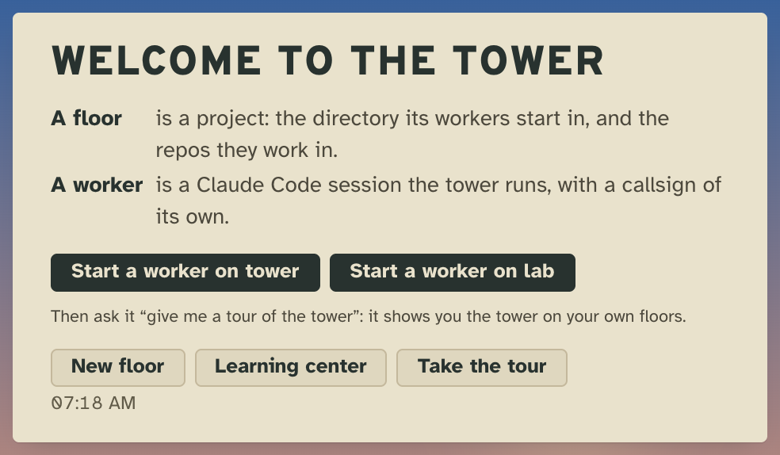
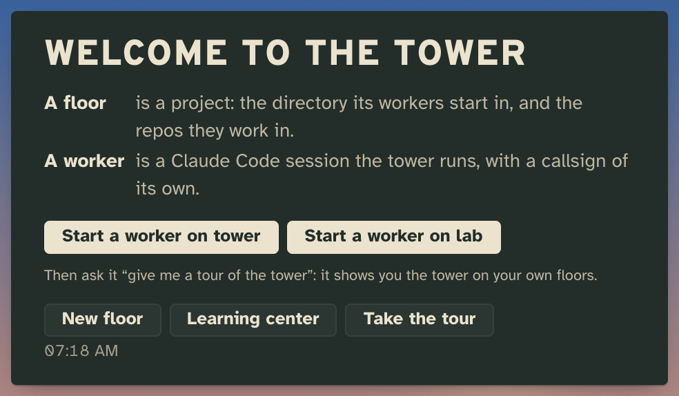
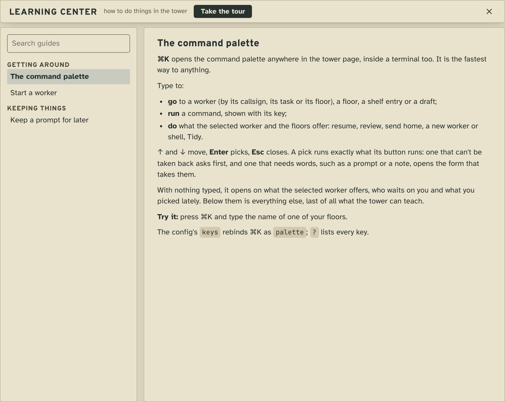
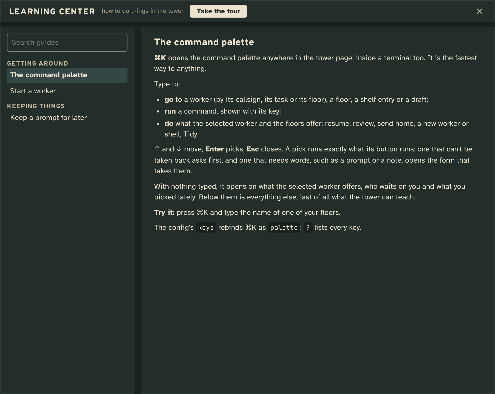

# Guides

The learning center: short guides to the tower's gestures, read in a view of their own, and a guided tour given by a
worker on your own floors.

## What it adds

### The tower page

**Learning center** and **Take the tour** in the skyline's greeting (the page's `board.skyline` region), from the
welcome on a new tower to every day after, beside Floors and Stats in the sidebar (`board.sign`), and in the palette.

| Light | Dark |
| --- | --- |
|  |  |

**The learning center** (`guides/center`, in the main pane) lists every guide by category, in each guide's order,
searched by title, keywords and body. The picked guide is drawn beside the list. A guide another extension
contributes carries its name after its title. A file that doesn't read as a guide is listed at the bottom with why.

| Light | Dark |
| --- | --- |
|  |  |

**Take the tour** (`guides/tour`) starts a worker on the first floor in board order, in its hub, asked "Give me a
tour of the tower.", and goes to it. The worker follows the `tower:guide` skill, which reads the guides as the gestures
to teach. The tour runs on Claude whatever the floor's runtime, since the skill ships with Claude's plugin.

### Workers

`tower kept guides` lists the guides and `tower read <tag>` prints one, as for any collection. A worker asked to write
a guide keeps it with `tower keep guides`.

## Guides

The tower-wide collection `guides` (`collections/_tower/guides/`) holds them. This extension ships its own through
`items`, read in place from `guides/`. Any extension adds its own the same way:

```json
{ "requires": { "tower": "2.13", "guides": "1.0" }, "items": { "guides": "guides" } }
```

A guide is one markdown file:

````markdown
# The command palette

```json
{ "keywords": ["palette", "search", "cmd k"], "category": "Getting around", "order": 1 }
```

**⌘K** opens the command palette anywhere in the tower page.


````

- The first line is the title, as every listing of a collection reads it.
- The json header says what finds it (`keywords`), where it is listed (`category`) and its place there (`order`).
  Categories are listed by their lowest order.
- The body is markdown, one line per paragraph. Images sit beside the guide in the same folder, named relative to it.

A user's guide of the same file name as a contributed one replaces it (`tower own <tag>` makes that copy to edit).
