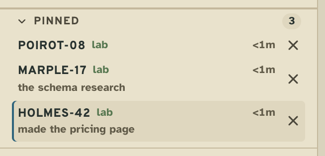
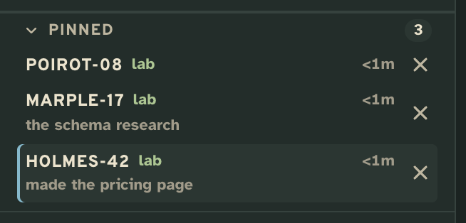
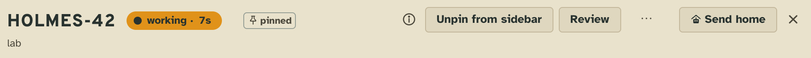
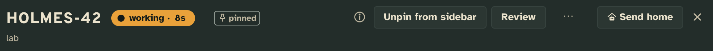

# Pins

Pin a conversation worth coming back to, with a note on why, and find it in the sidebar months later, after its worker
went home.

## What it adds

### The tower page

**The sidebar's Pinned section** (`board.sections`, between the limits and the floors): every pinned worker, newest
pin first, with its floor, its note and how long ago it was pinned. A row opens the worker, from the floor's archive
once it went home; its × unpins it. The heading folds the section to its count, and the section is gone while nothing
is pinned.

| Light | Dark |
| --- | --- |
|  |  |

**A worker's card** says `pinned` beside a pin, its note on hover, on its row in the sidebar and in its header. The header and the
worker's ⋯ menu offer Pin to sidebar, or Unpin from sidebar once it is pinned, and so does the palette.

| Light | Dark |
| --- | --- |
|  |  |

### The CLI

`tower x pins pin --note '<why>'` pins the worker that runs it, `--session <id>` another; pinning again replaces the
note. `tower x pins unpin` unpins, and `tower x pins list` lists every pin on every floor, with its session id:

```
POIROT-08  lab  20261125-141554-2f2d
MARPLE-17  lab  20261125-141554-d1ad  the schema research
HOLMES-42  lab  20261125-141553-9eda  made the pricing page
```

`GET /pins/list` answers the same as JSON.

### The workers

`tower whoami` lists its guidance in a line, so a worker asked to pin the conversation knows the command, and
`tower x pins` says when to pin and when not to.

Tower 3D and The Week draw nothing of it.

## Add it

It ships with the tower and runs unless `"extensions": { "pins": { "off": true } }`. It does nothing until a worker or
the user pins one.

## How it works

A pin lives in the extension's system stream `pins`, one fact per pin (`p`: the session, the floor it ran on, the
note) and per unpin (`u`), written only by its verbs. The stream's `reduce` keeps the pins standing. A board fold puts
them at `board.x.pins.pins`, callsigns resolved for archived workers too, which the section view `pins/section`
draws. A card fold adds the badge and the Pin to sidebar or Unpin from sidebar action. Since nothing lives in the
worker's own log, a pin outlives the worker's card on the board.

## Make it yours

What workers are told about pinning is the config's `extensions.pins.guidance`: `brief` and `full` replace it, `also`
adds to it. Where the section sits, folded or hidden, is the layout's `board.sections` for the page
(`renderers.page.layout`).

## Pictures

`npm run tool:extension-shots -- extensions/pins` retakes them from [`shots.json`](shots.json).
