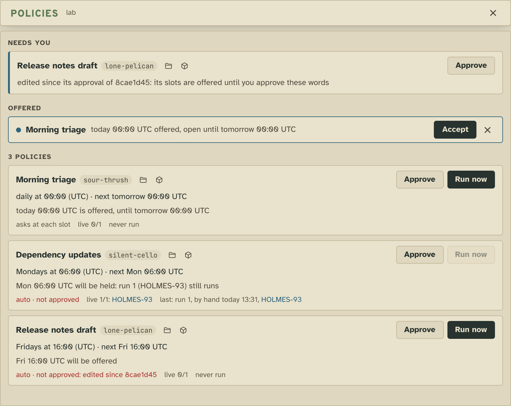
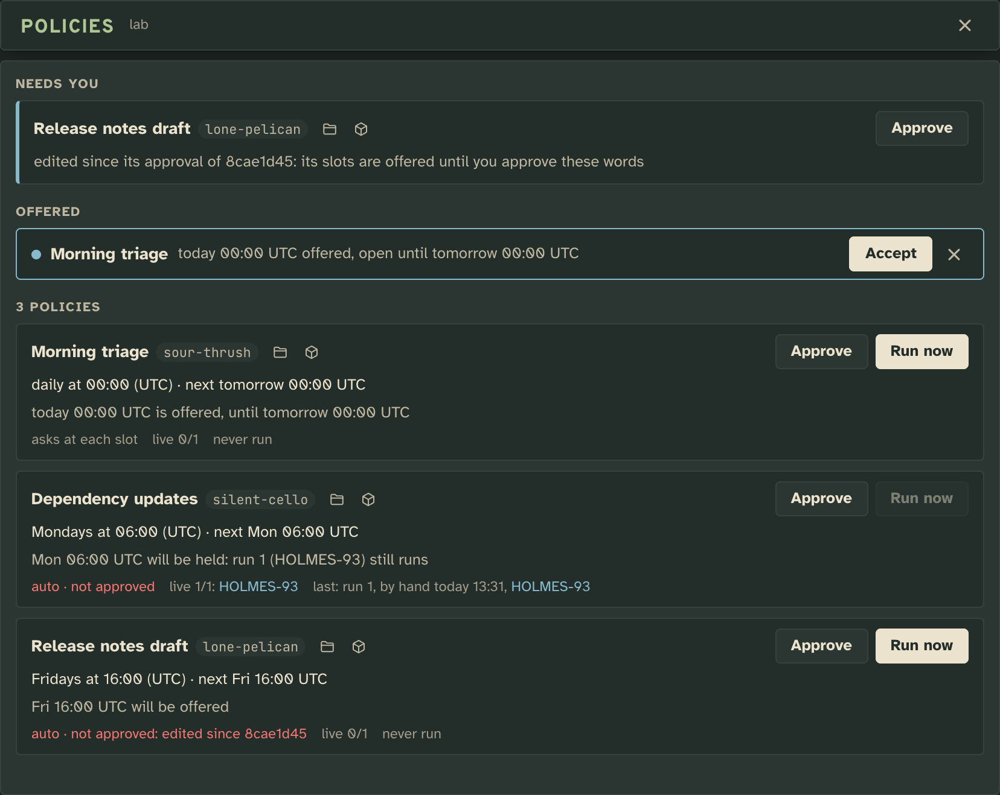
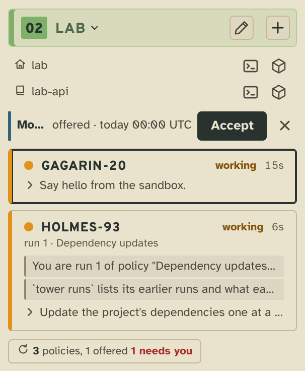
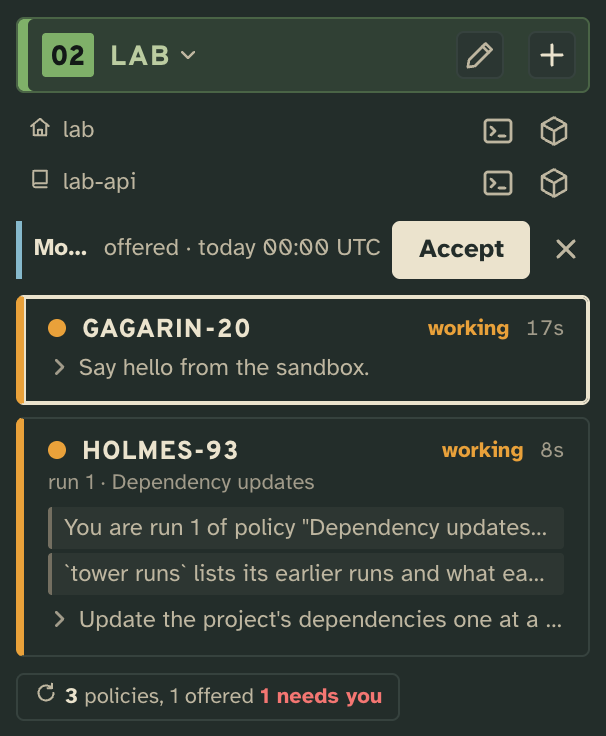

# Policies

Standing work the tower starts for you on a schedule: a prompt and a rule for when, kept as a file, with every slot
it ran, offered or skipped recorded and said in words.

## What it adds

### The tower page

**The Policies panel**, opened from the floor's policies tray. On top, what **needs you**: an `auto` policy edited
since its approval, an invalid one, or a slot held because its runs are still on duty. Then the slots **offered** now,
each with **Accept** and ✕. Then every policy: its rule and next slot in words, its approval, its runs, with
**Approve** and **Run now**.

| Light | Dark |
| --- | --- |
|  |  |

**On the floor in the sidebar**: each open offer as a row with **Accept** and ✕, a run's card saying which run of
which policy it is, and the policies tray counting what is offered and what needs you. An offer also counts in the
header's **offered** chip and takes its turn among the things waiting on you.

| Light | Dark |
| --- | --- |
|  |  |

### The CLI

`tower policies` lists the floor's policies and where each stands now, the same reason the tower acts on:

```
sour-thrush   Morning triage       daily at 00:00 (UTC)
              ask · live 0/1
              now: today 00:00 UTC is offered, until tomorrow 00:00 UTC
silent-cello  Dependency updates   Mondays at 06:00 (UTC)
              auto · not approved: its slots are offered · live 1/1 · last: run 1, by hand, HOLMES-93 working
              now: Mon 06:00 UTC will be held: run 1 (HOLMES-93) still runs
lone-pelican  Release notes draft  Fridays at 16:00 (UTC)
              auto · NOT approved (edited since 8cae1d45) · live 0/1
              now: Fri 16:00 UTC will be offered
```

`tower policies approve <tag>` approves a policy's words as they are now, `tower policies run <tag>` starts it now or
takes its open offer, and `tower runs [<tag>]` lists a policy's latest runs.

### The workers

A worker started for a policy reads in `tower whoami` which run of which policy it is, and `tower runs` for what
earlier runs left. Tower 3D and The Week draw none of it.

## Add it

It ships with the tower and is on for every floor. Off, nothing runs on a schedule, but its files and facts stay: on
again, every policy, run and approval is back.

## What it needs from you

**A policy, to do anything**: a floor with none shows nothing, not even the tray. Keep one with
`tower keep policies` (markdown on stdin), or ask a worker to; edit it in place like any kept item.

A policy is one markdown file: a `# Title` line, a fenced json header, then the prose, which is the whole prompt its
run's worker starts on.

````md
# Dependency updates

```json
{
  "when": { "cron": ["0 6 * * 1"], "tz": "UTC" },
  "check": "test -f package.json",
  "start": "auto",
  "live": 1,
  "hire": { "model": "opus", "effort": "high" }
}
```

Update the project's dependencies one at a time, running the tests after each. Open one pull request with every
update that passed, and list the ones that failed and why. Nobody watches this run: end with `tower home` once the
pull request is open.
````

The header's keys:

| Key | Takes | Unset |
|---|---|---|
| `when` | `cron`, one or more crons the tower can say in words (day of month and day of week never both, never a bare `*` minute), and `tz`, an IANA zone. | required; `tz` the machine's |
| `check` | A shell line run from the floor's hub at each slot, at most 60 s: exit 0, there is work (its output goes to the run); 1, none; anything else, failed. | no check |
| `start` | `ask`: each slot is offered to you. `auto`: started on its own, but only on words approved as they are now; any edit needs a new approval, and until then its slots are offered. | `ask` |
| `live` | How many of its runs may run at once; a slot due while they all run is held. | `1` |
| `hire` | The spawn's `cwd`, `cut` (`{ "name", "branch", "base" or "from" }`), `model` and `effort`. | a spawn's defaults |
| `runner` | Leaves the policy to another runner by that name: this extension never acts on it. | this extension runs it |
| `x` | A runner's own data. | none |

Any other key makes the policy invalid, said in the panel and in `tower policies`, and it never runs. A slot is on time for 5 minutes; one the tower wasn't up for is missed, and nothing records it.

## How it works

At each slot, the tower's slot loop fires the extension, which decides from the board alone: held while `live` is
full; else the check first, when there is one; then a run when the policy is `auto` and approved, else an offer.
Every slot it sees gets exactly one fact, in the floor's `runs` stream, so a slot is never decided twice, across
restarts too; approvals are facts in its `approvals` stream.

## Make it yours

- **Only on days there is work**: a `check` that exits 1 when there's nothing to do, so the slot passes quietly.
- **Started without asking**: `"start": "auto"`, then approve its words in the panel or with `tower policies approve`.
- **Your own runner**: name it in a policy's `runner`, put its data under `x`, and have it run or pass slots through
  the same verbs (`tower x policies run`, `tower x policies pass`).

## Pictures

`npm run tool:extension-shots -- extensions/policies` retakes them from [`shots.json`](shots.json), seeded with the
sample policies in [`shots/seed/`](shots/seed/).
