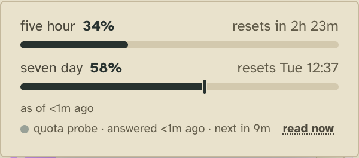
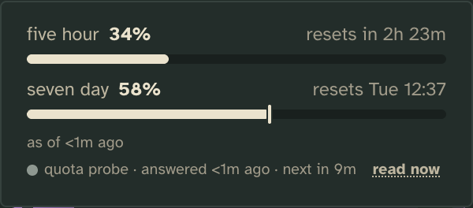

# Quota probe

Keeps each account's rate limits current while no worker is running, by asking Claude for them itself. Where `argv`
names several commands, each is an account with its own limits and its own schedule.

## What it adds

### The tower page

**A line under the rate limits** (the limits chip at the top of the sidebar opens them): when the probe last read,
when it reads next, and **read now**. Its lamp takes the colour of how it stands (answering, failing, backing off,
nothing to read), and hovering it says why its last read failed. The limits above it are the account's, as the probe
or a worker's turn last read them, whichever is newer. Where `argv` names several commands, each has its limits and
its line under its name, and the chip shows the tightest limit of any.

| Light | Dark |
| --- | --- |
|  |  |

**read now** reads that account at once, at most once a minute, and a toast says what it came to.

### Tower 3D

A lamp named `quota` at the end of the limits chip in the HUD, the default command's, with the whole line on hover and
a click that reads every command now.

### The CLI

`tower x quota limits` prints how much of each account is used, `tower x quota probes` the probe's line, one per
command, and `tower x quota read-now` reads now:

```
5h 34% used, resets in 1h 12m · week 12% used, resets Sun 22:00 · read 3m ago
quota probe · answered <1m ago · next in 9m · answering
```

`tower doctor` runs its check, which fails with what to do when the last read failed or the probe is overdue.

### The workers

`tower whoami` lists its guidance in a line, so a worker asked about quota knows where to look, and `tower x quota` says
when to use each word.

The Week draws nothing of its own.

## Add it

It ships with the tower and runs unless `"extensions": { "quota": { "off": true } }`. Off, the limits refresh only
during workers' turns, so between them they age.

## What it needs from you

**Nothing, if you are signed in to Claude Code with a Claude subscription.** It reads each account through the same
command your workers start with (the config's `argv`), so whatever signs them in signs it in. An account with no rate
limits to read (an API key, a cloud provider) says "nothing to read", and the probe asks again every 6 h.

One setting, how long after its last read it reads again:

```json
"extensions": { "quota": { "settings": { "every": "30m" } } }
```

`every` takes a whole number and `s`, `m` or `h`, at least a minute; `10m` when unset. After 3 failures in a row it
waits 10 min, doubling up to 1 h.

## How it works

Each command is due on its own: when no turn of that command has read within `every`, with its own backoff. Reads run
one at a time, so two accounts never run Claude at once. Each read runs Claude in print mode with nothing but a `get_usage` control request on stdin: no prompt, no tools, no
session saved, so it costs nothing. Each read is one fact in the system stream
`streams/system/probe.quota/YYYY-MM.jsonl`; an answered one is of the core's kind `tower/rate-limits`, so the core
folds it into the board's limits beside the workers' turns.

## Pictures

`npm run tool:extension-shots -- extensions/quota` retakes them from [`shots.json`](shots.json). A sandbox's workers
are not Claude, so its own read fails there: `shots/seed/reading.mjs` appends one made-up answered read.
