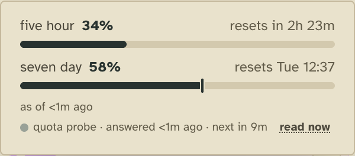
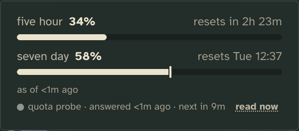

# Quota probe

Keeps the account's rate limits current while no worker is running, by asking Claude for them itself.

## What it adds

### The tower page

**A line under the rate limits** (the limits chip at the top of the sidebar opens them): when the probe last read,
when it reads next, and **read now**. Its lamp takes the colour of how it stands (answering, failing, backing off,
nothing to read), and hovering it says why its last read failed and when it last answered. The limits above the line
are the account's, as the probe or a worker's turn last read them, whichever is newer.

| Light | Dark |
| --- | --- |
|  |  |

**read now** reads at once, at most once a minute, and a toast says what it came to (`quota probe answered in 1.4s`,
or why it failed).

### Tower 3D

A lamp named `quota` at the end of the limits chip in the HUD, with the probe's state beside it while it asks for you,
the whole line on hover, and a click that reads now.

### The CLI

`tower probes` prints its line and state, and `tower probes run quota` reads now:

```
quota probe · answered <1m ago · next in 9m · answering
```

`tower x quota` lists its verb and reads: `read-now`, `reads` (the latest reads, each Claude's answer as it came or
why there is none), `said` and `status`. `tower doctor` runs its check, `quota/reading`, which fails with what to do
when the last read failed, the account has no limits to read, or the probe is overdue.

The Week draws nothing of its own, though its weekly figure comes from the limits the probe keeps current. It gives the
workers no guidance: a worker reads now only when the user asks.

## Add it

It is bundled, so it runs unless you turn it off:

```json
"extensions": { "quota": { "off": true } }
```

Off, the limits refresh only during workers' turns, so between them they age, and the probe's line, its lamp in Tower
3D, `tower probes` and its check are gone.

## What it needs from you

**Nothing, if you are signed in to Claude Code with a Claude subscription.** It reads the account through the same
command your workers start with (the config's `argv`), so whatever signs them in signs it in. An account with no rate
limits to read (an API key, a cloud provider, nobody signed in) says so: the line reads "nothing to read", and the
probe asks again every 6 h.

One setting, how long after its last read it reads again:

```json
"extensions": { "quota": { "settings": { "every": "30m" } } }
```

`every` takes a whole number and `s`, `m` or `h`, at least a minute; `10m` when unset. After 3 failures in a row it
waits 10 min, doubling up to 1 h. While a worker's turn has read every limit the probe reads, it waits `every` after
that turn.

## How it works

Each read runs Claude in print mode with nothing but a `get_usage` control request on stdin: no prompt, no tools, no
settings, no session saved, so it costs nothing. It runs from the temp folder and is killed after 30 s.

- `extension.json`: a system stream, `reads`, whose answered reads (`u`) are of the core's fact kind
  `tower/rate-limits`, so the core folds them into the board's limits beside the workers' turns'; failed reads are
  `f`. A slot, `tick`, every minute. A board fold, `x.quota`: its state (`new`, `ok`, `failing`, `backoff`,
  `unavailable`), its last read, why it failed and when it reads next. The verb `read-now`, the reads `reads`, `said`
  and `status`, and the check `reading` over `status`.
- `server.ts`: on each tick, reads when one is due; `read-now` reads at once, one read at a time, starts at least a
  minute apart. Each read appends one fact to `streams/system/probe.quota/YYYY-MM.jsonl` beside the config, the folder
  it kept from before it was an extension.
- `status.ts`: pure, shared by the tick, the fold and the reads: when it is due, how long it waits after failures, and
  how it stands.
- `client/quota.ts`, served as `/x/quota/quota.js`: the probe in words (`probeLine`, `probeTitle`, `probedLine`) and
  its state's colour, which the tower page and Tower 3D import to draw the line and the lamp.

## Make it yours

- **How often it reads**: `settings.every`.
- **How the probe is said**: `client/quota.ts`, which every renderer drawing it imports.
- **What it reads with**: the config's `argv`, the command every worker starts with: a wrapper there is used here too.

## Pictures

`npm run tool:extension-shots -- extensions/quota` retakes them from the scenes in [`shots.json`](shots.json). A
sandbox's workers are not Claude, so its own read fails there: `shots/seed/reading.mjs` waits for that failure, then
appends one made-up answered read.
