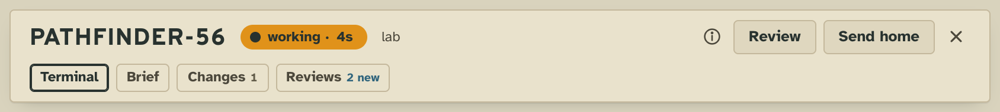
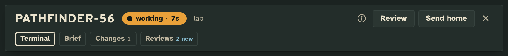
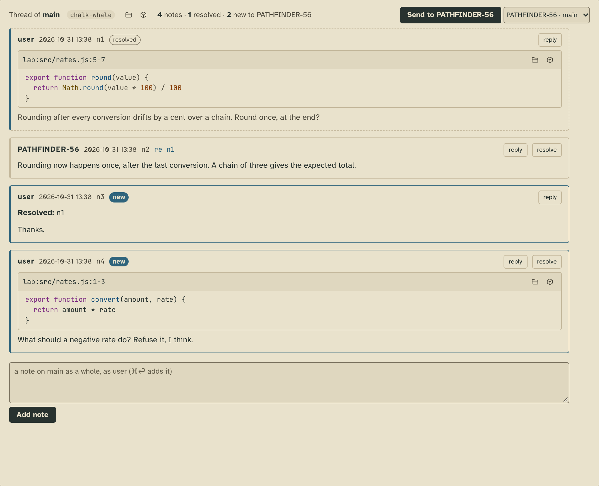
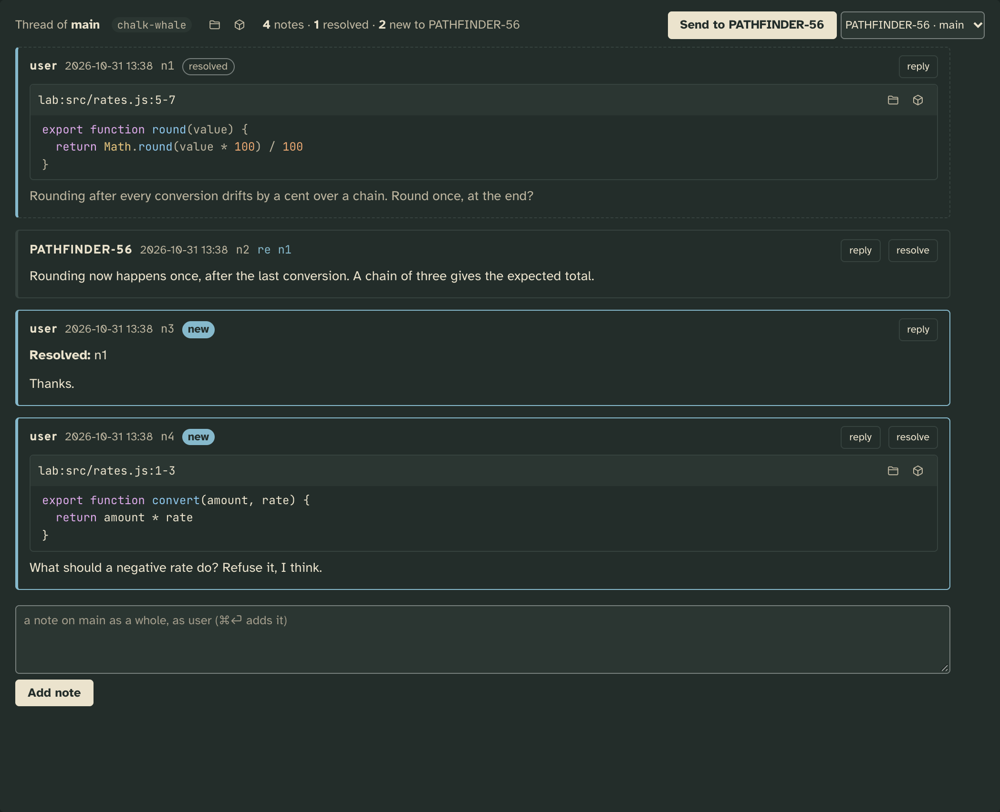
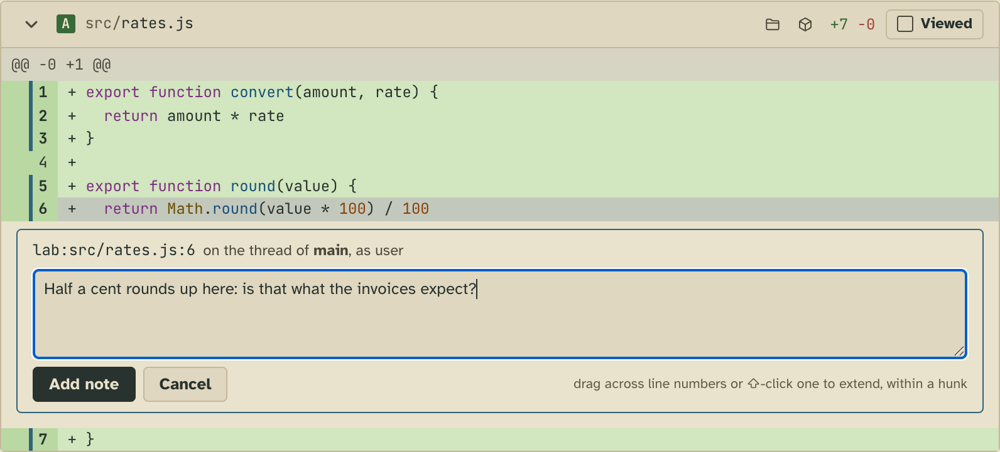
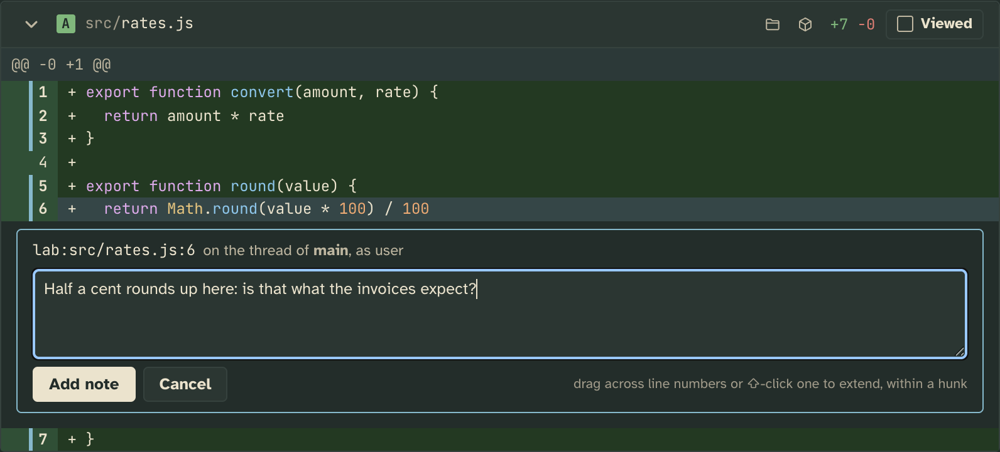
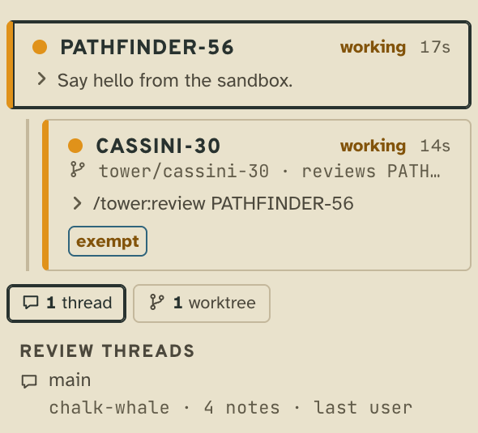
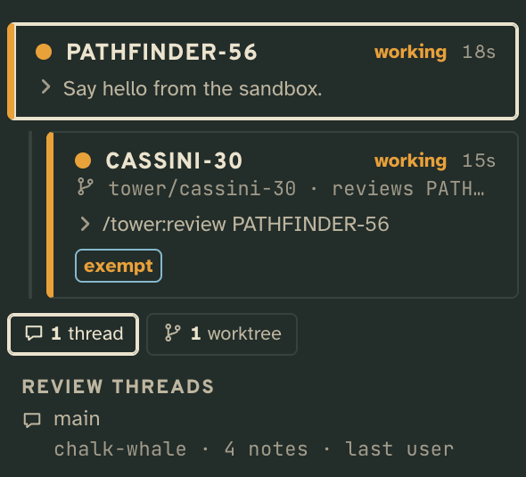

# Review threads

Talk about a worker's work before it lands, on one thread of notes per checkout, and hire a reviewer that reads the
diff and leaves its notes there.

## What it adds

### The tower page

**Review and a Reviews tab on every worker.** Review hires a reviewer of the worker's unlanded work; the tab holds
its checkout's thread, its tally the notes the worker hasn't seen. Review isn't offered where there is nothing to
review: no conversation yet, a reviewer, landed work, or a floor whose dirs aren't git repos.

| Light | Dark |
| --- | --- |
|  |  |

**The thread.** Each note with its author, number and the lines it quotes (marked once the worker's changes move
under them), **reply** and **resolve**. **Send to** types a pointer to the new notes into a worker, and the box at the
end adds a note on the checkout as a whole, signed with `user.name` from the config.

| Light | Dark |
| --- | --- |
|  |  |

**A note on lines in the Changes tab.** Click a line number (drag or ⇧-click for more) and write a note under it.

| Light | Dark |
| --- | --- |
|  |  |

**In the sidebar**, a reviewer stands under the worker it reviews, and a floor's trays hold its threads, open ones
first, then those Tidy filed once their work landed.

| Light | Dark |
| --- | --- |
|  |  |

Review is also in the palette (⌘K), and **Tidy** lists each landed thread to file.

### The workers

`tower thread` prints the thread of the worker's checkout and what is new to it (the whole of it is in
[`shots/thread.txt`](shots/thread.txt)). A worker answers on it with

```sh
echo "Rounding now happens once, after the last conversion." | tower note re n1
echo "Refused below zero." | tower note lab:src/rates.js:1-3
tower note resolve n4
tower review GAGARIN-40 tell
```

`tower review <CALLSIGN> tell` hires a reviewer that sends its notes to that worker when done.

Tower 3D draws the threads too (a pigeonhole, a reviewer beside its author); The Week draws none of it.

## Add it

It ships with the tower and is on by default. `"extensions": { "reviews": { "off": true } }` turns it off; the threads
stay as a plain collection, but nobody can add to them.

## What it needs from you

Nothing. Your name on the notes you write is `user.name` in the config (`"user": { "name": "Ada" }`), else `user`.
A reviewer works in a worktree of its own, so the floor's dirs must be git repos.

## How it works

A thread is one append-only markdown file per checkout, `collections/<project>/reviews/<checkout>.md`, each note a
`## <author> · <time> · n<k>` heading, each anchor a `` `repo:path:from-to` `` line with its quote fenced under it.
Only the extension's verbs write it (`append`, `resolve`, `hire`); its folds put the thread and where its work
stands on each card, read from the core's reading of git.

## Pictures

`npm run tool:extension-shots -- extensions/reviews` retakes them from [`shots.json`](shots.json), on a thread
`shots/seed/thread.sh` writes.
