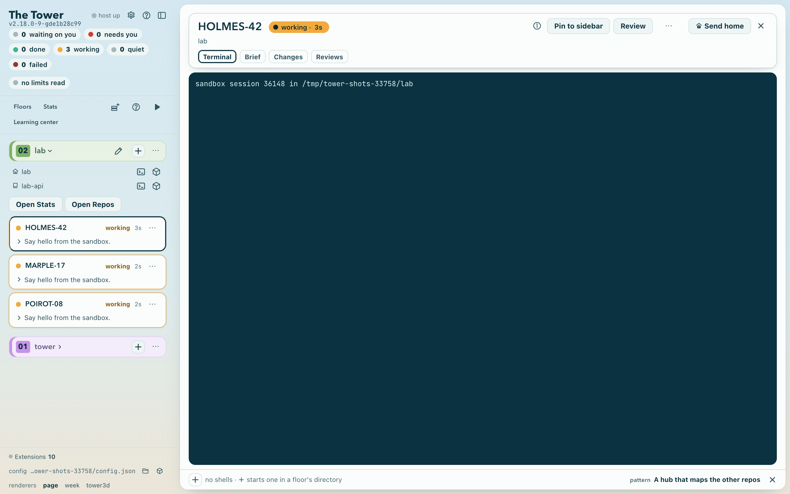
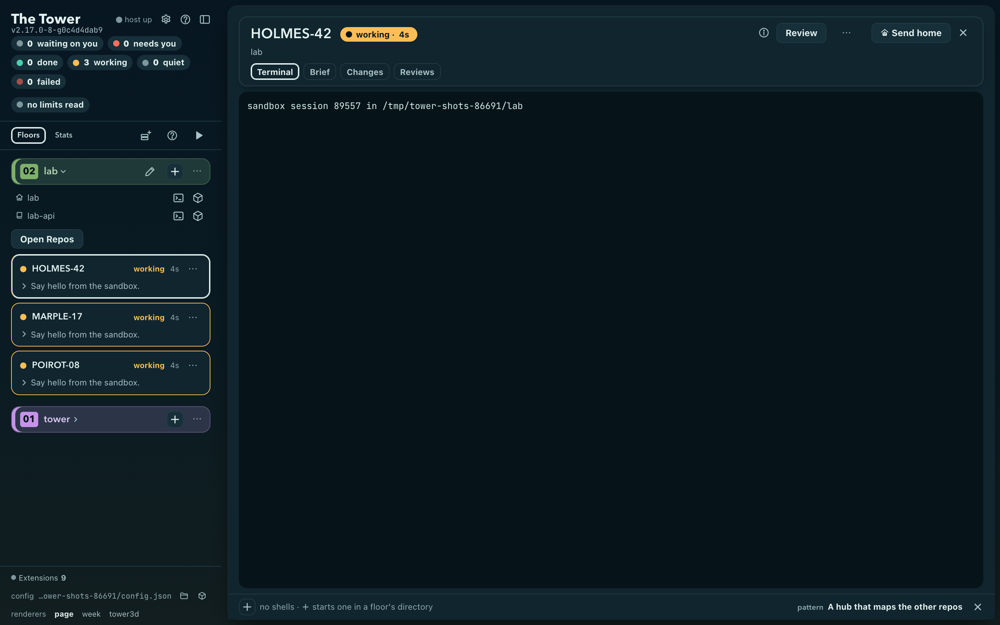
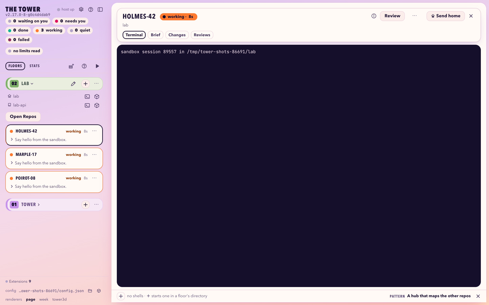
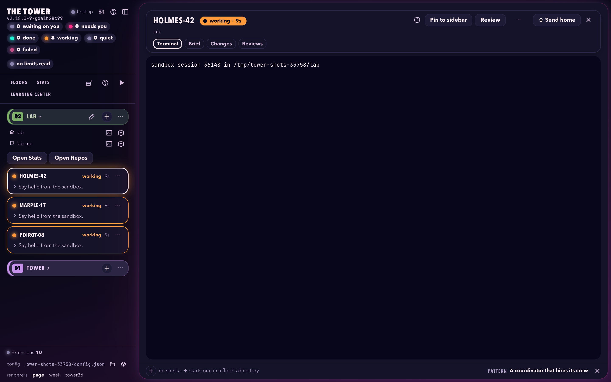

# Themes

Two looks for the tower page, offered and loaded only when you pick one: Aqua and Flamingo.

## What it adds

### The tower page

**Aqua (`themes/aqua`): the horizon from a beach at noon.** Foam-white cards on sea haze, deep-sea ink, turquoise for
what you act on, and a terminal of deep water. At night it is the same sea under the moon. The sidebar takes the wall's
blue, the main pane floats over it, and the wall runs from sky to sand.

| Light | Dark |
|---|---|
|  |  |

**Flamingo (`themes/flamingo`): a coastal city in neon.** At night, a navy ground lit in hot pink, violet and pool
cyan, with lamps glowing in their status colour and cards glowing most where you are: the selected worker's card
strongest, the others softly, and the main pane while you work in it. In light, magic hour: a lavender sky fading through pink to
peach over cream cards. Headings and labels are condensed capitals, and the one emphasized action is a pill.

| Light | Dark |
|---|---|
|  |  |

Both set the terminal's sixteen ANSI colours, more contrast in each scheme, and a full status border on a worker's
card. They change the look only: no view, command, CLI word or board part.

## Add it

It is bundled and on by default. Being on offers the two themes, listed on the board (`board.offeredThemes`), and
loads neither.

## What it needs from you

Pick one for the tower page in the config:

```json
{ "renderers": { "page": { "theme": "themes/aqua" } } }
```

Remove the key for the tower's own look. A page follows a change live. `tower config check` names an id nothing
offers.

## How it works

The manifest's `themes` offers `aqua.css` and `flamingo.css` to the `page` renderer. Each is one stylesheet: tokens
per scheme and for more contrast, then the shared character tokens, faces and ANSI colours; Flamingo's pill and its
cards' glow are tokens too (`--radius-primary`, `--card-glow-*`, `--main-glow-*`). After those come a few best-effort
rules on the page's own classes: the wall's gradient, and Flamingo's glowing lamps. Those rules may
need a change when the page changes. The faces are ones macOS installs (Avenir Next, Avenir Next Condensed), with
system fallbacks elsewhere.

## Make it yours

Stack a stylesheet of your own over the one you picked: the config's `renderers.page.themes` takes absolute paths
and loads them after it. To make a theme of your own, copy one of these files into an extension of yours
(docs/extending.md, "Write a theme").

## Pictures

`npm run tool:extension-shots -- extensions/themes`.
