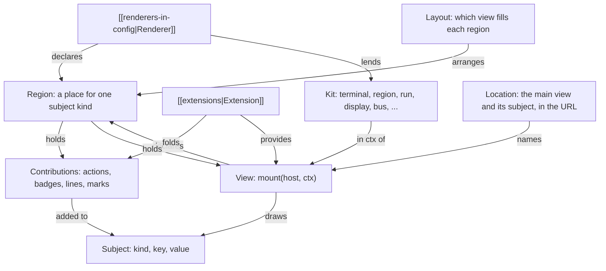
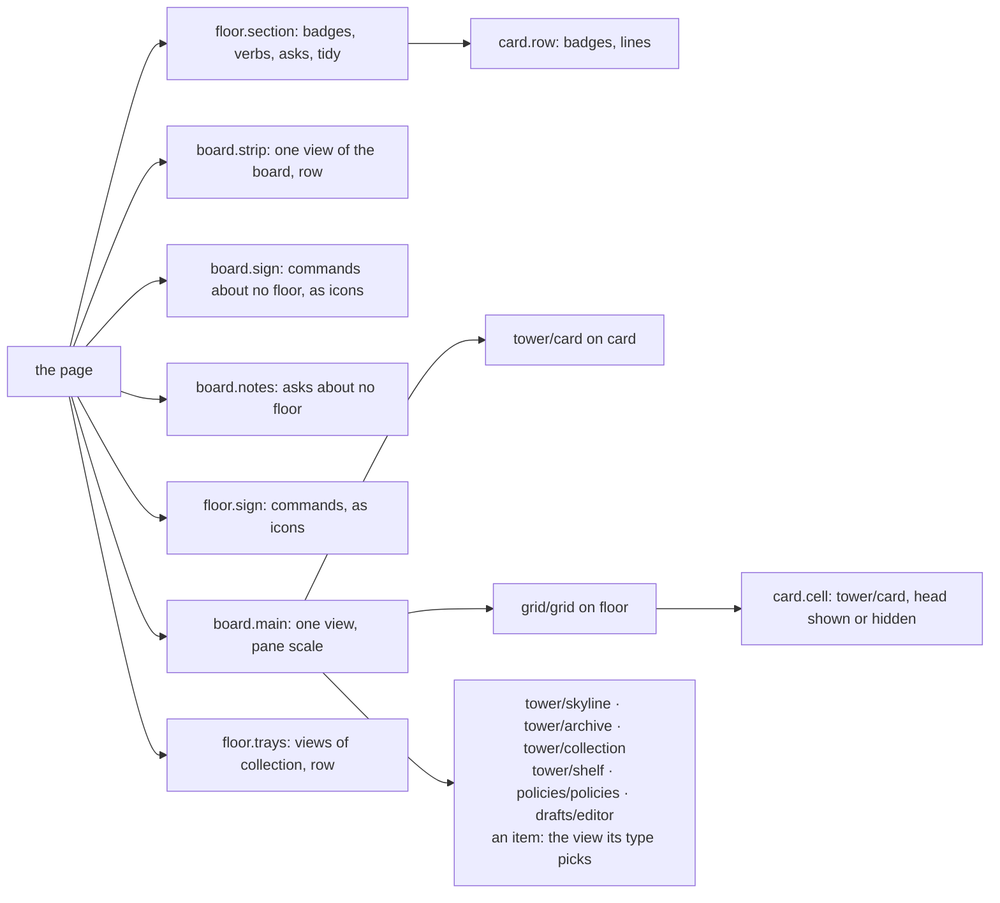
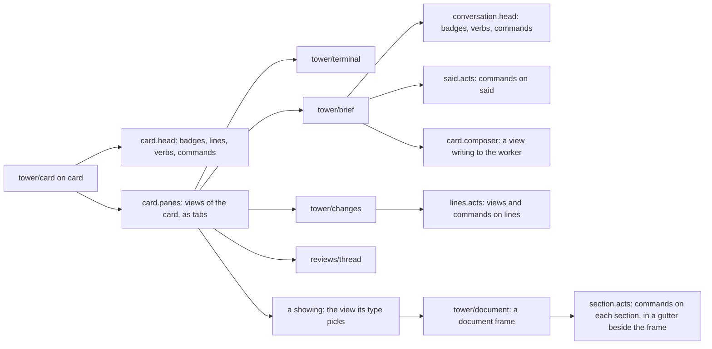
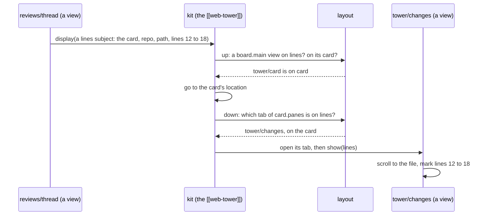

---
{
  "type": "decision",
  "name": "The UI model: regions, views, the layout, locations and display",
  "summary": "A renderer is made of regions, places it declares for one subject kind, which hold contributions extensions fold or views: modules that draw one subject into an element the region gives them, the core's and extensions' alike, given the board, the subject and the renderer's kit, never importing one another. The layout (the renderer's own, the config's, the viewer's) picks which view fills a region; where a renderer is, its location, is written in the URL by one grammar; display is the one navigation, placing a subject by walking its chain to the view that shows it. Extensions' commands and views take default chords on the subject in focus.",
  "in": "tower",
  "status": "accepted",
  "date": "2026-10-26",
  "reviewed": "2026-11-12",
  "refs": ["hub/src/shared/view-host.ts#viewHost", "hub/src/shared/view-host.ts#hostedHandlers", "hub/src/shared/views.ts#CORE_VIEWS", "hub/renderers/page/page.js#paintStrip", "hub/src/shared/views.ts#viewsOf", "hub/src/shared/views.ts#layoutOf", "hub/src/shared/views.ts#declaredLayout", "hub/src/shared/views.ts#offeredIn", "hub/src/shared/views.ts#pickView", "hub/src/shared/views.ts#displayed", "hub/src/shared/views.ts#openable", "hub/src/shared/views.ts#hashOf", "hub/src/shared/views.ts#locationOf", "hub/src/shared/views.ts#shortHashOf", "hub/src/shared/views.ts#viewOn", "hub/src/shared/views.ts#Kit", "hub/src/shared/views.ts#CommandKit", "hub/src/shared/views.ts#ViewCtx", "hub/src/shared/views.ts#Mounted", "hub/src/shared/extensions.ts#Manifest", "hub/src/shared/extensions.ts#ExtensionViewEntry", "hub/src/shared/extensions.ts#ViewerKind", "hub/src/bridge/extensions.ts#resolve", "hub/src/bridge/extensions.ts#withRendererLayouts", "hub/src/shared/keymap.ts#addedKeys", "hub/src/shared/keymap.ts#addedCommandOf", "hub/src/bridge/board.ts#boardOf", "hub/src/shared/run-command.ts#runCommandWith", "hub/src/shared/run-command.ts#NO_KIT", "hub/src/shared/regions.ts#landing", "hub/src/shared/shelf-page.ts#TowerVerb", "hub/renderers/page/view.js#mainViewOf", "hub/renderers/page/regions.js#regions", "hub/renderers/page/regions.js#CARDS_KEPT", "hub/src/views/card.ts#mount", "hub/src/views/terminal.ts#mount", "hub/src/views/brief.ts#mount", "hub/src/views/changes.ts#mount", "hub/src/views/link.ts#mount", "hub/src/shared/subjects.ts#shownSubject", "hub/renderers/page/view.js#hashOf", "hub/src/shared/views.ts#VIEW_ALIASES", "hub/src/shared/extensions.ts#LEGACY", "hub/extensions/reviews/client/thread.ts#mount", "hub/src/shared/views.ts#RegionHandle", "hub/src/shared/views.ts#RegionOptions", "hub/src/views/card.ts#CardOptions", "hub/src/shared/views.ts#TabWords", "hub/src/shared/subjects.ts#linesSubject", "hub/src/shared/subjects.ts#fileSubject", "hub/src/shared/subjects.ts#linkedFile", "hub/renderers/page/archive.js#archive", "hub/renderers/page/page.js#display", "hub/renderers/page/page.js#kitRegion", "hub/renderers/page/page.js#focusedSubject", "hub/src/views/skyline.ts#mount", "hub/src/views/archive.ts#mount", "hub/src/views/collection.ts#mount", "hub/src/views/shelf.ts#mount", "hub/src/shared/view-item.ts#typeView", "hub/src/views/document.ts#mount", "hub/src/views/video.ts#mount", "hub/src/shared/views.ts#coreViewOf", "hub/src/shared/media.ts#MEDIA_TYPES", "hub/extensions/drafts/client/editor.ts#mount", "hub/extensions/policies/client/view.ts#mount", "hub/src/tower/served.ts#CORE_VIEWS_DIR", "hub/renderers/page/renderer.json", "hub/examples/extensions/grid/extension.json", "hub/examples/extensions/grid/client/grid.js", "hub/examples/extensions/files/extension.json", "hub/examples/extensions/files/client/explorer.js", "hub/test/views.test.ts", "hub/docs/extending.md", "hub/extensions/reviews/client/anchors.ts#threadMarks", "hub/extensions/reviews/client/composer.ts#mount", "hub/extensions/reviews/server.ts", "hub/src/shared/adds.ts#marksOf", "hub/src/shared/views.ts#Bus", "hub/src/shared/views.ts#Mark", "hub/src/shared/view-sections.ts#drawSections", "hub/src/shared/toasts.ts#noticer", "hub/src/shared/views.ts#busOf", "hub/src/shared/subjects.ts#saidSubject", "hub/src/shared/subjects.ts#sectionSubject", "hub/src/shared/markdown.ts#sectionsOf", "hub/src/shared/markdown.ts#sectionLabels", "hub/src/shared/brief.ts#saidOf", "hub/src/shared/view-item.ts#Drawn", "hub/src/shared/view-frame.ts#writeLinks", "hub/renderers/page/page.js#linkHash", "hub/renderers/page/page.js#spawnFor", "hub/renderers/page/page.js#spawnTarget", "hub/renderers/page/page.js#frameKey", "hub/examples/extensions/narrate/extension.json", "hub/src/shared/views.ts#Pane", "hub/src/shared/views.ts#paneShows", "hub/src/shared/views.ts#shownOf", "hub/src/shared/subjects.ts#linesAt", "hub/src/views/tray.ts#mount", "hub/src/shared/items.ts#mountKeptTray", "hub/extensions/drafts/client/tray.ts#mount", "hub/extensions/reviews/client/tray.ts#mount", "hub/extensions/policies/client/tray.ts#mount", "hub/examples/extensions/tabline/extension.json", "hub/src/shared/regions.ts#CLI_REGIONS", "hub/src/shared/regions.ts#LayoutEntry", "hub/src/shared/regions.ts#overflowOf"]
}
---
**Problem.** An extension could add actions and badges to the board's subjects and run code in a renderer as a
command, but it could own no place on screen. A grid of workers' terminals had to lay an overlay over the tower page's
main pane, guess its z-index, close itself on any hash change and reach the page's xterm and keymap through globals:
no region to draw in, no place in navigation, two terminals on one worker, renderer facilities by side doors, no chord.

**Why.** The renderer is disposable ([[renderer-is-disposable]]) and every capability is reachable by every renderer
and worker ([[agents-have-every-capability]]): a pane of an extension's own needs a contract a renderer fills, not a
patch to one renderer's code. The model needs few terms that compose at every scale, so a grid cell, a worker's tab
and a framed document's section are the same thing.

**How.**
- *Regions* ([[renderers-in-config]]): a renderer declares, in its `renderer.json`, places for one subject kind
  (`board.main`, `card.panes`), each holding contributions or views at a scale (`chip`, `row`, `cell`, `pane`), one at
  a time or as tabs. A view declares the regions inside it in its manifest's `regions`; one id has one meaning, and two
  extensions declaring it with other fields are both refused ([`resolve`](ref:hub/src/bridge/extensions.ts#resolve)).
- *Views* ([`Manifest`](ref:hub/src/shared/extensions.ts#Manifest)'s `views`): a module's export `mount(host, ctx)`
  returning `{ update, show?, visible?, tab?, options?, close }` ([`Mounted`](ref:hub/src/shared/views.ts#Mounted)), on
  the kinds in `on`, handed those in `shows`, drawing the types it `accepts` at its `scales`, needing kit members.
  `ctx` ([`ViewCtx`](ref:hub/src/shared/views.ts#ViewCtx)) is the tower, the board, the subject, the kit, its own
  `state` in `tower.store`, its options, the `scale` its region declares and its location's `args`. A region handle's
  `options(next)` hands the view it holds new options, drawn in place by its `options`; a view without one is mounted
  afresh. A view never imports another and calls verbs only on a press inside it, wiring its own presses and bringing
  its styles in a `<style>` inside its host. A view's `on` may name `collection.<id>`, one collection alone
  ([`viewOn`](ref:hub/src/shared/views.ts#viewOn)). A view's `tab` export says, from the board, whether it has a tab on
  a subject and its tally; a mounted one's `tab()` says it from what it read, and a `tab` event on its host asks for
  the tab again ([`TabWords`](ref:hub/src/shared/views.ts#TabWords)).
- *The core's views* are [`CORE_VIEWS`](ref:hub/src/shared/views.ts#CORE_VIEWS), first in
  [`viewsOf`](ref:hub/src/shared/views.ts#viewsOf) and in the order that picks among them, their modules served at
  `/x/tower/<name>.js` from `src/views/` ([`CORE_VIEWS_DIR`](ref:hub/src/tower/served.ts#CORE_VIEWS_DIR)):
  [`tower/skyline`](ref:hub/src/views/skyline.ts#mount) on the board,
  [`tower/archive`](ref:hub/src/views/archive.ts#mount) on a floor,
  [`tower/collection`](ref:hub/src/views/collection.ts#mount) and [`tower/tray`](ref:hub/src/views/tray.ts#mount) on a
  collection, [`tower/shelf`](ref:hub/src/views/shelf.ts#mount) on a shelf entry, the worker view and its tabs, and the
  views by type. The drafts editor and the Policies panel are their extensions' views,
  [`drafts/editor`](ref:hub/extensions/drafts/client/editor.ts#mount) (on `item.drafts` and `collection.drafts`) and
  [`policies/policies`](ref:hub/extensions/policies/client/view.ts#mount) (on a floor).
- *The views by type* draw a kept item (`item.*`), a thing a worker showed (`shown`) and a checkout file (`file`), each
  accepting media types: `tower/document` markdown ([`mount`](ref:hub/src/views/document.ts#mount), in a frame where
  nothing runs, drawn by sections), `tower/html`, `tower/image`, [`tower/video`](ref:hub/src/views/video.ts#mount),
  `tower/text` (`text/*`, JSON, NDJSON) and `tower/file`, the fallback accepting none; and, on `shown` alone,
  [`tower/link`](ref:hub/src/views/link.ts#mount) for `text/uri-list`, an address a worker showed, whose subject
  carries the address as its body ([`shownSubject`](ref:hub/src/shared/subjects.ts#shownSubject)). Typed, an address
  is picked by the same rule as a file, so a layout taking markdown never takes it, and one taking `text/*` does. Each
  draws one body per type in its subject's frame ([`typeView`](ref:hub/src/shared/view-item.ts#typeView)): a kept item's
  under one head, with the way back to the floor's view of the extension declaring the item's collection; a showing's
  alone, filling its tab, whose head is `shown.head` and whose commands are drawn inside the open tab (`shown.tab`). An
  item's type is its file name's ([`MEDIA_TYPES`](ref:hub/src/shared/media.ts#MEDIA_TYPES): code as `text/plain`, so
  nothing a framed page loads from it runs as a script).
- *The worker view*: [`tower/card`](ref:hub/src/views/card.ts#mount) draws a worker's head and declares `card.panes`,
  its tabs, where the renderer mounts the views on the card: [`tower/terminal`](ref:hub/src/views/terminal.ts#mount),
  [`tower/brief`](ref:hub/src/views/brief.ts#mount) (shows `conversation` and `said`),
  [`tower/changes`](ref:hub/src/views/changes.ts#mount) (shows `lines`), the reviews extension's
  [`reviews/thread`](ref:hub/extensions/reviews/client/thread.ts#mount), then one tab per showing, drawn by the view its
  type picks in `card.panes` or by another view taking its type that the location's tab names. The page writes a
  showing's short hash only while its tab's view is the core's pick ([`hashOf`](ref:hub/renderers/page/view.js#hashOf)).
  A layout naming the retired `tower/shown` ([`LEGACY`](ref:hub/src/shared/extensions.ts#LEGACY)) reads as naming the
  views that draw showings ([`VIEW_ALIASES`](ref:hub/src/shared/views.ts#VIEW_ALIASES)).
- *Changes and reviews* meet through data, each reading only its own. Lines of a worker's changes are a `lines` viewer
  subject ([`linesSubject`](ref:hub/src/shared/subjects.ts#linesSubject)), which only the page that picked them holds.
  The reviews extension folds `marks` on each card, one per anchor of its thread
  ([`threadMarks`](ref:hub/extensions/reviews/client/anchors.ts#threadMarks)), which Changes draws on their lines as any
  extension's ([`marksOf`](ref:hub/src/shared/adds.ts#marksOf)). Under picked lines Changes fills `lines.acts`, a region
  holding commands and one view at `row` scale, where the reviews extension's
  [`reviews/composer`](ref:hub/extensions/reviews/client/composer.ts#mount) writes a note and, done, says so with a
  bubbling `done` event that lets the pick go. A note's anchor is `kit.display` of its lines, which opens Changes at
  them. Where an anchor's quote stands among the changes is the extension's own read, `anchors/<project>`, run on the
  [server](ref:hub/extensions/reviews/server.ts) against the core's `changes/<id>` while Reviews is seen: two diffs when
  both tabs are live, the price of neither view reading the other's data. A mark's `display` is in its type and drawn
  by no renderer: the thread subject it would name is of the floor, where no view lands, and the bus holds only what
  mounted views published, so the reviews extension leaves it out.
- *The kit* ([`Kit`](ref:hub/src/shared/views.ts#Kit)): what a renderer lends, `terminal`, `region`, `run`,
  `display`, `go`, `bus`, `toast`, `notice` (a toast standing until closed,
  [`noticer`](ref:hub/src/shared/toasts.ts#noticer)), `confirm`, `href`, `showing`, `location` (where the renderer is,
  read-only, told again through `update` as it changes) and `spawn`, named in its `renderer.json`; a view is offered
  only where the kit holds what it needs ([`offeredIn`](ref:hub/src/shared/views.ts#offeredIn)). `region` fills one of
  the renderer's regions inside a view (`item.head` in the drafts editor) with what extensions add to a subject, drawn
  and run the renderer's way ([`kitRegion`](ref:hub/renderers/page/page.js#kitRegion)), each hold in the element of the
  host marked to hold it (`data-holds="badges"`, `lines`, `actions`: the page's convention). A region holding views
  mounts them by the layout, a tabs region its tabs as (view, subject) pairs, and is handed `show` and `visible`
  ([`RegionHandle`](ref:hub/src/shared/views.ts#RegionHandle)); one holding a view beside contributions (`lines.acts`)
  draws both and is hidden while it holds neither ([`regions`](ref:hub/renderers/page/regions.js#regions)); a region of
  contributions may take `visible` too, which the page reads to forget the "new" dots it kept while the view is hidden
  ([[region-overflow]]); a region holding one view picks it again on every update, mounting it again when the pick
  changes. A command on a viewer subject runs on the subject its region was drawn on. A command is lent the part with
  no host ([`CommandKit`](ref:hub/src/shared/views.ts#CommandKit)) through
  [`runCommandWith`](ref:hub/src/shared/run-command.ts#runCommandWith); `runCommand` keeps its signature with
  [`NO_KIT`](ref:hub/src/shared/run-command.ts#NO_KIT).
- *Spawning from a view*: `run('spawn', subject)` opens the renderer's new-worker form on a floor, or on a draft, and
  goes to the worker it starts. `kit.spawn(on)` opens the same form for a view that keeps its place (the grid's New
  worker): it resolves with the id of the worker started, or with nothing once the form closes without one or the view
  closed first, the page then going to the worker; a form already open is brought back and answers its first asker
  ([`spawnFor`](ref:hub/renderers/page/page.js#spawnFor), over [`spawnTarget`](ref:hub/renderers/page/page.js#spawnTarget)).
  The form is the keymap's `spawn` command, so a command or a chord reaches it; `kit.spawn` exists for what `run` can't
  answer, the worker it started, with the view staying where it is.
- *The view host* ([`viewHost`](ref:hub/src/shared/view-host.ts#viewHost), served in `/lib/view.js`) mounts views for a
  renderer: a view's module imported by its whole address, the kit made from what the renderer lends, a member left out
  throwing its name, and the regions a view asks for filled, one view or one beside contributions by the host,
  contributions and tabs by the renderer's `fills`. The host follows nothing: the renderer hands it each board, tells
  it `visible` when it hides a view it keeps, and closes what it mounted. The page's
  [`regions`](ref:hub/renderers/page/regions.js#regions) is its user. Each view it mounts is a machine ([[machines]],
  [`hostedHandlers`](ref:hub/src/shared/view-host.ts#hostedHandlers)): importing, mounting under a timer, mounted,
  failed or closed. What the renderer asks before the mount settles (`show`, `visible`, new options) is handed to the
  view once it has; a mount that settles after its view failed or closed is closed at once; a failed view takes nothing
  more until closed.
- *Viewer subjects* are what a renderer page holds and the board never carries: their kinds are `file`, `lines`,
  `said`, `section` and `passage` ([`ViewerKind`](ref:hub/src/shared/extensions.ts#ViewerKind)); views, commands and
  regions may be on one, and no fold may. A `passage` is text picked in a file a view frames
  ([`passageSubject`](ref:hub/src/shared/passage.ts#passageSubject), [[passage-picks]]): it lives only in the
  `passage.acts` region the view asks for under the pick, and is never published on the bus. A file in a checkout, `file:<card>/<repo>/<path>`
  ([`fileSubject`](ref:hub/src/shared/subjects.ts#fileSubject)), is a child of its card like `lines`, carrying `text`,
  the read path its content is served at, `type`, its absolute path `file` when it has one (the binary fallback's Finder
  and editor buttons need it), and a `fragment` saying where to open it. It is how a view that browses a worker's files
  hands one to a region, where the layout picks among the views on `file`. A relative link in a markdown file of a
  checkout is another file of its repo ([`linkedFile`](ref:hub/src/shared/subjects.ts#linkedFile), [[markdown-safe]]),
  which `tower/document` displays: `displayed` walks up to its card, where a tab whose view `shows` `file` is chosen
  over the views by type on it, and the tabs region hands the file to that view. A prompt, an answer, or Claude's
  words on the way (side `step.<n>`) in the Brief ([`saidSubject`](ref:hub/src/shared/subjects.ts#saidSubject), of its
  conversation) and a section of a markdown document
  ([`sectionSubject`](ref:hub/src/shared/subjects.ts#sectionSubject), of the showing, item or shelf file it is part of)
  each carry their own text as `body` and their type.
- *The bus* ([`Bus`](ref:hub/src/shared/views.ts#Bus), [`busOf`](ref:hub/src/shared/views.ts#busOf)): the page holds
  one and lends it as `kit.bus`, and to commands. A view publishes what it drew under the subject it is of, and what it
  published is cleared as it closes, each publish cleared once, so one document in two grid cells stands until both
  close. The page resolves a key through the bus after the board, so a press, a chord with the focus on a subject's
  region and `display(key)` reach one. The bus also holds marks ([`Mark`](ref:hub/src/shared/views.ts#Mark)): what one
  capability says is happening to a key now, held apart from the published subjects so a view drawing its subject again
  draws them, told through `onMark` of the key's kind; whoever puts one lifts it. The Brief publishes every prompt and
  answer it draws ([`saidOf`](ref:hub/src/shared/brief.ts#saidOf)) and fills `said.acts` beside each copy. Under its
  scroll the Brief's foot holds `card.composer`, one view on the card at `row` scale that writes to the worker
  ([[submit-at-prompt]]); with no view offered there, or the layout hiding it, the foot takes no room.
- *Sections*: `tower/document`, and `tower/shelf` for an `md` entry's file, draw through
  [`drawSections`](ref:hub/src/shared/view-sections.ts#drawSections), which splits the source with
  [`sectionsOf`](ref:hub/src/shared/markdown.ts#sectionsOf) (before each heading of the shallowest level that occurs
  more than once) and draws a gutter beside the frame, in the page's document: one row per section, labelled by
  [`sectionLabels`](ref:hub/src/shared/markdown.ts#sectionLabels), each a `section.acts` region. The gutter holds
  contributions only and is hidden while no row holds any; a marked section's row and its part of the frame are lit.
  How the rows follow the frame, and why nothing is heard inside it, is [[markdown-safe]]'s. A body by type returns
  what it keeps ([`Drawn`](ref:hub/src/shared/view-item.ts#Drawn)), so both frames forward `show(section)`, which scrolls the
  frame, and `visible`. Links in a document frame are written where they go as it is drawn
  ([`writeLinks`](ref:hub/src/shared/view-frame.ts#writeLinks)). The narrate example
  ([`extension.json`](ref:hub/examples/extensions/narrate/extension.json)) is the proof: Listen on `section` and `said`,
  From here on `section`, reading the sections after it off the bus and marking the one it reads. A chord on a viewer
  kind resolves only with the focus on that subject's own region (a gutter row, a bubble), never on the viewer subjects
  under a subject in focus, which would be ambiguous with many sections standing; and `display` of a section of a
  `file` can't walk up, since [`displayed`](ref:hub/src/shared/views.ts#displayed) resolves parents on the board and a
  file is on neither the board nor the bus.
- *Values without code*: a value on a card needs no server and no renderer code: an extension declares a writable fact
  and projects it into the card's `lines` in its manifest ([[extensions]]), and the line lands in every region holding
  `lines` on a card (the page's `card.row` and `card.head`, Tower 3D's `card.desk`, the CLI's `card.whoami`). The card
  line example ([`tabline`](ref:hub/examples/extensions/tabline/extension.json)) writes through the fact's door from a
  command on the card, and a worker writes its own with `tower x`.
- *The layout* ([`layoutOf`](ref:hub/src/shared/views.ts#layoutOf)): three layers, the renderer's own, the config's
  `renderers.<r>.layout` and the viewer's in `tower.store`, each field from the highest that sets it, `hidden` the
  union less what a higher layer orders, or pins where that pin stands in the merge. An entry
  ([`LayoutEntry`](ref:hub/src/shared/regions.ts#LayoutEntry)) also takes the user's pins, overflow form and budgets
  ([[region-overflow]]). Under the three, the defaults an extension gives the regions it declares
  (`regions.<id>.layout` in its manifest: `order`, `hidden` and `options` alone) are laid by
  [`declaredLayout`](ref:hub/src/shared/views.ts#declaredLayout): a region only its extension knows has a default only
  that extension can give, and the user takes it back with a config line. An extension lays out only its own regions:
  the tower drops its layout of a region any renderer declares as it resolves
  ([`withRendererLayouts`](ref:hub/src/bridge/extensions.ts#withRendererLayouts)).
- *Picking a view* ([`pickView`](ref:hub/src/shared/views.ts#pickView)): for a typed subject, the first in the layout's
  order that accepts it, then the view of the extension declaring the subject's collection, then the core view whose
  `accepts` fits most specifically (`text/markdown` before `text/*`), then the most specific of the rest, then a
  fallback. So an extension's view takes a type no core view accepts by being installed, and any other only through the
  order: `tower/text` accepts `text/*`, so `text/csv` is the core's until a layout says otherwise.
  [`coreViewOf`](ref:hub/src/shared/views.ts#coreViewOf) is the core's view for a type alone: the tower page's
  `#kept/
/<c>/<id>` names it, and `shortHashOf` writes that hash back for it alone. A subject bearing no type (a
  floor, a collection) is drawn by the order's first, then the view of the extension declaring its collection when
  that view is on its exact kind (`collection.<id>`), then the first offered, the core's first. So the untyped
  `display` of the drafts collection opens a new draft in `drafts/editor`, and what means the whole listing names
  `tower/collection`. A full region draws a prefix of its ranked list in place
  ([`overflowOf`](ref:hub/src/shared/regions.ts#overflowOf)); how a view and the region inside it share a head through
  `data-tuck` marks is [[region-overflow]]'s.
- *Row regions*: the tower page's `board.strip`, at the top of the sidebar, is a `row` region on the board: the one
  view the layout picks stays mounted for as long as the page is open, whatever the main pane shows, so an extension
  can keep something in sight or play it. The page paints it only when a view draws it
  ([`paintStrip`](ref:hub/renderers/page/page.js#paintStrip)). `floor.trays` is a `row` region on each collection of an
  open floor ([[collection-trays]]): the region moves into the sidebar's placeholder per collection a host kept mounted
  by the collection's key through redraws, closed when the collection leaves the board or its pick changes, so a press
  that went down before the board arrived still clicks its control. A row region's layout `order` also places its rows:
  the page's `renderer.json` orders `drafts/tray`, `reviews/tray` and `policies/tray` first, its own trays after.
  [`tower/tray`](ref:hub/src/views/tray.ts#mount) draws any collection
  ([`mountKeptTray`](ref:hub/src/shared/items.ts#mountKeptTray)); the drafts, reviews and policies extensions draw
  their own ([`drafts/tray`](ref:hub/extensions/drafts/client/tray.ts#mount),
  [`reviews/tray`](ref:hub/extensions/reviews/client/tray.ts#mount),
  [`policies/tray`](ref:hub/extensions/policies/client/tray.ts#mount)), picked by the owner rule with no layout line,
  each marking what the main pane has open through `kit.location`.
- *Locations* ([`hashOf`](ref:hub/src/shared/views.ts#hashOf), [`locationOf`](ref:hub/src/shared/views.ts#locationOf)):
  `{ view, subject?, pane?, args? }` in the URL as
  `#v/<cap>/<name>[/<key>[/<arg>…]][;<cap>/<name>[/<key>[/<shows>[/<arg>…]]]]`, each key and arg one encoded segment,
  so `;` only starts the pane. A pane ([`Pane`](ref:hub/src/shared/views.ts#Pane)) names its tab's view and subject,
  `shows`, the key of a subject below that one the tab shows (a checkout file in the files example's explorer), and
  `args`, where in it (a link's fragment). The tower page's older hashes are short forms read as the views they name,
  and the page keeps writing them ([`shortHashOf`](ref:hub/src/shared/views.ts#shortHashOf)).
- *Display* ([`displayed`](ref:hub/src/shared/views.ts#displayed)): the one navigation, `kit.display(subject, { view?
  })` or `tower.ui('display')` from a framed page ([`TowerVerb`](ref:hub/src/shared/shelf-page.ts#TowerVerb)). It walks
  the subject's chain outward to the nearest level whose main view hosts the one below as a tab, else the first level
  with a main view; a view given narrows the walk, as a tab before the main view. A tab is a view on the level or the
  subject below it, or one showing the kind of a subject below the level, never of the level itself: a view showing
  cards (the grid) is no tab of a card. The renderer mounts the location and hands the view `show(subject)` when it is
  on a subject above; a view given that is mounted and takes it stays, and when it is on that subject's kind the
  location follows it there with no remount (a new draft, on its item once its first save is on the board). The tower
  page's [`display`](ref:hub/renderers/page/page.js#display) opens a worker the board doesn't carry as a read subject
  when a view hands it the card (the archive's), else once the board carries it when the page started it, else after
  looking it up in the floors' archives, a lookup any move of the viewer's cancels ([[web-tower]]). `kit.href(to)` is the hash of the renderer's page that goes to a location or displays a
  subject, for a link in a frame where nothing runs, which can only navigate; no view needs it, so a renderer without
  it still hosts `tower/document` and `tower/shelf`, whose links to other files then draw refused. In the tower page a
  subject's ([`linkHash`](ref:hub/renderers/page/page.js#linkHash)) is the location `display` puts it at. A subject a
  tab hosts is in its pane's `shows` ([`paneShows`](ref:hub/src/shared/views.ts#paneShows)), its `fragment` the pane's
  arg, so a viewer subject with a parent has an address though the board never holds it. Reading one, the page's tabs
  region hands the open tab `show` with a subject built from the key
  ([`shownOf`](ref:hub/src/shared/views.ts#shownOf)); each hosted kind's view reads a subject by its key: the Brief a
  `said`, Changes a `lines` ([`linesAt`](ref:hub/src/shared/subjects.ts#linesAt)), the files example's explorer a
  `file`. The other way, a view tells the kit what it shows (`kit.showing`): in the tab the location names, the
  location follows in place, so a tree click replaces the history entry, a followed link pushes one, and Back returns
  to the file left. A hash naming the view in place with other `args` (a shelf entry's other file) mounts it afresh,
  since a view reads its `args` once.
- *Focus* ([`focusedSubject`](ref:hub/renderers/page/page.js#focusedSubject)): the subject of the innermost region
  holding the document's focus, else the main pane's, a viewer subject read from the bus; chords and `kit.run` resolve
  there.
- *Keys* ([[keymap]]): `commands.<c>.keys` and `views.<v>.keys` give default chords, global, by `<cap>/<name>` in
  `board.keys` ([`addedKeys`](ref:hub/src/shared/keymap.ts#addedKeys)). The config's choice wins; a default colliding
  with the keymap's, a renderer's `keeps`, a configured chord or another extension's default is dropped, both in the
  last case, each a problem on its extension. From a script frame only a view's chord resolves
  ([`frameKey`](ref:hub/renderers/page/page.js#frameKey)): a command's is code, and any script can claim a key.
- *The page* ([[web-tower]]) hosts every view of its main pane through
  [`regions`](ref:hub/renderers/page/regions.js#regions); its click switchboard leaves a view's presses to the view,
  but for the regions it fills there. Where a `one` region would close its view as the location leaves, the page keeps
  the workers left last drawn and hidden ([`CARDS_KEPT`](ref:hub/renderers/page/regions.js#CARDS_KEPT)), each told
  `visible(false)`, so a worker is as it was left when gone back to. A worker the board left is a read subject the page
  holds ([`archive`](ref:hub/renderers/page/archive.js#archive)).
- *The grid* ([`examples/extensions/grid`](ref:hub/examples/extensions/grid/extension.json)) proves the model: reloaded
  at its location, its cells and head toggle kept in its state, each cell its own region `card.cell`, holding
  `tower/card` at cell scale with the `head` option the toggle sets. `tower/card` draws no close at `cell`, where
  leaving for the skyline would take the grid away, and the view holding it speaks to it through its options
  ([`CardOptions`](ref:hub/src/views/card.ts#CardOptions)): `acts`, the host's own controls at the end of the head,
  `pick`, the callsign as a menu of other workers, and `omit`, commands its head leaves out, which a contributions
  region takes as its options ([`RegionOptions`](ref:hub/src/shared/views.ts#RegionOptions)). The card answers with a
  bubbling `act` or `pick` event on its host. So the host's controls are data the card draws, the grid's CSS never
  reaches into the card, and the grid's toggle hands each cell new options in place, keeping its tab and scroll.
- *The files example* ([`examples/extensions/files`](ref:hub/examples/extensions/files/extension.json)) is the model's
  test from a real ask: a tab on every worker built on the extension contract alone. Its reads are confined to the
  worker's checkout by the extension ([[extensions]]); a file opened is a `file` subject handed to `file.open`, a region
  it declares whose default layout puts its own `files/code` first, the core's views by type drawing the rest. It is
  live while seen by a poll of `git status` and of the open file, nothing while hidden
  ([`explorer.js`](ref:hub/examples/extensions/files/client/explorer.js)). Its explorer `shows` `file`: a file of its
  worker displayed from anywhere, a link followed in a document among them, opens in its tree at the link's fragment.

The model in one picture:

The tower page's regions (`renderers/page/renderer.json`):

The worker view's regions:

Display, a note's anchor opening its lines:

**Alternatives considered.**
- Views keyed by renderer and region in the manifest: it puts placement in the extension, which belongs to the
  renderer and the layout.
- A bare region for extensions to draw into, outside navigation: no location, so no reload or Back, and the page's
  own view stays mounted under it (two terminals on one worker).
- Shadow DOM for a view's host: it would keep the renderer's styles out of the regions the renderer draws inside a
  view, and switching later would break every view.
- A second list order instead of `shows` (the first kind mounts, the rest are shown): it doesn't fit views that mount
  on two kinds.
- A `styles` field naming a served stylesheet per view: a view brings its styles in a `<style>` inside its host, so it
  still draws only inside its host and nothing new is served.
- The grid's controls as commands on `card` drawn in `card.head`: taking a worker out and swapping act on the grid's
  own state, which no command reaches; and a slot of the card's head that the host fills with its own elements would be
  the host drawing inside another view.
- A frame reporting where its sections are, or the renderer's controls drawn inside a document frame with author CSS
  stripped: the frame's document is the author's, and a deny list of what can paint over a control in it would be kept
  forever. Sections come from the source the view holds, and their commands sit beside the frame.

**Impact.** An extension's view is a place on screen any renderer hosting views mounts, reachable by location,
display, the palette and a chord, with no renderer code of its own. The tower page's main pane, a worker's tabs, the
grid's cells and the sidebar's trays and strip are all views on that contract.
