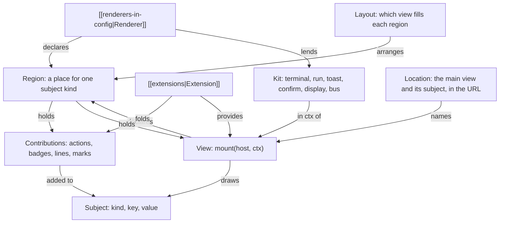
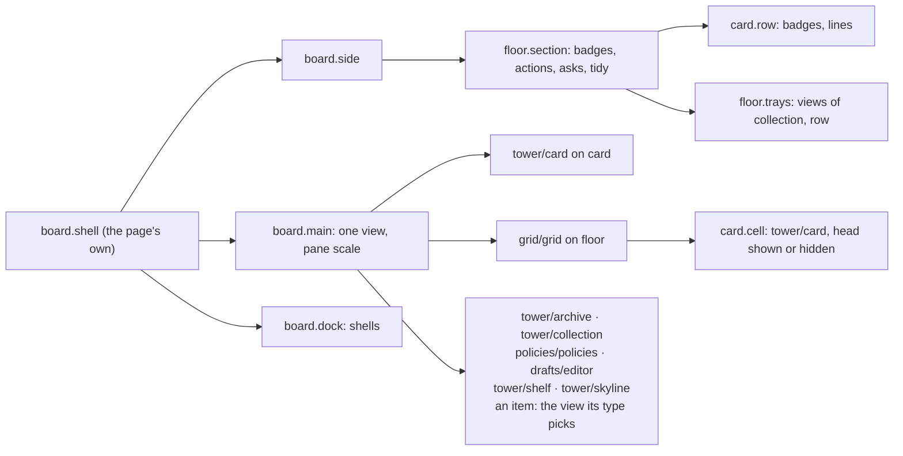
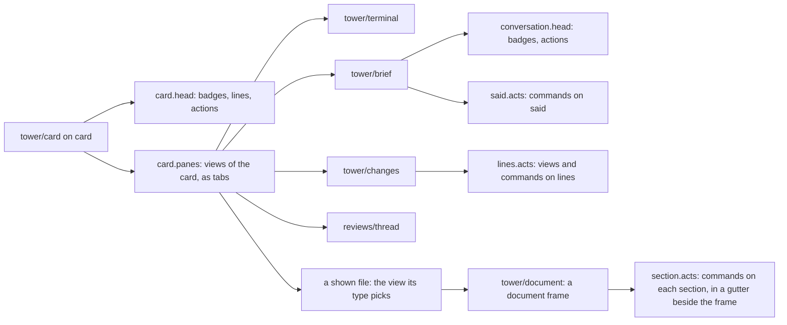
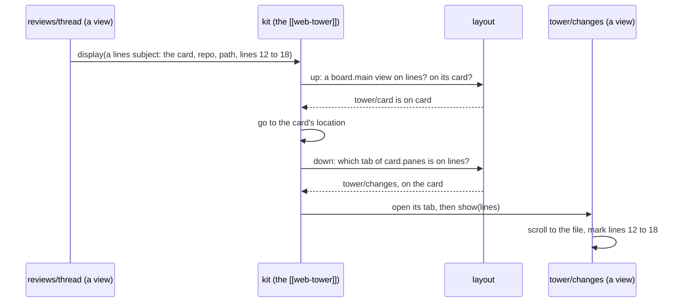
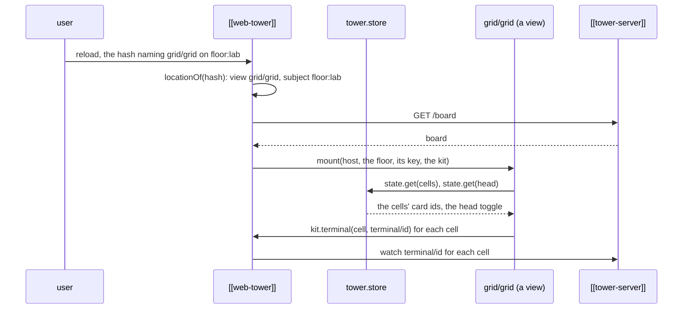
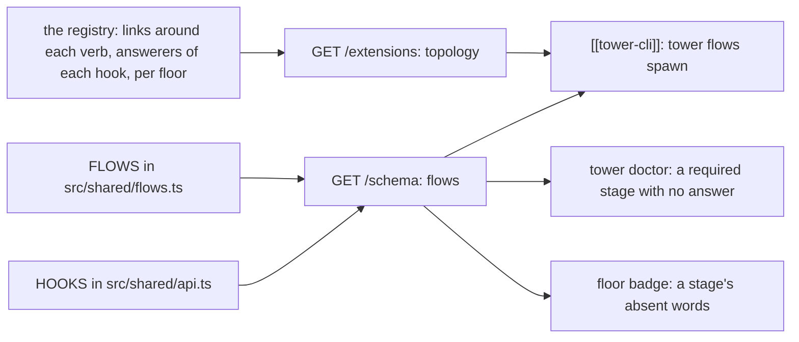

---
{
  "type": "decision",
  "name": "The UI model: regions, views, the layout, locations and display",
  "summary": "A renderer is made of regions, places it declares for one subject kind, which hold contributions extensions fold or views: modules that draw one subject into an element the region gives them, the core's and extensions' alike, given the board, the subject and the renderer's kit, never importing one another. The layout (the renderer's own, the config's, the viewer's) picks which view fills a region; where a renderer is, its location, is written in the URL by one grammar; display is the one navigation, placing a subject by walking its chain to the view that shows it. Extensions' commands and views take default chords on the subject in focus.",
  "in": "tower",
  "status": "accepted",
  "date": "2026-10-26",
  "reviewed": "2026-10-29",
  "refs": ["hub/src/shared/views.ts#CORE_VIEWS", "hub/src/shared/views.ts#viewsOf", "hub/src/shared/views.ts#layoutOf", "hub/src/shared/views.ts#offeredIn", "hub/src/shared/views.ts#pickView", "hub/src/shared/views.ts#displayed", "hub/src/shared/views.ts#openable", "hub/src/shared/views.ts#hashOf", "hub/src/shared/views.ts#locationOf", "hub/src/shared/views.ts#shortHashOf", "hub/src/shared/views.ts#viewOn", "hub/src/shared/views.ts#Kit", "hub/src/shared/views.ts#CommandKit", "hub/src/shared/extensions.ts#Manifest", "hub/src/shared/extensions.ts#ExtensionViewEntry", "hub/src/bridge/extensions.ts#resolve", "hub/src/shared/keymap.ts#addedKeys", "hub/src/shared/keymap.ts#addedCommandOf", "hub/src/bridge/board.ts#boardOf", "hub/src/shared/adds.ts#runCommandWith", "hub/src/shared/adds.ts#NO_KIT", "hub/src/shared/regions.ts#landing", "hub/src/shared/shelf-page.ts#TowerVerb", "hub/renderers/page/view.js#mainViewOf", "hub/renderers/page/regions.js#regions", "hub/src/views/card.ts#mount", "hub/src/views/terminal.ts#mount", "hub/src/views/brief.ts#mount", "hub/src/views/changes.ts#mount", "hub/src/views/shown.ts#mount", "hub/extensions/reviews/client/thread.ts#mount", "hub/src/shared/views.ts#RegionHandle", "hub/src/shared/views.ts#TabWords", "hub/src/shared/subjects.ts#linesSubject", "hub/renderers/page/archive.js#archive", "hub/renderers/page/page.js#display", "hub/renderers/page/page.js#kitRegion", "hub/renderers/page/page.js#focusedSubject", "hub/src/views/skyline.ts#mount", "hub/src/views/archive.ts#mount", "hub/src/views/collection.ts#mount", "hub/src/views/shelf.ts#mount", "hub/src/views/item.ts#itemView", "hub/src/views/document.ts#mount", "hub/src/views/video.ts#mount", "hub/src/shared/views.ts#coreViewOf", "hub/src/shared/media.ts#MEDIA_TYPES", "hub/extensions/drafts/client/editor.ts#mount", "hub/extensions/policies/client/view.ts#mount", "hub/src/tower/served.ts#CORE_VIEWS_DIR", "hub/renderers/page/renderer.json", "hub/examples/extensions/grid/extension.json", "hub/examples/extensions/grid/client/grid.js", "hub/test/views.test.ts", "hub/docs/extending.md"]
}
---
**Problem.** An extension could add actions and badges to the board's subjects, and run code in a renderer as a
command, but it could own no place on screen. A grid of workers' terminals (the extensions probe's P3) had to lay an
overlay over the tower page's main pane, guess its z-index, close itself on any hash change, and reach the page's xterm
and keymap through globals: no region to draw in, no place in navigation, two terminals on one worker, renderer
facilities by side doors, no chord.

**Why.** The renderer is disposable ([[renderer-is-disposable]]) and every capability is reachable by every renderer
and worker ([[agents-have-every-capability]]): a pane of an extension's own needs a contract a renderer fills, not a
patch to one renderer's code. The model needs few terms that compose at every scale, so a grid cell, a worker's tab
and a framed document's section are the same thing.

**How.**
- *Regions* ([[renderers-in-config]]): a renderer declares, in its `renderer.json`, places for one subject kind
  (`board.main`, `card.panes`), each holding contributions or views at a scale (`chip`, `row`, `cell`, `pane`), one at
  a time or as tabs. A view declares the regions inside it in its manifest's `regions`; one id has one meaning, and two
  extensions declaring it with other fields are both refused ([`resolve`](ref:hub/src/bridge/extensions.ts#resolve)).
- *Views* ([`Manifest`](ref:hub/src/shared/extensions.ts#Manifest)'s `views`, since 1.104 in this shape): a module's
  export `mount(host, ctx)` returning `{ update, show?, visible?, close }`, on the kinds in `on`, handed those in
  `shows`, drawing those types it `accepts` at its `scales`, needing kit members. `ctx` is the tower, the board, the
  subject, the kit, its own `state` in `tower.store` and its options. A view never imports another and calls verbs only
  on a press inside it, wiring its own presses and bringing its styles in a `<style>` inside its host. A view's `on`
  may name `collection.<id>`, one collection alone ([`viewOn`](ref:hub/src/shared/views.ts#viewOn), since 1.108).
  The core's are [`CORE_VIEWS`](ref:hub/src/shared/views.ts#CORE_VIEWS), first in
  [`viewsOf`](ref:hub/src/shared/views.ts#viewsOf), in the order that picks among them, their modules served at
  `/x/tower/<name>.js` from `src/views/` ([`CORE_VIEWS_DIR`](ref:hub/src/tower/served.ts#CORE_VIEWS_DIR)) since
  1.108: [`tower/skyline`](ref:hub/src/views/skyline.ts#mount), [`tower/archive`](ref:hub/src/views/archive.ts#mount),
  [`tower/collection`](ref:hub/src/views/collection.ts#mount) and [`tower/shelf`](ref:hub/src/views/shelf.ts#mount).
  The drafts editor and the Policies panel are their extensions' views,
  [`drafts/editor`](ref:hub/extensions/drafts/client/editor.ts#mount) (on `item.drafts` and `collection.drafts`) and
  [`policies/policies`](ref:hub/extensions/policies/client/view.ts#mount) (on a floor). A kept item is drawn by the
  views by type (since 1.109), each on `item.*` and accepting media types: `tower/document` markdown
  ([`documentHtml`](ref:hub/src/views/document.ts#mount) in a frame where nothing runs), `tower/html`, `tower/image`,
  [`tower/video`](ref:hub/src/views/video.ts#mount), `tower/text` (`text/*`, JSON, NDJSON) and `tower/file`, the
  fallback accepting none; one head serves them all ([`itemView`](ref:hub/src/views/item.ts#itemView)), with the way
  back to the floor's view of the extension declaring the item's collection. An item's type is its file name's
  ([`MEDIA_TYPES`](ref:hub/src/shared/media.ts#MEDIA_TYPES): code as `text/plain`, so nothing a framed page loads
  from it runs as a script). The worker view is views since 1.111: [`tower/card`](ref:hub/src/views/card.ts#mount)
  draws a worker's head and declares `card.panes`, its tabs, where the renderer mounts the views on the card,
  [`tower/terminal`](ref:hub/src/views/terminal.ts#mount), [`tower/brief`](ref:hub/src/views/brief.ts#mount) (shows
  `conversation`), [`tower/changes`](ref:hub/src/views/changes.ts#mount) (shows `lines`) and the reviews extension's
  [`reviews/thread`](ref:hub/extensions/reviews/client/thread.ts#mount), then one tab per showing, drawn by
  [`tower/shown`](ref:hub/src/views/shown.ts#mount), today's switch on a showing's kind until shown files are drawn by
  the views by type. A view's `tab` export says, from the board, whether it has a tab on a subject and its tally; a
  mounted one's `tab()` says it from what it read, and a `tab` event on its host asks for the tab again
  ([`TabWords`](ref:hub/src/shared/views.ts#TabWords)). Until step 6 each tab reads what it needs itself: Changes
  reads the thread for its notes' marks, Reviews the Changes against the default branch for its quotes, and a note's
  lines are a `lines` subject ([`linesSubject`](ref:hub/src/shared/subjects.ts#linesSubject)) displayed into Changes.
- *The kit* ([`Kit`](ref:hub/src/shared/views.ts#Kit)): what a renderer lends, `terminal`, `region`, `run`,
  `display`, `go`, `toast`, `confirm`, named in its `renderer.json`; a view is offered only where the kit holds what it
  needs. `region` (since 1.108) fills one of the renderer's regions inside a view, `item.head` in the drafts editor,
  with what extensions add to a subject, drawn and run the renderer's way
  ([`kitRegion`](ref:hub/renderers/page/page.js#kitRegion)), each hold in the element of the host marked to hold it
  (`data-holds="badges"`, `lines`, `actions`: the page's convention, so one head draws them in three places). A region
  holding views mounts them by the layout, a tabs region its tabs as (view, subject) pairs, and is handed `show` and
  `visible` ([`RegionHandle`](ref:hub/src/shared/views.ts#RegionHandle), since 1.111). `run('spawn', subject)`
  opens the renderer's new-worker form on a floor, or on a draft, which is deleted once a worker starts on it. A command is
  lent the part with no host ([`CommandKit`](ref:hub/src/shared/views.ts#CommandKit)) through
  [`runCommandWith`](ref:hub/src/shared/adds.ts#runCommandWith); `runCommand` keeps its signature with
  [`NO_KIT`](ref:hub/src/shared/adds.ts#NO_KIT).
- *The layout* ([`layoutOf`](ref:hub/src/shared/views.ts#layoutOf)): three layers, the renderer's own, the config's
  `renderers.<r>.layout` and the viewer's in `tower.store`, each field from the highest that sets it, `hidden` the
  union less what a higher layer orders. [`pickView`](ref:hub/src/shared/views.ts#pickView) picks the view a region
  draws a subject with: the layout's order, then the view of the extension declaring the subject's collection, then
  the core view whose `accepts` fits most specifically (`text/markdown` before `text/*`), then the most specific of
  the rest, then a fallback. [`coreViewOf`](ref:hub/src/shared/views.ts#coreViewOf) is the core's view for a type
  alone: the tower page's `#kept/
/<c>/<id>` names it, and `shortHashOf` writes that hash back for it alone.
- *Locations* ([`hashOf`](ref:hub/src/shared/views.ts#hashOf), [`locationOf`](ref:hub/src/shared/views.ts#locationOf)):
  `{ view, subject?, pane?, args? }` in the URL as `#v/<cap>/<name>[/<key>[/<arg>…]][;<cap>/<name>[/<key>]]`, each key
  and arg one encoded segment, so `;` only starts the pane. The tower page's older hashes are short forms read as the
  core views they name, and the page keeps writing them ([`shortHashOf`](ref:hub/src/shared/views.ts#shortHashOf)).
- *Display* ([`displayed`](ref:hub/src/shared/views.ts#displayed)): the one navigation, `kit.display(subject, { view?
  })` or `tower.ui('display')` from a framed page. It walks the subject's chain outward to the nearest level whose
  main view hosts the one below as a tab, else the first level with a main view; a view given narrows the walk, as a
  tab before the main view. The renderer mounts the location and hands the view `show(subject)` when it is on a
  subject above; a view given that is mounted and takes it stays, and when it is on that subject's kind the location
  follows it there with no remount (a new draft, on its item once its first save is on the board). The tower page's
  [`display`](ref:hub/renderers/page/page.js#display) opens a worker the board doesn't carry as a read subject when a
  view hands it the card (the archive's), else after reading the floors' archives, else once the board carries it when
  the page started it: its own spawns and resumes, and any its views started through the `tower` it lends them.
- *Focus* ([`focusedSubject`](ref:hub/renderers/page/page.js#focusedSubject)): the subject of the innermost region
  holding the document's focus, else the main pane's; chords and `kit.run` resolve there.
- *Keys* (D5): `commands.<c>.keys` and `views.<v>.keys` give default chords, global, by `<cap>/<name>` in
  `board.keys` ([`addedKeys`](ref:hub/src/shared/keymap.ts#addedKeys), [[keymap]]). The config's choice wins; a
  default colliding with the keymap's, a renderer's `keeps`, a configured chord or another extension's default is
  dropped, both in the last case, each a problem on its extension. From a script frame only a view's chord resolves.
- *The page* ([[web-tower]]) hosts every view of its main pane, the worker's since 1.111, through
  [`regions`](ref:hub/renderers/page/regions.js#regions), drawn and hashed as before (`#<id>/changes` is a worker on its
  Changes tab); its click switchboard leaves a view's presses to the view, but for the regions it fills there. Over
  §6's rule that a `one` region closes its view as the location leaves, the page keeps the four workers left last
  drawn and hidden, each told `visible(false)` and never a close it didn't get, so a worker is as it was left when
  gone back to (its tab, its panes' scroll, its pick, its terminal streaming); a showing's tab is kept across workers
  up to eight. A worker the board left is a read subject the page holds
  ([`archive`](ref:hub/renderers/page/archive.js#archive)). The grid of
  terminals ([`examples/extensions/grid`](ref:hub/examples/extensions/grid/extension.json)) proves it: reloaded at its
  location, its cells and head toggle kept in its state.

The model in one picture:

The tower page as regions, the worker and a kept item drawn by its routes until their views ship:

The card as regions, as the worker view's tabs become views:

Display, a note's anchor opening its lines:

The grid, reloaded:

A flow listed, where a verb's points of contact are read:

**Alternatives considered.**
- Views keyed by renderer and region in the manifest (the reserved shape): it put placement in the extension, which
  belongs to the renderer and the layout. Replaced as a minor, since no manifest used it.
- A bare region for extensions to draw into, outside navigation: no location, so no reload or Back, and the page's
  own view stays mounted under it (two terminals on one worker).
- Shadow DOM for a view's host: it would keep the renderer's styles out of the regions the renderer draws inside a
  view, and switching later would break every view.
- A second list order instead of `shows` (the first kind mounts, the rest are shown): it doesn't fit views that mount
  on two kinds.
- Core views as modules from the start: every main-pane route rewritten at once on the surface used all day. They
  stayed the page's routes, mapped from their locations, and ship as modules one step at a time: the main pane's in
  step 4, the worker's in 5a.
- A `styles` field naming a served stylesheet per view: a view brings its styles in a `<style>` inside its host, as
  the grid does, so it still draws only inside its host and nothing new is served.
- A draft's new-worker form as a kit member: it is the keymap's `spawn` command, run on the draft, so a command or a
  chord reaches it the same way.

**Impact.** An extension's view is a place on screen any renderer hosting views mounts, reachable by location,
display, the palette and a chord, with no renderer code of its own. The tower page's main pane hosts them; the worker
view's tabs are views on that contract since 1.111; the sidebar's trays and the grid's cells follow on it.
