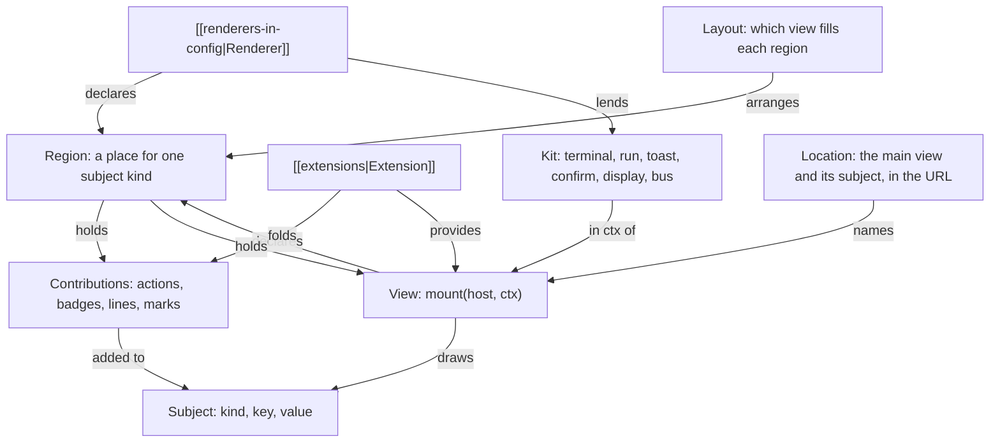
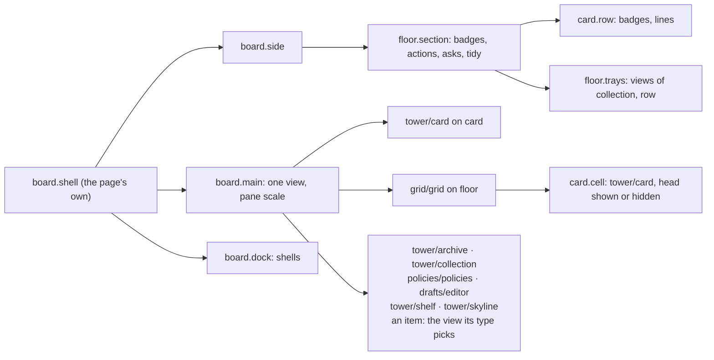
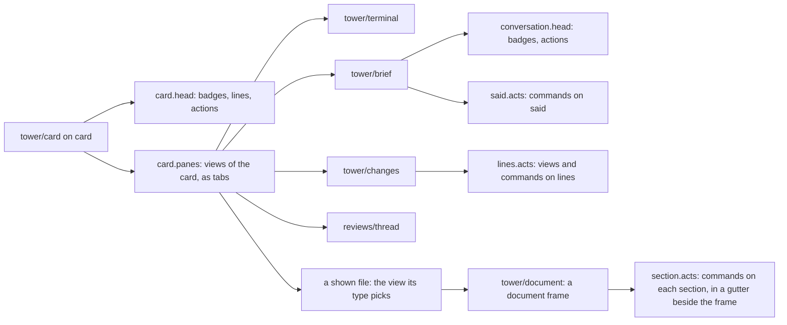
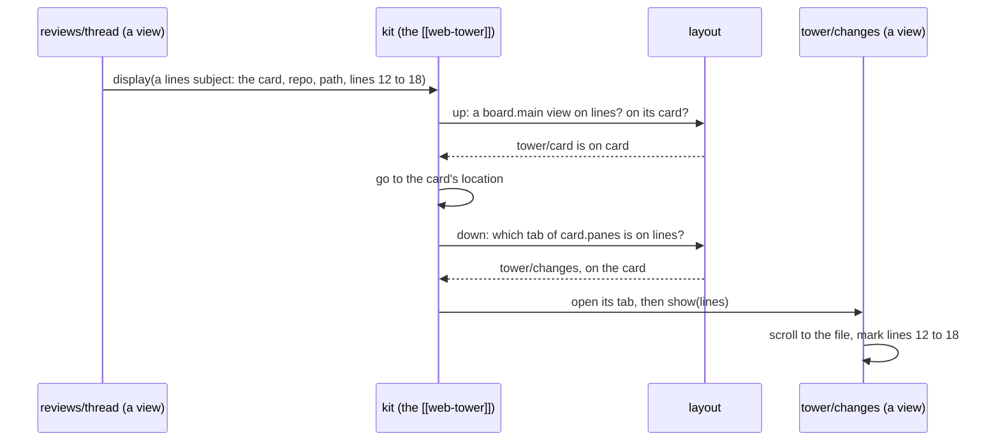
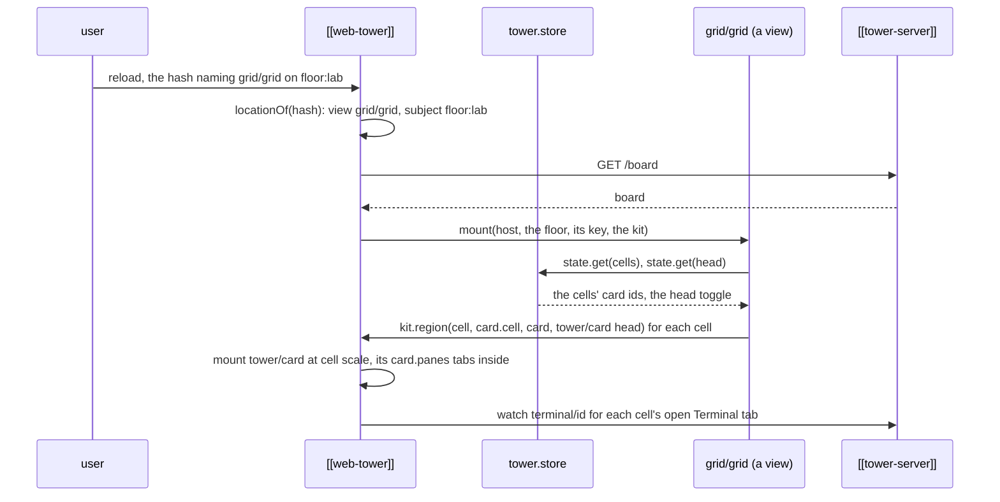
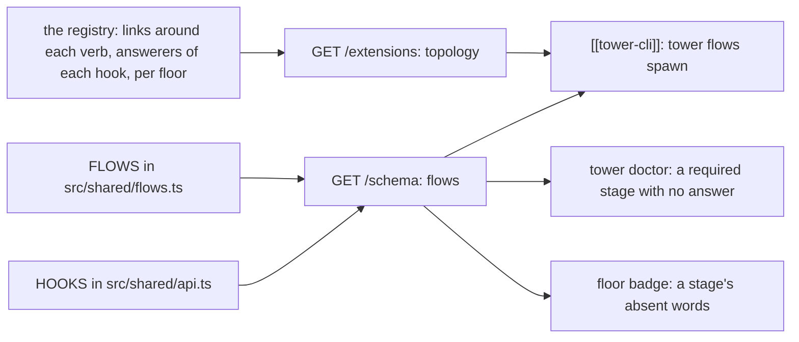

---
{
  "type": "decision",
  "name": "The UI model: regions, views, the layout, locations and display",
  "summary": "A renderer is made of regions, places it declares for one subject kind, which hold contributions extensions fold or views: modules that draw one subject into an element the region gives them, the core's and extensions' alike, given the board, the subject and the renderer's kit, never importing one another. The layout (the renderer's own, the config's, the viewer's) picks which view fills a region; where a renderer is, its location, is written in the URL by one grammar; display is the one navigation, placing a subject by walking its chain to the view that shows it. Extensions' commands and views take default chords on the subject in focus.",
  "in": "tower",
  "status": "accepted",
  "date": "2026-10-26",
  "reviewed": "2026-10-31",
  "refs": ["hub/src/shared/views.ts#CORE_VIEWS", "hub/src/shared/views.ts#viewsOf", "hub/src/shared/views.ts#layoutOf", "hub/src/shared/views.ts#declaredLayout", "hub/src/shared/views.ts#offeredIn", "hub/src/shared/views.ts#pickView", "hub/src/shared/views.ts#displayed", "hub/src/shared/views.ts#openable", "hub/src/shared/views.ts#hashOf", "hub/src/shared/views.ts#locationOf", "hub/src/shared/views.ts#shortHashOf", "hub/src/shared/views.ts#viewOn", "hub/src/shared/views.ts#Kit", "hub/src/shared/views.ts#CommandKit", "hub/src/shared/extensions.ts#Manifest", "hub/src/shared/extensions.ts#ExtensionViewEntry", "hub/src/bridge/extensions.ts#resolve", "hub/src/shared/keymap.ts#addedKeys", "hub/src/shared/keymap.ts#addedCommandOf", "hub/src/bridge/board.ts#boardOf", "hub/src/shared/adds.ts#runCommandWith", "hub/src/shared/adds.ts#NO_KIT", "hub/src/shared/regions.ts#landing", "hub/src/shared/shelf-page.ts#TowerVerb", "hub/renderers/page/view.js#mainViewOf", "hub/renderers/page/regions.js#regions", "hub/src/views/card.ts#mount", "hub/src/views/terminal.ts#mount", "hub/src/views/brief.ts#mount", "hub/src/views/changes.ts#mount", "hub/src/views/link.ts#mount", "hub/src/shared/subjects.ts#shownSubject", "hub/renderers/page/view.js#hashOf", "hub/src/shared/views.ts#VIEW_ALIASES", "hub/src/shared/extensions.ts#LEGACY", "hub/extensions/reviews/client/thread.ts#mount", "hub/src/shared/views.ts#RegionHandle", "hub/src/shared/views.ts#RegionOptions", "hub/src/views/card.ts#CardOptions", "hub/src/shared/views.ts#TabWords", "hub/src/shared/subjects.ts#linesSubject", "hub/src/shared/subjects.ts#fileSubject", "hub/src/shared/subjects.ts#linkedFile", "hub/renderers/page/archive.js#archive", "hub/renderers/page/page.js#display", "hub/renderers/page/page.js#kitRegion", "hub/renderers/page/page.js#focusedSubject", "hub/src/views/skyline.ts#mount", "hub/src/views/archive.ts#mount", "hub/src/views/collection.ts#mount", "hub/src/views/shelf.ts#mount", "hub/src/views/item.ts#typeView", "hub/src/views/document.ts#mount", "hub/src/views/video.ts#mount", "hub/src/shared/views.ts#coreViewOf", "hub/src/shared/media.ts#MEDIA_TYPES", "hub/extensions/drafts/client/editor.ts#mount", "hub/extensions/policies/client/view.ts#mount", "hub/src/tower/served.ts#CORE_VIEWS_DIR", "hub/renderers/page/renderer.json", "hub/examples/extensions/grid/extension.json", "hub/examples/extensions/grid/client/grid.js", "hub/examples/extensions/files/extension.json", "hub/examples/extensions/files/client/explorer.js", "hub/test/views.test.ts", "hub/docs/extending.md", "hub/extensions/reviews/client/anchors.ts#threadMarks", "hub/extensions/reviews/client/composer.ts#mount", "hub/src/shared/adds.ts#marksOf", "hub/src/shared/views.ts#Bus", "hub/src/shared/views.ts#busOf", "hub/src/shared/subjects.ts#saidSubject", "hub/src/shared/subjects.ts#sectionSubject", "hub/src/shared/markdown.ts#sectionsOf", "hub/src/shared/markdown.ts#sectionsHtml", "hub/src/shared/markdown.ts#sectionLabels", "hub/src/shared/brief.ts#saidOf", "hub/src/views/document.ts#followSections", "hub/src/views/item.ts#Drawn", "hub/src/views/frame.ts#writeLinks", "hub/renderers/page/page.js#linkHash", "hub/examples/extensions/narrate/extension.json", "hub/src/shared/views.ts#Pane", "hub/src/shared/views.ts#paneShows", "hub/src/shared/views.ts#shownOf", "hub/src/shared/subjects.ts#linesAt", "hub/src/views/tray.ts#mount", "hub/src/shared/items.ts#mountKeptTray", "hub/extensions/drafts/client/tray.ts#mount", "hub/extensions/reviews/client/tray.ts#mount", "hub/extensions/policies/client/tray.ts#mount", "hub/examples/extensions/tabline/extension.json", "hub/src/shared/regions.ts#CLI_REGIONS"]
}
---
**Problem.** An extension could add actions and badges to the board's subjects, and run code in a renderer as a
command, but it could own no place on screen. A grid of workers' terminals (the extensions probe's P3) had to lay an
overlay over the tower page's main pane, guess its z-index, close itself on any hash change, and reach the page's xterm
and keymap through globals: no region to draw in, no place in navigation, two terminals on one worker, renderer
facilities by side doors, no chord.

**Why.** The renderer is disposable ([[renderer-is-disposable]]) and every capability is reachable by every renderer
and worker ([[agents-have-every-capability]]): a pane of an extension's own needs a contract a renderer fills, not a
patch to one renderer's code. The model needs few terms that compose at every scale, so a grid cell, a worker's tab
and a framed document's section are the same thing.

**How.**
- *Regions* ([[renderers-in-config]]): a renderer declares, in its `renderer.json`, places for one subject kind
  (`board.main`, `card.panes`), each holding contributions or views at a scale (`chip`, `row`, `cell`, `pane`), one at
  a time or as tabs. A view declares the regions inside it in its manifest's `regions`; one id has one meaning, and two
  extensions declaring it with other fields are both refused ([`resolve`](ref:hub/src/bridge/extensions.ts#resolve)).
- *Views* ([`Manifest`](ref:hub/src/shared/extensions.ts#Manifest)'s `views`, since 1.104 in this shape): a module's
  export `mount(host, ctx)` returning `{ update, show?, visible?, options?, close }`, on the kinds in `on`, handed those in
  `shows`, drawing those types it `accepts` at its `scales`, needing kit members. `ctx` is the tower, the board, the
  subject, the kit, its own `state` in `tower.store`, its options and the `scale` its region declares (since 1.112).
  A region handle's `options(next)` hands the view it holds new options, drawn in place by its `options`, a view
  without one mounted afresh (since 1.113). A view never imports another and calls verbs only
  on a press inside it, wiring its own presses and bringing its styles in a `<style>` inside its host. A view's `on`
  may name `collection.<id>`, one collection alone ([`viewOn`](ref:hub/src/shared/views.ts#viewOn), since 1.108).
  The core's are [`CORE_VIEWS`](ref:hub/src/shared/views.ts#CORE_VIEWS), first in
  [`viewsOf`](ref:hub/src/shared/views.ts#viewsOf), in the order that picks among them, their modules served at
  `/x/tower/<name>.js` from `src/views/` ([`CORE_VIEWS_DIR`](ref:hub/src/tower/served.ts#CORE_VIEWS_DIR)) since
  1.108: [`tower/skyline`](ref:hub/src/views/skyline.ts#mount), [`tower/archive`](ref:hub/src/views/archive.ts#mount),
  [`tower/collection`](ref:hub/src/views/collection.ts#mount) and [`tower/shelf`](ref:hub/src/views/shelf.ts#mount).
  The drafts editor and the Policies panel are their extensions' views,
  [`drafts/editor`](ref:hub/extensions/drafts/client/editor.ts#mount) (on `item.drafts` and `collection.drafts`) and
  [`policies/policies`](ref:hub/extensions/policies/client/view.ts#mount) (on a floor). A kept item and a thing a
  worker showed are drawn by the views by type (on `item.*` since 1.109, on `shown` since 1.115, on `file` since 1.117), each accepting media
  types: `tower/document` markdown ([`mount`](ref:hub/src/views/document.ts#mount) in a frame where nothing
  runs, sectioned since 1.118, below), `tower/html`, `tower/image`, [`tower/video`](ref:hub/src/views/video.ts#mount), `tower/text` (`text/*`, JSON,
  NDJSON) and `tower/file`, the fallback accepting none; and, on `shown` alone,
  [`tower/link`](ref:hub/src/views/link.ts#mount) for `text/uri-list`, an address a worker showed (a url framed, a
  link as the page to open it from), whose subject carries the address as its body
  ([`shownSubject`](ref:hub/src/shared/subjects.ts#shownSubject)): typed, an address is picked by the same rule as a
  file, so a layout taking markdown never takes it, and one taking `text/*` does: an address is text, drawn as its
  body by `tower/text`. Each view draws one body per type in its subject's frame
  ([`typeView`](ref:hub/src/views/item.ts#typeView)): a kept item's under one head, with the way back to the floor's
  view of the extension declaring the item's collection; a showing's alone, filling its tab, whose head is the tab
  strip's `shown.head`. An item's type is its file name's
  ([`MEDIA_TYPES`](ref:hub/src/shared/media.ts#MEDIA_TYPES): code as `text/plain`, so nothing a framed page loads
  from it runs as a script). The worker view is views since 1.111: [`tower/card`](ref:hub/src/views/card.ts#mount)
  draws a worker's head and declares `card.panes`, its tabs, where the renderer mounts the views on the card,
  [`tower/terminal`](ref:hub/src/views/terminal.ts#mount), [`tower/brief`](ref:hub/src/views/brief.ts#mount) (shows
  `conversation`), [`tower/changes`](ref:hub/src/views/changes.ts#mount) (shows `lines`) and the reviews extension's
  [`reviews/thread`](ref:hub/extensions/reviews/client/thread.ts#mount), then one tab per showing, drawn by the view
  its type picks in `card.panes`, or by another view taking its type that the location's tab names (Open Text); the
  page writes a showing's short hash only while its tab's view is the core's pick
  ([`hashOf`](ref:hub/renderers/page/view.js#hashOf)). The interim `tower/shown` (1.111 to 1.114) retired into
  [`LEGACY`](ref:hub/src/shared/extensions.ts#LEGACY) as a `view` entry: a layout naming it reads as the views that
  draw showings now ([`VIEW_ALIASES`](ref:hub/src/shared/views.ts#VIEW_ALIASES)), its `order` leaving them to their
  pick, its `hidden` hiding them, and an old hash naming it lands on the showing's tab. A view's `tab` export says, from the board, whether it has a tab on a subject and its tally; a
  mounted one's `tab()` says it from what it read, and a `tab` event on its host asks for the tab again
  ([`TabWords`](ref:hub/src/shared/views.ts#TabWords)).
- *Changes and reviews* (step 6, since 1.116) meet through data, each reading only its own. Lines of a worker's
  changes are a `lines` viewer subject ([`linesSubject`](ref:hub/src/shared/subjects.ts#linesSubject)), which only the
  page that picked them holds. The reviews extension folds `marks` on each card, one per anchor of its thread
  ([`threadMarks`](ref:hub/extensions/reviews/client/anchors.ts#threadMarks)), which Changes draws on their lines as
  any extension's ([`marksOf`](ref:hub/src/shared/adds.ts#marksOf)). Under picked lines Changes asks the kit for
  `lines.acts` on them, a region holding commands and one view at `row` scale, where the reviews extension's
  [`reviews/composer`](ref:hub/extensions/reviews/client/composer.ts#mount) writes a note and, done, says so with a
  bubbling `done` event that lets the pick go. Lines are pickable while the checkout is live and something is offered
  on lines. A note's anchor is `kit.display` of its lines, which opens Changes at them. Where an anchor's quote stands
  among the changes is the extension's own read, `anchors/<project>`, run on the server against the core's
  `changes/<id>` while Reviews is seen: two diffs when both tabs are live, the price of neither view reading the
  other's data. The Changes tally comes from its own read, so it shows once Changes has been opened; the board
  carries no per-file diff hash to count viewed files from. A mark's `display` (§4) is in its type and drawn by no
  renderer: the thread subject it would name is of the floor, where no view lands, so the reviews extension leaves it
  out. Tower 3D keeps its desk's glue over `/panels.js`' deprecated copies until it hosts `card.panes`.
- *The kit* ([`Kit`](ref:hub/src/shared/views.ts#Kit)): what a renderer lends, `terminal`, `region`, `run`,
  `display`, `go`, `bus` (since 1.118), `toast`, `confirm`, `href` (since 1.121), `showing` (since 1.124), `location` (since 1.125: where the
  renderer is, read-only, for a view that marks what is open, told again through `update` as it changes), named in its `renderer.json`; a view is offered only where the kit holds what it
  needs. `region` (since 1.108) fills one of the renderer's regions inside a view, `item.head` in the drafts editor,
  with what extensions add to a subject, drawn and run the renderer's way
  ([`kitRegion`](ref:hub/renderers/page/page.js#kitRegion)), each hold in the element of the host marked to hold it
  (`data-holds="badges"`, `lines`, `actions`: the page's convention, so one head draws them in three places). A region
  holding views mounts them by the layout, a tabs region its tabs as (view, subject) pairs, and is handed `show` and
  `visible` ([`RegionHandle`](ref:hub/src/shared/views.ts#RegionHandle), since 1.111); one holding a view beside
  contributions (`lines.acts`) draws both, and is hidden while it holds neither
  ([`regions`](ref:hub/renderers/page/regions.js#regions)). A command on a viewer subject runs on the subject its
  region was drawn on. `run('spawn', subject)`
  opens the renderer's new-worker form on a floor, or on a draft, which is deleted once a worker starts on it. A command is
  lent the part with no host ([`CommandKit`](ref:hub/src/shared/views.ts#CommandKit)) through
  [`runCommandWith`](ref:hub/src/shared/adds.ts#runCommandWith); `runCommand` keeps its signature with
  [`NO_KIT`](ref:hub/src/shared/adds.ts#NO_KIT).
- *A file in a checkout* (1.114) is a viewer subject, `file:<card>/<repo>/<path>`
  ([`fileSubject`](ref:hub/src/shared/subjects.ts#fileSubject)), a child of its card like `lines`, carrying `text`, the
  read path its content is served at, `type` and, when it has one, `file`, its absolute path (1.117), which the binary
  fallback's Finder and editor buttons need. It is how a view that browses a worker's files (the files example)
  hands one to a region, where the layout picks among the views on `file` (the files example's `files/code` first for code,
  the core's views by type for the rest). A `fragment` (1.120) says where to open it, a link's `#fragment`. A
  relative link in a markdown file of a checkout is another file of its repo
  ([`linkedFile`](ref:hub/src/shared/subjects.ts#linkedFile), [[markdown-safe]]), which `tower/document` displays:
  `displayed` walks up to its card, where a tab whose view `shows` `file` (the files example's explorer) is chosen
  over the views by type on it, and the tabs region hands the file to that view, which opens it there.
  Viewer kinds, `file` and `lines`, are spelled one way in a manifest: views, commands and regions may be on one, and
  no fold may (since 1.116), since the board never carries a viewer subject to fold.
- *Viewer subjects and the bus* (step 5c, since 1.118). A prompt or an answer in the Brief
  ([`saidSubject`](ref:hub/src/shared/subjects.ts#saidSubject), of its conversation) and a section of a markdown
  document ([`sectionSubject`](ref:hub/src/shared/subjects.ts#sectionSubject), of the showing or item it is part of)
  are viewer subjects, each carrying its own text as `body` and its type. The page holds one bus
  ([`Bus`](ref:hub/src/shared/views.ts#Bus), [`busOf`](ref:hub/src/shared/views.ts#busOf)) and lends it as `kit.bus`;
  a view publishes what it drew under the subject it is of, and what it published is cleared as it closes (each
  publish cleared once, so one document in two grid cells stands until both close). The page resolves a key through
  the bus after the board, so a press, a chord with the focus on a subject's region and `display(key)` reach one.
  The Brief publishes every prompt and answer it draws ([`saidOf`](ref:hub/src/shared/brief.ts#saidOf)) and fills
  `said.acts` beside each copy where anything is offered on `said`. `tower/document` splits its source with
  [`sectionsOf`](ref:hub/src/shared/markdown.ts#sectionsOf) (pure, lexed once: before each heading of the shallowest
  level that occurs more than once, a blank section 0 left out), draws each section with
  [`sectionsHtml`](ref:hub/src/shared/markdown.ts#sectionsHtml) into an element made with the frame's document and
  held by reference, and draws a gutter beside the frame in the page's document: one row per section, labelled by
  [`sectionLabels`](ref:hub/src/shared/markdown.ts#sectionLabels) from the source (section 0 "Before the first
  heading", or "The whole document" when alone; a repeated label numbered " · n"), each a `section.acts` region. The
  gutter holds contributions only and is hidden while no row holds any.
  [`followSections`](ref:hub/src/views/document.ts#followSections) keeps the rows level. Nothing is heard inside the
  frame (WebKit calls no listener there, [[markdown-safe]]), so each animation frame while the tab is seen reads the
  frame's `scrollY`; when it or the frame body's size (a `ResizeObserver`, the page's) changed, it reads every anchor
  and row, then writes every row, each at the larger of its anchor's top and the previous row's bottom; it stops while
  the tab is hidden and places the rows again when it comes back. A body by type returns what it keeps ([`Drawn`](ref:hub/src/views/item.ts#Drawn)), so both frames
  forward `show(section)`, which scrolls the frame, and `visible`. Links in a document frame are written where they go
  by one rule as it is drawn ([`writeLinks`](ref:hub/src/views/frame.ts#writeLinks), [[markdown-safe]]). The narrate example
  ([`extension.json`](ref:hub/examples/extensions/narrate/extension.json)) is the proof: Listen on `section` and on
  `said`, beside Listen on the whole file. Open: a chord on a viewer kind resolves only with the focus on that
  subject's own region (a gutter row, a bubble), not the viewer subject under a subject in focus (`bus.under`, §10),
  which is ambiguous with many sections standing; the palette doesn't yet list commands on the viewer subjects in
  focus; `display` of a section of a `file` can't walk up, since [`displayed`](ref:hub/src/shared/views.ts#displayed)
  resolves parents on the board and a file is on neither the board nor the bus; and a row follows its anchor exactly,
  so it scrolls away while its section is still being read (a sticky row is a candidate refinement). The bus doesn't
  change step 6's call on a mark's `display`: a mark must lead somewhere while no thread view is mounted, which the
  bus, holding only what mounted views published, can't name.
- *Values without code* (step 7, since 1.123). A value on a card needs no server and no renderer code: an extension
  declares a writable fact and projects it into the card's `lines` in its manifest ([[extensions]], writable facts),
  and the line lands in every region holding `lines` on a card, the page's `card.row` and `card.head`, Tower 3D's
  `card.desk` and the CLI's `card.whoami`, each drawing a card's `lines` as it already did. The card line
  (`examples/extensions/tabline`) writes through the fact's door from a command on `card.head`, and a worker writes
  its own with `tower x`.
- *The layout* ([`layoutOf`](ref:hub/src/shared/views.ts#layoutOf)): three layers, the renderer's own, the config's
  `renderers.<r>.layout` and the viewer's in `tower.store`, each field from the highest that sets it, `hidden` the
  union less what a higher layer orders. Under them, since 1.114, the defaults an extension gives the regions it
  declares (`regions.<id>.layout` in its manifest), laid under the renderer's own by
  [`declaredLayout`](ref:hub/src/shared/views.ts#declaredLayout): a region only its extension knows has a default
  only that extension can give, and the user takes it back with a config line. [`pickView`](ref:hub/src/shared/views.ts#pickView) picks the view a region
  draws a subject with: the layout's order, then the view of the extension declaring the subject's collection, then
  the core view whose `accepts` fits most specifically (`text/markdown` before `text/*`), then the most specific of
  the rest, then a fallback. So a view of an extension takes a type no core view accepts by being installed, and any
  other only through the order: `tower/text` accepts `text/*`, JSON and NDJSON, so `text/csv` is the core's until a
  layout says otherwise. [`coreViewOf`](ref:hub/src/shared/views.ts#coreViewOf) is the core's view for a type
  alone: the tower page's `#kept/
/<c>/<id>` names it, and `shortHashOf` writes that hash back for it alone.
  A subject bearing no type (a floor, a collection) is drawn by the order's first, then the view of the extension
  declaring its collection when that view is on its exact kind (`collection.<id>` for a collection, since 1.125:
  before, the owner of a collection subject was never found), then the first offered, the core's first. So the
  untyped `display` of the drafts collection opens a new draft in `drafts/editor`, and what means the whole listing
  names `tower/collection`, as the page's `#kept/
/<c>` already did.
- *Trays* (step 8, since 1.125). The tower page's `floor.trays` is a region whose subject is the collection (its id
  names where it sits, on the floor) at `row` scale, drawn once per collection of an open floor
  ([`rows`](ref:hub/renderers/page/regions.js#regions)): the page's sidebar paints a placeholder per collection, and
  the region moves into it a host kept mounted by the collection's key, through redraws and folds, closed when the
  collection leaves the board or its pick changes. A row region's layout `order` also places its rows, those drawn by
  a view it names first; the page's `renderer.json` names `drafts/tray`, `reviews/tray` and `policies/tray`, so the
  collections keep today's order, and its own trays (worktrees, stranded, archive, Tidy) follow them.
  [`tower/tray`](ref:hub/src/views/tray.ts#mount) draws any collection
  ([`mountKeptTray`](ref:hub/src/shared/items.ts#mountKeptTray): its count, its newest items unfolded, a way to all of
  them); the drafts, reviews and policies extensions draw their own collections'
  ([`drafts/tray`](ref:hub/extensions/drafts/client/tray.ts#mount),
  [`reviews/tray`](ref:hub/extensions/reviews/client/tray.ts#mount),
  [`policies/tray`](ref:hub/extensions/policies/client/tray.ts#mount)), picked by the owner rule above with no layout
  line, each marking what the main pane has open through `kit.location`. A tray's unfolded part is an element of class
  `tray-open`, which the row's flex layout places under every tray; whether a tray is unfolded is the view's state.
  The trays name no extension in the page; its sidebar still does elsewhere: the offers rows and their Accept, a
  worker's policy run line, a worker's reviewer on its row and the sign's new-draft button, each a region's work
  still to come.
- *Locations* ([`hashOf`](ref:hub/src/shared/views.ts#hashOf), [`locationOf`](ref:hub/src/shared/views.ts#locationOf)):
  `{ view, subject?, pane?, args? }` in the URL as
  `#v/<cap>/<name>[/<key>[/<arg>…]][;<cap>/<name>[/<key>[/<shows>[/<arg>…]]]]`, each key and arg one encoded segment,
  so `;` only starts the pane. A pane ([`Pane`](ref:hub/src/shared/views.ts#Pane)) names its tab's view and subject;
  since 1.124 also `shows`, the key of a subject below that one the tab shows (a checkout file in the files example's
  explorer), and `args`, where in it (a link's fragment): additive, so `pane.subject` keeps naming the tab's own
  subject. The tower page's older hashes are short forms read as the
  core views they name, and the page keeps writing them ([`shortHashOf`](ref:hub/src/shared/views.ts#shortHashOf)).
- *Display* ([`displayed`](ref:hub/src/shared/views.ts#displayed)): the one navigation, `kit.display(subject, { view?
  })` or `tower.ui('display')` from a framed page. It walks the subject's chain outward to the nearest level whose
  main view hosts the one below as a tab, else the first level with a main view; a view given narrows the walk, as a
  tab before the main view. A tab is a view on the level or the subject below it, or one showing the kind of a subject
  below the level, never of the level itself: a view showing cards (the grid) is no tab of a card. The renderer mounts the location and hands the view `show(subject)` when it is on a
  subject above; a view given that is mounted and takes it stays, and when it is on that subject's kind the location
  follows it there with no remount (a new draft, on its item once its first save is on the board). The tower page's
  [`display`](ref:hub/renderers/page/page.js#display) opens a worker the board doesn't carry as a read subject when a
  view hands it the card (the archive's), else after reading the floors' archives, else once the board carries it when
  the page started it: its own spawns and resumes, and any its views started through the `tower` it lends them.
  A link in a frame where nothing runs can't call `display`, only navigate, so `kit.href(to)` (since 1.121) is the
  hash of the renderer's page that goes to a location, or displays a subject: no view needs it, so a renderer
  written before it still hosts `tower/document` and `tower/shelf`, whose links to other files then draw refused; in
  the tower page a location's is its hash, and a subject's
  ([`linkHash`](ref:hub/renderers/page/page.js#linkHash)) the location `display` puts it at, which a reload or another
  tab reads again. A subject a tab hosts is in its pane's `shows` ([`paneShows`](ref:hub/src/shared/views.ts#paneShows)),
  its `fragment` the pane's arg, so a viewer subject with a parent, a checkout file, has an address though the board
  never holds it. Reading one, the page's tabs region hands the open tab `show` with a subject built from the key
  ([`shownOf`](ref:hub/src/shared/views.ts#shownOf): `value` holds only `fragment`), a step after drawing it so a
  subject `display` hands whole in the same step is handed first; a view that shows a kind reads what it needs from
  the key. The other way, a view tells the kit what it shows (`kit.showing`, since 1.124): in the tab the location
  names, the location follows in place, as a view writing its own hash does, so a tree click replaces the entry and a
  followed link pushes one, and Back returns to the file left. Picking the tab again names what it showed last. Each
  hosted kind's view reads a subject by its key: the brief a `said`, Changes a `lines`
  ([`linesAt`](ref:hub/src/shared/subjects.ts#linesAt)), the files example's explorer a `file`. A hash naming the view in place with other `args` (a shelf
  entry's other file) mounts it afresh, since a view reads its `args` once.
- *Focus* ([`focusedSubject`](ref:hub/renderers/page/page.js#focusedSubject)): the subject of the innermost region
  holding the document's focus, else the main pane's, a viewer subject read from the bus (since 1.118); chords and
  `kit.run` resolve there.
- *Keys* (D5): `commands.<c>.keys` and `views.<v>.keys` give default chords, global, by `<cap>/<name>` in
  `board.keys` ([`addedKeys`](ref:hub/src/shared/keymap.ts#addedKeys), [[keymap]]). The config's choice wins; a
  default colliding with the keymap's, a renderer's `keeps`, a configured chord or another extension's default is
  dropped, both in the last case, each a problem on its extension. From a script frame only a view's chord resolves.
- *The page* ([[web-tower]]) hosts every view of its main pane, the worker's since 1.111, through
  [`regions`](ref:hub/renderers/page/regions.js#regions), drawn and hashed as before (`#<id>/changes` is a worker on its
  Changes tab); its click switchboard leaves a view's presses to the view, but for the regions it fills there. Over
  §6's rule that a `one` region closes its view as the location leaves, the page keeps the four workers left last
  drawn and hidden, each told `visible(false)` and never a close it didn't get, so a worker is as it was left when
  gone back to (its tab, its panes' scroll, its pick, its terminal streaming); a showing's tab is kept across workers
  up to eight. A worker the board left is a read subject the page holds
  ([`archive`](ref:hub/renderers/page/archive.js#archive)). The grid
  ([`examples/extensions/grid`](ref:hub/examples/extensions/grid/extension.json)) proves it: reloaded at its
  location, its cells and head toggle kept in its state, each cell (since 1.112) its own region `card.cell`, which
  holds `tower/card` at cell scale with the `head` option the toggle sets. A view is told the `scale` of the region it
  is mounted in; `tower/card` draws no close at `cell`, where leaving for the skyline would take the grid away. At
  `cell` its head is compact (since 1.113), one row of lamp, callsign and tabs when hidden, and the view holding it
  speaks to it through its options ([`CardOptions`](ref:hub/src/views/card.ts#CardOptions)): `acts`, the host's own
  controls at the end of the head (the grid's Open and take it out), `pick`, the callsign as a menu of other workers
  (the grid's swap), and `omit`, commands its head leaves out (the grid's own Add to grid), which a contributions
  region takes as its options ([`RegionOptions`](ref:hub/src/shared/views.ts#RegionOptions)). The card answers with a
  bubbling `act` or `pick` event on its host, as a view tells its tab with `tab`. So the host's controls are data the
  card draws, and the grid's CSS never reaches into the card; the grid's toggle hands each cell new options in place,
  keeping its tab and scroll.
- The files example ([`examples/extensions/files`](ref:hub/examples/extensions/files/extension.json), 1.114) is the
  model's test from a real ask: a tab on every worker built on the extension contract alone. Its reads are confined
  to the worker's checkout by the extension (a read that serves a file, [[extensions]]); a file opened is a `file`
  subject handed to `file.open`, a region it declares whose default layout puts its own `files/code` (Shiki, VS Code's
  grammars and themes) first, the core's views by type to draw the rest. It is live while seen by a poll, as Changes is:
  one `git status` per repo of the checkout and one `stat` of the open file every 2 s, one round at a time, stretched
  to four times a slow round's length (30 s at most), nothing while hidden; a file over 1 MB that changes waits for
  Reload, since each draw has the tower read and send the whole file. Where the contract fell short, it grew by
  addition: a read serving a file, a read path's rest param, a region's default layout, and the `file` kind. Its
  explorer `shows` `file` (1.120): a file of its worker displayed from anywhere, a link followed in a document among
  them, opens in its tree with each folder on its way, at the link's fragment.

The model in one picture:

The tower page as regions, the worker and a kept item drawn by its routes until their views ship:

The card as regions, as the worker view's tabs become views:

Display, a note's anchor opening its lines:

The grid, reloaded:

A flow listed, where a verb's points of contact are read:

**Alternatives considered.**
- Views keyed by renderer and region in the manifest (the reserved shape): it put placement in the extension, which
  belongs to the renderer and the layout. Replaced as a minor, since no manifest used it.
- A bare region for extensions to draw into, outside navigation: no location, so no reload or Back, and the page's
  own view stays mounted under it (two terminals on one worker).
- Shadow DOM for a view's host: it would keep the renderer's styles out of the regions the renderer draws inside a
  view, and switching later would break every view.
- A second list order instead of `shows` (the first kind mounts, the rest are shown): it doesn't fit views that mount
  on two kinds.
- Core views as modules from the start: every main-pane route rewritten at once on the surface used all day. They
  stayed the page's routes, mapped from their locations, and ship as modules one step at a time: the main pane's in
  step 4, the worker's in 5a.
- A `styles` field naming a served stylesheet per view: a view brings its styles in a `<style>` inside its host, as
  the grid does, so it still draws only inside its host and nothing new is served.
- The grid's controls as commands on `card` drawn in `card.head` (1.113): take it out and swap act on the grid's own
  state, which no command reaches; and a slot of the card's head that the host fills with its own elements would be
  the host drawing inside another view.
- A frame reporting where its sections are, or the renderer's controls drawn inside a document frame with author CSS
  stripped (D11's first option): the frame's document is the author's, and a deny list of what can paint over a
  control in it would be kept forever. Sections come from the source the view holds, and their commands sit beside
  the frame, where nothing in it can cover them.
- A draft's new-worker form as a kit member: it is the keymap's `spawn` command, run on the draft, so a command or a
  chord reaches it the same way.

**Impact.** An extension's view is a place on screen any renderer hosting views mounts, reachable by location,
display, the palette and a chord, with no renderer code of its own. The tower page's main pane hosts them; the worker
view's tabs are views on that contract since 1.111, the grid's cells are worker views since 1.112, and the sidebar's
trays since 1.125.
