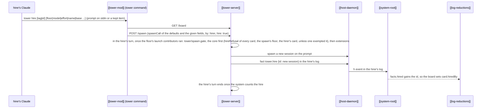

---
{
  "type": "flow",
  "name": "Hire",
  "summary": "A worker starts another on a prompt with tower hire: a spawn marked as its hire, which the tower weighs against the floor's hiring limits, starts, and logs as a fact in the hirer's log, one hire of a hirer at a time; the board turns the fact into the new card's hiredBy.",
  "in": "tower",
  "reviewed": "2026-10-29",
  "involves": ["tower-mod", "tower-server", "host-daemon", "system-root", "log-reductions"],
  "refs": ["hub/src/directory.ts#hireArgs", "hub/src/directory.ts#hireFloor", "hub/src/tower/dispatch.ts#hired", "hub/src/tower/dispatch.ts#gate", "hub/src/tower/dispatch.ts#inTurn", "hub/src/tower/dispatch.ts#counted", "hub/src/system.ts#watchSystem", "hub/src/directory.ts#hiredLines", "hub/src/shared/crews.ts#hireRefusal", "hub/src/shared/crews.ts#hireDepth", "hub/src/shared/crews.ts#liveHires", "hub/src/shared/spawn-form.ts#spawnDefaults", "hub/src/shared/spawn-form.ts#spawnCall", "hub/src/shared/model.ts#hiringConfig", "hub/src/bridge/facts.ts", "hub/src/bridge/board.ts#hirersOf", "hub/src/tower/dispatch.ts#newLaunch"]
}
---

- **Limits and order live in the tower** ([[hiring-limits]]). A `spawn` with `hire` and `by` is `by`'s hire, whoever
  sends it: [`hired`](ref:hub/src/tower/dispatch.ts#hired) takes it in the hirer's turn, and its gate
  ([`gate`](ref:hub/src/tower/dispatch.ts#gate), `tower/spawn.gate`) weighs it with
  [`hireRefusal`](ref:hub/src/shared/crews.ts#hireRefusal) against the floor's `hiring`, the core's answer before any
  extension's, and past it answers `limited` (409), the command telling the worker to ask the user. An extension's
  gate may refuse it after, as `refused` or `limited` naming its gate; one that never answers holds the hire (open). A hirer's hires queue by its callsign
  ([`inTurn`](ref:hub/src/tower/dispatch.ts#inTurn)), each holding the turn until the system
  [`counted`](ref:hub/src/tower/dispatch.ts#counted) it, so the next is weighed against it.
- **What is hired.** The same form the user's quick hire sends, everything left to its default
  ([`spawnDefaults`](ref:hub/src/shared/spawn-form.ts#spawnDefaults), [`spawnCall`](ref:hub/src/shared/spawn-form.ts#spawnCall)):
  a new worktree when the floor cuts by default, else the hub. The prompt is stdin or a kept item's text; an empty
  one is refused.
- **On another floor.** `floor <id>` ([`hireFloor`](ref:hub/src/directory.ts#hireFloor)) hires on that floor, with
  that floor's defaults, as the caller's hire; a kept item is still read from the hirer's floor, and an unknown id is
  refused with the floors listed. The spawn's `project` is that floor, so its `hiring` decides the hire, while the
  depth and the live hires counted are the hirer's, wherever they work. The handbook says to hire across floors only
  when the user asks. The board's `hiredBy.project` is the hirer's floor, and [[crews]] link the hire under its hirer.
- **The fact.** Right after the spawn the host appends `tower.hire` to the hirer's own log through its `fact`; a hire
  that can't be logged is killed (it can be resumed), so every hire that runs is counted. The board inverts it across
  resumes ([`hirersOf`](ref:hub/src/bridge/board.ts#hirersOf)): the hired card's `hiredBy` names the hirer's callsign
  and floor.
- **Its answer is the hirer's.** While the hirer runs, a hire's answer to the hirer's prompt waits on the hirer, not
  on the user: off the attention list, its status word "waiting on <HIRER>" ([[waiting-on-you]]).
- **Going home.** The hire reports to its hirer ([[crews]]): `tower home` ends the hirer's crew, deepest first. A
  finished hire whose worktree's work has landed is on the floor's [[tidy]] list.
- **Reviews share the fact.** `tower review` hires through `reviews/hire`, a spawn with `hire` too ([[review-round]]);
  a hire a launch contributor exempts is never weighed against the limits, its `tower.exempt` logged before it starts,
  and reviews' exempts every reviewer it starts. A hire whose prompt starts a reviewer as before 1.95, with no
  exemption given, isn't weighed either ([`legacyReviewer`](ref:hub/src/bridge/legacy.ts#legacyReviewer)). The weighing runs after the
  contributors and before the cut ([`newLaunch`](ref:hub/src/tower/dispatch.ts#newLaunch), on the path the worktree
  will have), so a refused hire cuts nothing.
- **Failure.** Without `TOWER_SESSION_ID` the command refuses (the Claude was not started by the tower); with the
  host down the floor offers no spawn and the command says to run `tower up`; a host older than protocol 2 can't
  append the fact, and the hire refuses with `unavailable` before it spawns.
