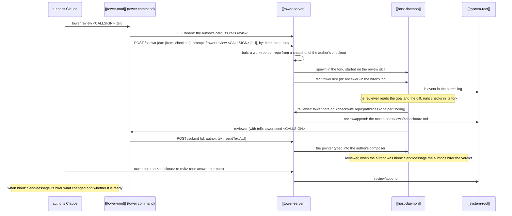

---
{
  "type": "flow",
  "name": "Review round",
  "summary": "One review end to end: a worker (or the user) hires a reviewer in a fork of the author's checkout, the reviewer leaves notes on the checkout's thread, delivers a pointer to them, and the author answers each note on the same thread.",
  "in": "tower",
  "reviewed": "2026-10-17",
  "involves": ["tower-mod", "tower-server", "host-daemon", "system-root"],
  "refs": ["hub/src/directory.ts#cardNamed", "hub/src/tower/server.ts#hired", "hub/src/directory.ts#readThread", "hub/src/bridge/verbs.ts#cardOffers", "hub/src/shared/reviews.ts#reviewPrompt", "hub/src/shared/reviews.ts#reviewedIn", "hub/src/shared/reviews.ts#sendText", "hub/src/shared/reviews.ts#unseenBy", "hub/src/tower/server.ts#spawnCut", "hub/src/tower/server.ts#appendReview", "hub/src/worktrees.ts#fork", "hub/src/worktrees.ts#snapshot", "hub/src/mod/skills/review/SKILL.md", "hub/src/mod/skills/handbook/SKILL.md"]
}
---

- **Who starts it.** Any worker with `tower review <CALLSIGN>`, or the user from the card's `review` verb. The
  card offers `review` only when the worker has a conversation, is no reviewer itself, its checkout is there and
  every dir of its floor is a git repo ([`cardOffers`](ref:hub/src/bridge/verbs.ts#cardOffers)). The card's own call is a `spawn` with
  `cut.from` and no `tell`: the reviewer's notes then wait on the thread for the user, who sends them from the
  Reviews panel. `tower review ... tell` swaps the prompt for one that makes the reviewer send them itself. The
  tower command finds the author on the board, else in the floors' archives
  ([`cardNamed`](ref:hub/src/directory.ts#cardNamed), [[board-archive]]).
- **The fork, the pair and the thread** are [[reviewer]]'s and [[review-threads]]': the reviewer works in a fork of
  the author's checkout ([`fork`](ref:hub/src/worktrees.ts#fork); a failed spawn rolls the cut back,
  [`spawnCut`](ref:hub/src/tower/server.ts#spawnCut)), the pair is derived from its first prompt, and notes are
  appended only through [`review/append`](ref:hub/src/tower/server.ts#appendReview). The hire itself is a fact
  ([[hire]]), never refused by the hiring limits ([[hiring-limits]]).
- **Delivery is a submit.** [`sendText`](ref:hub/src/shared/reviews.ts#sendText) is one line naming the notes
  new to the target ([`unseenBy`](ref:hub/src/shared/reviews.ts#unseenBy)) and how to read and answer them; it
  is typed into the author's composer, so the author must be at it (the card's `submit` call). `tower send` to a
  hired author ends it with whom to report to once the notes are answered: its hirer (`card.hiredBy`).
- **One round.** The reviewer stops after delivering; a re-review is a new hire. The author answers with
  `tower note on <checkout> re n<k>`.
- **The loop closes at the hirer.** When the author was hired, the reviewer tells the author's hirer its verdict in
  one line, and the author, once it has answered every note, reports to its hirer what changed and whether the work
  is ready: the thread alone reaches no one who isn't reading it (the `review` skill and the handbook's Reviews). The reviewer reports to its author, so sending the author home sends it too
  ([[crews]]); once the checkout's work lands, [[tidy]] files the thread.
- **Failure.** `tower review` fails when the card offers no review, saying which of those is missing, when the tower is down, or when the worker
  was not started by the tower (no `TOWER_SESSION_ID` or `TOWER_HOOKS_SOCKET`).
