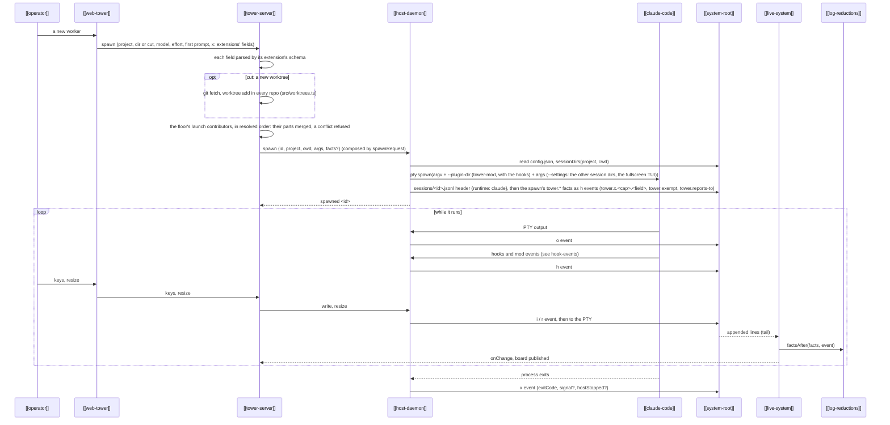

---
{
  "type": "flow",
  "name": "Session lifecycle",
  "summary": "One Claude session end to end: a renderer asks for it, the host runs it in a PTY and logs everything, and every renderer derives what to show from that log.",
  "in": "tower",
  "reviewed": "2026-10-25",
  "involves": ["operator", "web-tower", "tower-server", "host-daemon", "claude-code", "system-root", "live-system", "log-reductions"],
  "refs": ["hub/src/shared/launch.ts#spawnRequest", "hub/src/host/main.ts#spawnSession", "hub/src/host/session.ts#sessionEnv", "hub/src/system.ts#watchSystem", "hub/src/bridge/facts.ts#factsAfter", "hub/src/tower/http.ts#streamScreen", "hub/src/shared/model.ts#sessionDirs", "hub/src/tower/dispatch.ts#spawnCut", "hub/src/tower/dispatch.ts#newLaunch", "hub/src/tower/dispatch.ts#contribute"]
}
---

- **Triggers.** The `spawn` verb, from a renderer's spawn dialog or `tower spawn`. The tower draws the session id
  ([`newWorker`](ref:hub/src/tower/dispatch.ts#newWorker), [[callsign-free-name]]) and builds the request with
  [`spawnRequest`](ref:hub/src/shared/launch.ts#spawnRequest), which names Claude by its [[callsign]] and composes its
  `--settings` ([[repos-file-access-only]], [[fullscreen-tui]]); the host adds only its own wiring
  ([`sessionArgv`](ref:hub/src/host/session.ts#sessionArgv)). Before it, [`newLaunch`](ref:hub/src/tower/dispatch.ts#newLaunch)
  runs the floor's launch contributors ([`contribute`](ref:hub/src/tower/dispatch.ts#contribute), [[extensions]]): their
  flags go before the core's, their text after the tower's brief and the first prompt, their env in `--settings`, a
  model or effort only where the spawn left it out, and the spawn's fields and the core facts they give are the
  `facts` the host logs before the PTY starts. A resume runs them too and logs nothing; a fork carries its lineage's
  `tower.x.*` facts.
- **Where.** A session starts in a main checkout (`spawn {cwd}`, the hub's when `cwd` is left out), in a [[worktree]]
  the floor already has, or in a new one: `spawn {cut}`, never with a `cwd`, cuts the same name in every repo first, then starts the worker in the hub's worktree, and rolls the cut
  back if the spawn fails ([`spawnCut`](ref:hub/src/tower/dispatch.ts#spawnCut)). The host accepts a `cwd` only through
  [`sessionDirs`](ref:hub/src/shared/model.ts#sessionDirs), which also gives the other directories the session may
  read; a worktree whose folder is gone in any repo is refused as `lost` ([[tower-cuts-worktrees]]).
- **The log is written before anything else sees it.** Input and resizes are appended before they
  reach the PTY. A renderer never talks to Claude; it reads the log and asks the host.
- **The screen is replayed, not stored.** Opening a session rebuilds its screen from the `o` and `r`
  events ([`snapshot`](ref:hub/src/bridge/screen.ts#snapshot)), then streams appended output. The log is read for
  those and `x` alone ([`screenEvents`](ref:hub/src/tail.ts#screenEvents)): no other line is parsed.
- **End.** The PTY exits by itself, by `kill`, because the host stopped (`hostStopped`), or by a signal from
  outside the tower (`exitCode` above 128 for one Claude caught, or a logged `signal` for one it didn't, other than
  the host's SIGHUP, 129 or signal 1). A session with no `x` whose host is
  gone shows as `lost`. Lost, stopped with the host or killed from outside, it is stranded: on duty until resumed or
  let go ([[carry-on]], [[let-go]]). Any way it ended, it can be resumed: a resume is a new session
  continuing the same Claude conversation.
- **Renderers restart freely.** The tower or `tower` can die mid-session; the host keeps the PTY and the log,
  and the next renderer folds the log again ([[host-owns-ptys]]), from the checkpoint the last fold left
  ([[fold-checkpoints]]).
