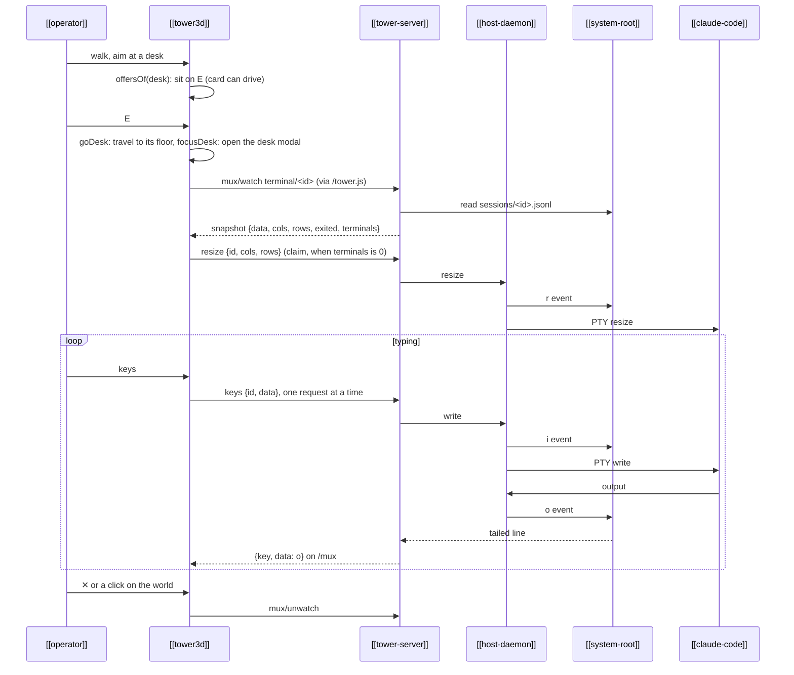

---
{
  "type": "flow",
  "name": "Sitting at a desk in Tower 3D",
  "summary": "In Tower 3D you aim at a worker's desk and press E: the desk panel opens as a modal over the world, the session's real terminal opens on its terminal stream and claims the PTY size unless another terminal is open on the session, and every key you type reaches the host in order.",
  "in": "tower-core",
  "reviewed": "2026-10-31",
  "involves": ["operator", "tower3d", "tower-server", "host-daemon", "claude-code", "system-root"],
  "refs": ["hub/renderers/tower3d/src/acts.ts#offersOf", "hub/renderers/tower3d/src/desk.ts#makeSeat", "hub/renderers/tower3d/src/main.ts#onKey", "hub/renderers/tower3d/src/main.ts#RUN", "hub/renderers/tower3d/src/main.ts#goDesk", "hub/renderers/tower3d/src/main.ts#focusDesk", "hub/renderers/tower3d/src/term.ts#mountTerm", "hub/src/shared/term-view.ts#termHandlers", "hub/src/shared/term-view.ts#mountTermView", "hub/src/shared/termkeys.ts#terminalKeymap", "hub/src/tower/tower.js#keySender", "hub/src/tower/tower.js#relay", "hub/src/tower/http.ts#muxWatch", "hub/src/tower/http.ts#screenStream", "hub/src/tower/http.ts#terminalStream", "hub/src/tower/http.ts#command", "hub/renderers/tower3d/src/main.ts#drawChanges", "hub/renderers/tower3d/src/main.ts#mountDeskScreen", "hub/renderers/tower3d/src/main.ts#replay", "hub/renderers/tower3d/src/input.ts#listen", "hub/src/machine.ts#hostRequest", "hub/src/host/main.ts#handle"]
}
---

- **Aim, then E.** What sits under the crosshair offers its verbs on every frame
  ([`offersOf`](ref:hub/renderers/tower3d/src/acts.ts#offersOf)); a desk's `use` is "sit" while its card is live
  ([[verb-prompts]]). E runs it through the act table ([`RUN`](ref:hub/renderers/tower3d/src/main.ts#RUN)):
  [`goDesk`](ref:hub/renderers/tower3d/src/main.ts#goDesk) travels to the desk's floor if needed, and
  [`focusDesk`](ref:hub/renderers/tower3d/src/main.ts#focusDesk) opens the desk panel, a modal over the dimmed
  world. While it is open the scene isn't drawn: the canvas keeps its last frame and updates go on. A video-wall
  tile opens the same panel where you stand. A worker gathered with its crew sits at a meeting table instead
  ([[whereabouts]]); aiming at it, or at its empty desk, opens the same panel.
- **The transport depends on where Tower 3D runs.** At `/r/tower3d/` `/tower.js` calls the routes and opens one
  `/mux` stream; framed from a shelf in the tower page, it posts to the page, which makes the same requests through
  its [`relay`](ref:hub/src/tower/tower.js#relay). The server parses each command by its schema
  ([`command`](ref:hub/src/tower/http.ts#command)) and relays it to the host over `control.sock`
  ([`hostRequest`](ref:hub/src/machine.ts#hostRequest)) ([[renderer-api]]).
- **Snapshot, then tail.** The screen stream sends the screen rebuilt from the log, then each `o`, `r` and `x` the
  host appends ([`screenStream`](ref:hub/src/tower/http.ts#screenStream)). A session that is no longer running
  sends only its snapshot: the terminal opens read-only, claims nothing and sends no keys.
- **Claimed on open, when it is the only terminal.** One PTY, one size: whoever types owns it. The desk opens the
  `terminal/<id>` stream, whose snapshot says how many other terminals are open on the session
  ([`terminalStream`](ref:hub/src/tower/http.ts#terminalStream); a monitor's `screen/<id>` stream is not one).
  With none, [`mountTerm`](ref:hub/renderers/tower3d/src/term.ts#mountTerm) fits the terminal to the modal at the
  viewer's font (`tower.prefs`) and sends `resize` as soon as the snapshot arrives, so typing works at once. Beside
  another it reads "watching" at a font that fits, so opening never reflows the session under whoever is working.
  Typing (Claude's mouse reports included) claims, its keys sent after the resize; a focus report from a watching
  view is sent without claiming. A resize from another viewer hands the size back. A shell's stream says nothing of
  other terminals, so a shell claims on open. The rule is the shared machine every renderer's terminal runs
  ([`termHandlers`](ref:hub/src/shared/term-view.ts#termHandlers), in xterm by
  [`mountTermView`](ref:hub/src/shared/term-view.ts#mountTermView), [[renderer-shared-modules]], [[machines]]).
- **Keys in order.** [`keySender`](ref:hub/src/tower/tower.js#keySender) sends each chunk xterm produces as its own
  `keys` request, the next only after the last answered: Claude reads text and Enter in one write as a paste. The Mac
  editing keys are sent as readline keys by [`terminalKeymap`](ref:hub/src/shared/termkeys.ts#terminalKeymap)
  ([[renderer-shared-modules]]) at the chords `board.keys` binds ([[keymap]]). The host logs `i` before writing to
  the PTY ([`handle`](ref:hub/src/host/main.ts#handle)).
- **The panel's tabs.** Logbook ([[logbook]]: a past session picked there replaces the terminal with its last
  screen, [`replay`](ref:hub/renderers/tower3d/src/main.ts#replay) and
  [`mountDeskScreen`](ref:hub/renderers/tower3d/src/main.ts#mountDeskScreen), until live is chosen again or Esc),
  Changes and Reviews ([[shared-panels]], drawn by [`drawChanges`](ref:hub/renderers/tower3d/src/main.ts#drawChanges))
  and each thing the worker showed lie over the terminal, which keeps its size. While a text box has focus, keys
  type into it and never move you.
- **Leaving.** Esc in the terminal belongs to Claude; ✕, a click on the dimmed world, or Esc outside the terminal
  ([`onKey`](ref:hub/renderers/tower3d/src/main.ts#onKey)) closes the panel. Closing unwatches the stream, and the
  session keeps running.
